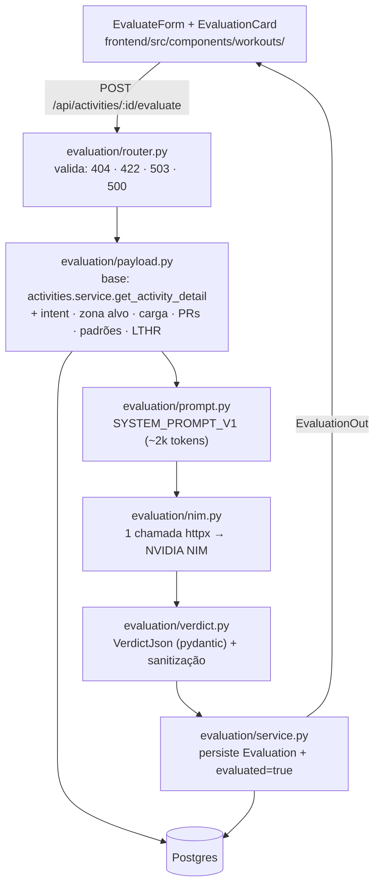

# Avaliar com IA — Design

**Spec**: `.specs/features/ai-evaluation/spec.md`
**Status**: Draft

---

## Architecture Overview

**Abordagem escolhida (recomendação):** novo domínio `app/evaluation/` seguindo o padrão dos domínios existentes (activities, health, potential) — payload builder que reusa `get_activity_detail` como base, prompt versionado como constante, cliente NIM sobre httpx puro, POST síncrono. Conforma com AD-002 (zero Garmin), AD-003 (híbrido Python+LLM), AD-009 (payload espelha a tela).

**Alternativas consideradas:**

| Abordagem | Por que não |
| --------- | ----------- |
| SDK `openai` apontando para a NIM | Dependência nova para um endpoint; camada extra de abstração sobre um contrato já simples (Bearer + `/v1/chat/completions` + `usage`) |
| Job em background (padrão SyncJob) + polling | Usuário único local; a chamada leva segundos, não minutos — job + polling é complexidade sem ganho (assumption do spec trava POST síncrono) |



**Fluxo do endpoint** (ordem de validação): `get_zone_config` (500 zonas, dependency) → 404 inexistente → 422 não-corrida (intent via pydantic: enum + ≤500 chars, 422 automático) → 503 key ausente → payload → NIM (502/504) → validação do veredito (502) → persistência (200).

**Contrato do detalhe (AD-009):** a tela de detalhe passa a renderizar avaliações — `ActivityDetailOut` ganha `evaluations: list[EvaluationOut]` (mais recente primeiro) e `ActivityOut` ganha `activity_type: str` (a UI precisa distinguir corrida para exibir o formulário).

---

## Code Reuse Analysis

### Existing Components to Leverage

| Component | Location | How to Use |
| --------- | -------- | ---------- |
| `get_activity_detail` | `backend/app/activities/service.py` | **Base do payload**: campos da atividade, voltas classificadas por zona (com `km_label`), consistência (mesmo gate ≥8km/≥4 voltas), contexto do dia, meta das zonas — uma fonte de verdade para classificação/consistência/contexto |
| `ZoneConfig` + `load_zone_config` | `backend/app/vdot/zones.py` | Classificação por zona (via detail) + dependency `get_zone_config` do router (padrão 500) |
| Mapeamento PR→canônico | `backend/app/potential/calc.py` (`_PR_EVENT_TO_CANONICAL`, `CANONICAL`) | Padrão para o bloco de PRs do payload: query direta em `PersonalRecord`, só eventos canônicos com `pr_date` |
| Arquivo de zonas (vdot/source/test_date) | `backend/data/vdot_zones.json` | Bloco `vdot` do payload (VDOT corrente + origem) — mesma fonte de verdade do Potencial |
| `consistency_metrics` | `backend/app/activities/metrics.py` | Já vem pelo detail — o payload não recalcula |
| Padrão de testes | `backend/tests/` (conftest + seeding + TestClient) | API tests com DB semeados; NIM mockada via `monkeypatch` (nenhum teste chama a API real) |
| `ApiError`/`parseError`/tipos espelho | `frontend/src/lib/api.ts` | `evaluateActivity()` segue o padrão; `InferredType` É o enum de intenção (chaves 1:1) |
| Card/Chip/estilos | `frontend/src/components/workouts/WorkoutDetail.tsx` | O card de avaliação segue o vocabulário visual (`rounded-xl border bg-card`, tema escuro) |

### Integration Points

| System | Integration Method |
| ------ | ------------------ |
| NVIDIA NIM | `POST {NVIDIA_BASE_URL}/chat/completions` (OpenAI-compatível), Bearer `NVIDIA_API_KEY`, body `{model, messages, temperature, max_tokens}`; resposta `choices[0].message.content` + `usage{prompt_tokens, completion_tokens}` |
| Postgres | Tabelas existentes: `evaluations` (já no schema, inalterada), `activities.evaluated`, `load`, `personal_records`, `patterns`, `sleep`/`hrv`/`rhr` (via detail) — **zero migração** |
| Endpoint de detalhe | `activities.service.get_activity_detail` ganha a query de avaliações; `ActivityDetailOut`/`ActivityOut` estendidos (aditivo) |

---

## Components

### Backend — `backend/app/evaluation/`

#### `schemas.py`
- **Purpose**: Contratos Pydantic compartilhados (importado por ambos os routers — sem ciclo).
- **Interfaces**:
  - `EvaluateIn`: `intent_type: Literal["prova","intervalado","limiar","tempo","progressivo","longao","facil"]`, `intent_text: str | None = Field(max_length=500)` — 422 automático fora do contrato
  - `EvaluationOut`: `id, activity_id, intent_type, intent_text, verdict, verdict_json, model, prompt_version, tokens_in, tokens_out, created_at`
  - `VerdictJson` (§9.2): `veredito: Literal["on_target","too_hard","too_easy","context_explained","fatigue_signal"]`, `headline: str`, `execucao_vs_intencao: {pct_zona_alvo: float | None, principais_desvios: list[str]}`, `o_que_funcionou/corrigir_prox_vez/contexto_relevante: list[str]`, `confianca: Literal["alta","média","baixa"]`; `model_config = ConfigDict(extra="ignore")` — extras ignorados, obrigatórios ausentes rejeitam (Decisão E)
- **Dependencies**: pydantic (já no projeto)
- **Reuses**: convenção de modelos inline dos routers (aqui extraída para evitar ciclo activities↔evaluation)

#### `payload.py`
- **Purpose**: Monta o payload determinístico 100% do banco (EVAL-02/07/16).
- **Interfaces**:
  - `TARGET_ZONES: dict[str, list[str] | None]` — facil→easy · tempo→threshold · limiar→threshold · intervalado→interval · longao→easy+marathon · progressivo→None · prova→None
  - `build_evaluation_payload(db, activity, detail, intent_type, intent_text) -> dict` — compõe: `intencao` (tipo + texto), `resumo` (métricas da corrida), `voltas` (do detail: km, pace, zona, FC, cadência, temperatura, elevação — bloco omitido sem voltas), `tempo_por_zona_pct` (5 zonas, % da duração das voltas com zona válida), `zona_alvo` (zonas alvo + `pct_zona_alvo` = Σ duração das voltas na zona alvo ÷ Σ duração das voltas com zona, 1 decimal; bloco omitido quando `TARGET_ZONES[type]` é None ou não há voltas com zona), `consistencia` (do detail, gate vigente), `contexto` (do detail), `carga_do_dia` (linha de `load` da data local — omitida sem linha), `zonas` (meta do detail: rótulos + faixas de pace), `vdot` (do arquivo de zonas: valor + source + test_date), `lthr_bpm` (config), `prs` (canônicos com data), `padroes` (ativos — omitido se vazio)
- **Dependencies**: Session, models (`DailyLoad`, `PersonalRecord`, `Pattern`), `get_settings`
- **Reuses**: `get_activity_detail` como base; padrão de mapeamento de PRs do potential
- **Formato**: números legíveis para o LLM e para auditoria — pace "MM:SS/km", durações humanizadas, chaves PT-BR (o payload é artefato de prompt **e** de auditoria persistido em `payload_json`)

#### `prompt.py`
- **Purpose**: System prompt destilado da skill `analyze-garmin-run` (~2k tokens — plano §9.3), versionado.
- **Interfaces**: `PROMPT_VERSION = "v1"`; `SYSTEM_PROMPT_V1: str`
- **Conteúdo** (esboço — texto final é da task): papel (avaliador de execução vs intenção declarada); regras dos 5 vereditos (quando usar cada); intenção primeiro (fácil rápido demais = falha); hierarquia AD-005 (pace/zona decide, FC corrobora contra o LTHR); regra do calor (>25°C julga fácil por esforço, não pace); elevação por volta explica desvio; contexto muda ou confirma, nunca decora (se não muda o veredito, 1 linha); formato de saída: **exatamente** o JSON §9.2, em PT-BR, usando **exclusivamente os números do payload** (nunca recalcular, nunca inventar); `pct_zona_alvo` = eco do valor do payload (null quando ausente).
- **Dependencies**: nenhuma (constante)
- **Reuses**: `garmin_mcp/.opencode/skills/analyze-garmin-run/SKILL.md` (regras §C/§D, hierarquia, calor, bordas)

#### `nim.py`
- **Purpose**: Cliente NIM — exatamente uma chamada por avaliação, com as classes de erro que o router mapeia.
- **Interfaces**:
  - `class NimError(Exception)` (HTTP ≠ 200) · `class NimTimeout(NimError)` · `class NimInvalidJSON(NimError)` (JSON ilegível)
  - `chat_completion(system, user, settings) -> tuple[dict, dict]` (veredito parseado, `usage`) — httpx `Client`, Bearer, body `{model, messages[system,user], temperature: 0.2, max_tokens: 2000}`, timeout `NVIDIA_TIMEOUT_S`; conteúdo em cercas de código markdown é aceito (strip antes do `json.loads`); `usage` ausente → `{prompt_tokens: 0, completion_tokens: 0}` (edge do spec)
- **Dependencies**: httpx (passa de dev → runtime no pyproject), settings
- **Reuses**: nada — é o único ponto de I/O externo da feature (e o único lugar onde a NIM existe)

#### `verdict.py`
- **Purpose**: Validação do JSON da NIM contra o schema §9.2 + sanitização do eco numérico.
- **Interfaces**: `validate_verdict(data: dict) -> VerdictJson` (levanta `ValueError` de schema — router mapeia 502); a sanitização do `pct_zona_alvo` (sobrescreve com o valor calculado em Python, ou `None`) acontece no service, antes de persistir — o número exibido no card é sempre o do Python (AD-003 até no eco do LLM)
- **Dependencies**: `schemas.VerdictJson`
- **Reuses**: pydantic (padrão do projeto)

#### `service.py`
- **Purpose**: Orquestra a avaliação de ponta a ponta e persiste; nada é gravado em falha.
- **Interfaces**:
  - `evaluate(db, activity_id, intent_type, intent_text, zone_config) -> dict | None` — None = 404; carrega detail (base do payload) → `build_evaluation_payload` → `nim.chat_completion` → `validate_verdict` → sanitiza `pct_zona_alvo` → cria `Evaluation` (com `payload_json`, `model`, `prompt_version`, tokens do usage) + `activity.evaluated = True` → commit → dict no shape de `EvaluationOut`
  - `list_evaluations(db, activity_id) -> list[dict]` — consumido pelo detail (EVAL-17)
- **Dependencies**: Session, `activities.service.get_activity_detail`, payload/prompt/nim/verdict, models
- **Reuses**: todo o pipeline de leitura do activities (uma fonte de verdade)

#### `router.py`
- **Purpose**: `POST /api/activities/{activity_id}/evaluate` + mapeamento de erros (EVAL-09..15).
- **Interfaces**: `POST` com `EvaluateIn` → 200 `EvaluationOut`; mapa: `ZoneConfigError→500` (dependency, padrão activities), não-corrida→422 (mensagem clara), `NVIDIA_API_KEY` vazia→503, `NimError`/`NimInvalidJSON`/`ValueError` de schema→502, `NimTimeout`→504. Montado em `main.py`.
- **Dependencies**: `get_db`, `get_zone_config` (reutilizada do activities), `get_settings`
- **Reuses**: padrão de validação do `activities/router.py` (422 antes de qualquer query cara, 404, 500 de zonas)

### Frontend

#### `frontend/src/lib/api.ts` (extensão)
- **Purpose**: Espelhar os contratos novos + `evaluateActivity`.
- **Interfaces**: tipos `EvaluateRequest`, `VerdictJson`, `EvaluationOut`; `ActivityOut.activity_type`; `ActivityDetailOut.evaluations: EvaluationOut[]`; `evaluateActivity(id, body) -> Promise<EvaluationOut>` (POST, mesmo padrão de `parseError`)
- **Reuses**: `InferredType` como enum de intenção (chaves 1:1 — zero tipo novo)

#### `frontend/src/components/workouts/EvaluateForm.tsx`
- **Purpose**: Formulário de intenção + botão + estados (EVAL-01/08/10).
- **Interfaces**: props `{ activity: ActivityOut, onEvaluated: (evaluation: EvaluationOut) => void }`; select com 7 opções (rótulos PT-BR com acento, valores ASCII), pré-preenchido com `inferred_type`; textarea opcional (≤500, placeholder "era pra ser 30min a 4:15"); botão "Avaliar com IA" desabilitado enquanto a chamada está em curso com "Analisando treino…"; erro inline em PT-BR no lugar do card
- **Reuses**: vocabulário visual do WorkoutDetail (cards, chips, muted)

#### `frontend/src/components/workouts/EvaluationCard.tsx`
- **Purpose**: Card da avaliação mais recente + entradas de histórico (EVAL-05/17/18).
- **Interfaces**: `<EvaluationCard evaluation={latest} />` — selo ✅/⚠️/❌ (✅ on_target/context_explained · ⚠️ too_easy/fatigue_signal · ❌ too_hard), headline, % na zona alvo quando existir, desvios, listas ("o que funcionou", "corrigir na próxima vez", "contexto relevante"), confiança, rodapé de método (modelo · tokens · data — selo de fonte AD-009); histórico: `<EvaluationHistory evaluations={rest} />` (data, selo, headline)
- **Reuses**: padrão de cabeçalho forte + selo de método dos painéis (AD-009)

#### `frontend/src/components/workouts/WorkoutDetail.tsx` (extensão)
- **Purpose**: Composição — só corridas (`activity_type`) rendem o formulário; avaliações renderizadas do `detail.evaluations`; após avaliação, prepend no estado local + `evaluated=true` (sem refetch).
- **Reuses**: estados existentes (loading/not-found/error/ready)

---

## Data Models

**Zero migração de banco** — o schema já tem tudo (Fase 0 antecipou a feature):

```python
# Evaluation (existente, inalterada) — backend/app/db/models.py:193
evaluations(id, user_id, activity_id FK→activities SET NULL,
           intent_type, intent_text, payload_json, model, prompt_version,
           verdict, verdict_json, tokens_in, tokens_out, created_at)

# Activity.evaluated (existente) — setado True pelo motor
```

**Contratos novos (runtime):**

```typescript
// VerdictJson (§9.2) — o JSON que a NIM devolve e o card renderiza
interface VerdictJson {
  veredito: "on_target" | "too_hard" | "too_easy" | "context_explained" | "fatigue_signal";
  headline: string;
  execucao_vs_intencao: { pct_zona_alvo: number | null; principais_desvios: string[] };
  o_que_funcionou: string[];
  corrigir_prox_vez: string[];
  contexto_relevante: string[];
  confianca: "alta" | "média" | "baixa";
}
```

**Relações:** `Evaluation.activity_id → Activity` (N avaliações por atividade — re-avaliação é linha nova, EVAL-19); `Activity.evaluated` alimenta o badge da lista (EVAL-20).

---

## Error Handling Strategy

| Error Scenario | Handling | User Impact |
| -------------- | -------- | ----------- |
| `activity_id` inexistente | service → None → 404 | "Treino não encontrado" inline no form |
| Atividade não-corrida | 422 antes de montar payload/chamar NIM | Mensagem clara; form nem renderiza (UI) |
| `intent_type`/`intent_text` inválidos | Pydantic → 422 automático | Mensagem de validação inline |
| `NVIDIA_API_KEY` vazia | 503 sem chamada à NIM | "IA não configurada (NVIDIA_API_KEY)" |
| NIM HTTP ≠ 200 | `NimError` → 502 | Mensagem PT-BR; nada gravado |
| NIM timeout | `NimTimeout` → 504 | "A IA demorou demais"; botão volta |
| JSON ilegível/fora do schema | `NimInvalidJSON`/`ValueError` → 502 | "Resposta da IA inválida"; nada gravado |
| Zonas sem arquivo | `ZoneConfigError` → 500 (dependency) | "Zonas VDOT não configuradas" (padrão existente) |
| `usage` ausente na resposta | tokens 0, avaliação persiste | Rodapé do card mostra tokens 0 |

Em toda falha: nenhuma linha de `Evaluation`, `evaluated` inalterado (Decisão E).

---

## Risks & Concerns

| Concern | Location (file:line) | Impact | Mitigation |
| ------- | -------------------- | ------ | ---------- |
| Reuso do `get_activity_detail` carrega campos de UI (ex.: `hr_color`) no payload | `backend/app/activities/service.py:219` | Ruído cosmético no `payload_json` (artefato de auditoria) | Aceito: a meta das zonas é contexto desejado do prompt; alternativa (extrair helpers privados) custa refactor sem ganho |
| Suporte a `response_format: json_object` varia por modelo na NIM | — | Depender disso quebraria em modelos flash (Fase 2) | Não dependemos: JSON instruído no prompt + strip de cercas de código + validação pydantic estrita — portável |
| LLM pode ecoar `pct_zona_alvo` errado | — | Número exibido no card trairia o AD-003 | Service sanitiza o eco antes de persistir: `pct_zona_alvo` ← valor Python (ou null) |
| Latência de modelo raciocinador (glm-5.3) pode passar de 60s | — | Timeout falso-negativo na UX | `NVIDIA_TIMEOUT_S` default **120s**; UI com "Analisando treino…" explícito |
| httpx está apenas no dev-group | `backend/pyproject.toml:31` | Import quebra em runtime | Mover para `dependencies` (task de config) |
| `ActivityOut` não expõe `activity_type` | `backend/app/activities/router.py:44` | UI não consegue decidir se rende o formulário | Campo aditivo no contrato (task do detail) |
| Qualidade do prompt não é testável por unidade | `prompt.py` | Veredito fraco não pega no gate de teste | Prompt versionado + UAT com spot-check do success criteria (fácil rápido demais nunca ✅) |
| Avaliações concorrentes (duas abas) = 2 chamadas NIM | — | Custo dobrado | Aceito no spec (edge documentado); guarda da UI é o botão desabilitado por aba |

---

## Tech Decisions

| Decision | Choice | Rationale |
| -------- | ------ | --------- |
| Cliente NIM | httpx direto (sem SDK) | Um endpoint, contrato simples, zero dependência nova além do httpx (que já é usado pelo TestClient); transparência total do request |
| Parâmetros da chamada | `temperature: 0.2`, `max_tokens: 2000` | Veredito estruturado pede estabilidade; teto de custo de saída |
| POST síncrono | Sem job/polling | Assumption do spec — usuário único local; a UI espera com feedback |
| Detalhe ganha `evaluations` + `activity_type` | Extensão aditiva do contrato | AD-009: o payload espelha a tela; a tela agora renderiza avaliações |
| Sanitização do eco numérico | Service sobrescreve `pct_zona_alvo` com o valor Python | AD-003 sem brecha: nem o eco do LLM decide número |
| Sem `response_format` na chamada | JSON instruído + parse tolerante + validação estrita | Portabilidade entre modelos da NIM (incl. flash da Fase 2) |
| Config nova | `NVIDIA_TIMEOUT_S=120`, `LTHR_BPM=177` por env | "Config 100% env vars" (plano §10); LTHR default é o calibrado do perfil, env sobrepõe |
| `prompt_version` | Constante `PROMPT_VERSION` casada com `SYSTEM_PROMPT_V1` | Toda avaliação rastreia o prompt que produziu o veredito (AD-003) |

Nenhuma decisão aqui cria convenção cross-feature — todas são locais ao domínio evaluation. Não há novo AD-NNN.
