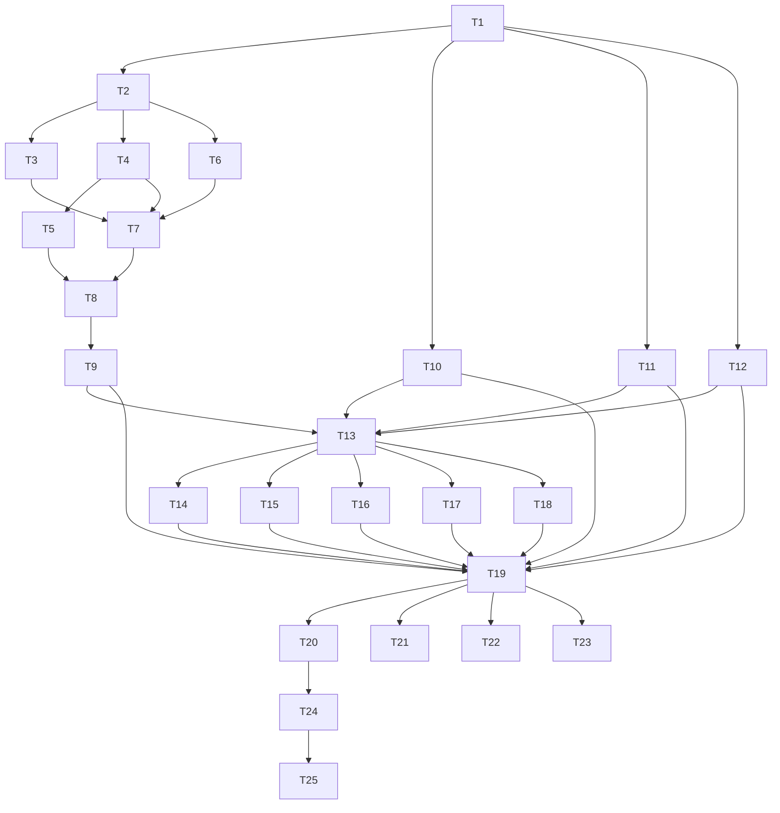

# Tasks: Backend Decoupling — Pragmatic Hexagonal Architecture

## Task Breakdown

### T1: Create Domain Package Structure ✅
**Description**: Create `app/domain/` directory with 8 domain contexts (activities, health, performance, shoes, evaluation, profile, training_load, garmin)
**Where**: `app/domain/`
**Depends on**: none
**Tests**: Verify directory structure exists with all 8 contexts
**Gate**: `ls app/domain/` shows activities health performance shoes evaluation profile training_load garmin

### T2: Activities Domain — Entities & Value Objects ✅
**Description**: Move Activity, Split, RunningDynamics entities + Pace, HeartRate, ZoneKey value objects to `app/domain/activities/domain/`
**Where**: `app/domain/activities/domain/entities.py`, `app/domain/activities/domain/value_objects.py`
**Depends on**: T1
**Tests**: Unit tests for entities/value objects (pure, no mocks)
**Gate**: `pytest tests/domain/activities/test_entities.py -v`

### T3: Activities Domain — Pure Services ✅
**Description**: Extract ConsistencyCalculator, ZoneClassifier to `app/domain/activities/domain/services.py`
**Where**: `app/domain/activities/domain/services.py`
**Depends on**: T2
**Tests**: Property-based tests for consistency calculations
**Gate**: `pytest tests/domain/activities/test_services.py -v`

### T4: Activities Domain — Ports (Protocols) ✅
**Description**: Define ActivityRepository, SplitRepository, ZoneConfigProvider protocols
**Where**: `app/domain/activities/ports/repositories.py`, `app/domain/activities/ports/zone_config.py`
**Depends on**: T2
**Tests**: Protocol compliance verified by mypy
**Gate**: `mypy app/domain/activities/ports/`

### T5: Activities Domain — SQLAlchemy Adapters ✅
**Description**: Implement SQLAlchemyActivityRepository, SQLAlchemySplitRepository, DBZoneConfigProvider
**Where**: `app/domain/activities/adapters/sqlalchemy_repo.py`, `app/domain/activities/adapters/sqlalchemy_split.py`, `app/domain/activities/adapters/db_zone_config.py`
**Depends on**: T4
**Tests**: Integration tests with testcontainers (PostgreSQL)
**Gate**: `pytest tests/domain/activities/test_adapters.py -v`

### T6: Activities Domain — Schemas (Pydantic DTOs) ✅
**Description**: Define request/response models for domain API
**Where**: `app/domain/activities/schemas.py`
**Depends on**: T2
**Tests**: Serialization round-trip tests
**Gate**: `pytest tests/domain/activities/test_schemas.py -v`

### T7: Activities Domain — Application Service ✅
**Description**: Create ActivityService orchestrating repo + domain services
**Where**: `app/domain/activities/service.py`
**Depends on**: T3, T4, T6
**Tests**: Unit tests with mocked ports
**Gate**: `pytest tests/domain/activities/test_service.py -v`

### T8: Activities Domain — DI Providers ✅
**Description**: FastAPI Depends providers for ActivityService
**Where**: `app/domain/activities/dependencies.py`
**Depends on**: T5, T7
**Tests**: DI resolution test
**Gate**: `pytest tests/domain/activities/test_dependencies.py -v`

### T9: Activities Domain — Router ✅
**Description**: Domain API router at `/api/v1/activities`
**Where**: `app/domain/activities/router.py`
**Depends on**: T8
**Tests**: Integration tests with TestClient
**Gate**: `pytest tests/domain/activities/test_router.py -v`

### T10: Health Domain — Full Extraction
**Description**: Extract health domain (sleep, HRV, RHR, stress, dose-response) with entities, services, ports, adapters, schemas, service, router
**Where**: `app/domain/health/` (7 files)
**Depends on**: T1
**Tests**: Unit + integration tests
**Gate**: `pytest tests/domain/health/ -v`

### T11: Performance Domain — Full Extraction
**Description**: Extract performance domain (VDOT, predictions, decay, VO2max) with entities, services, ports, adapters, schemas, service, router
**Where**: `app/domain/performance/` (7 files)
**Depends on**: T1
**Tests**: Unit + integration tests
**Gate**: `pytest tests/domain/performance/ -v`

### T12: Remaining Domains — Shoes, Evaluation, Profile, Training-Load, Garmin
**Description**: Extract remaining 5 domain contexts
**Where**: `app/domain/shoes/`, `app/domain/evaluation/`, `app/domain/profile/`, `app/domain/training_load/`, `app/domain/garmin/` (~35 files)
**Depends on**: T1
**Tests**: Unit + integration tests per domain
**Gate**: `pytest tests/domain/ -v`

### T13: Create BFF Package Structure
**Description**: Create `app/bff/` with 6 BFF contexts (home, health, performance, activities, profile, shoes)
**Where**: `app/bff/`
**Depends on**: T9, T10, T11, T12
**Tests**: Structure exists
**Gate**: `ls app/bff/` shows home health performance activities profile shoes

### T14: Home BFF — Service, Schemas, Dependencies, Router
**Description**: Compose ActivityService + HealthService + TrainingLoadService + PerformanceService + ProfileService
**Where**: `app/bff/home/` (4 files)
**Depends on**: T13
**Tests**: Unit tests mock domain services; integration test
**Gate**: `pytest tests/bff/home/ -v`

### T15: Health BFF — Service, Schemas, Dependencies, Router
**Description**: Compose HealthService + TrainingLoadService
**Where**: `app/bff/health/` (4 files)
**Depends on**: T13
**Tests**: Unit + integration tests
**Gate**: `pytest tests/bff/health/ -v`

### T16: Performance BFF — Service, Schemas, Dependencies, Router
**Description**: Compose PerformanceService + TrainingLoadService
**Where**: `app/bff/performance/` (4 files)
**Depends on**: T13
**Tests**: Unit + integration tests
**Gate**: `pytest tests/bff/performance/ -v`

### T17: Activities BFF — Service, Schemas, Dependencies, Router
**Description**: Compose ActivityService (list + detail)
**Where**: `app/bff/activities/` (4 files)
**Depends on**: T13
**Tests**: Unit + integration tests
**Gate**: `pytest tests/bff/activities/ -v`

### T18: Profile & Shoes BFF — Service, Schemas, Dependencies, Router
**Description**: Compose ProfileService + ShoesService
**Where**: `app/bff/profile/`, `app/bff/shoes/` (8 files)
**Depends on**: T13
**Tests**: Unit + integration tests
**Gate**: `pytest tests/bff/profile/ tests/bff/shoes/ -v`

### T19: Register Domain + BFF Routers in main.py
**Description**: Add all new routers to FastAPI app with proper tags
**Where**: `app/main.py`
**Depends on**: T9, T10, T11, T12, T14, T15, T16, T17, T18
**Tests**: OpenAPI schema includes all endpoints
**Gate**: `curl localhost:8000/openapi.json | jq '.paths | keys'`

### T20: Old Endpoints Delegate to BFF Layer
**Description**: Modify old routers to delegate to BFF services
**Where**: `app/home/router.py`, `app/health/router.py`, `app/potential/router.py`, `app/activities/router.py`, `app/profile/router.py`, `app/shoes/router.py`, `app/tenis_analysis/router.py`, `app/tenis_degradation/router.py`
**Depends on**: T19
**Tests**: Old endpoints return identical payload to new BFF endpoints
**Gate**: `pytest tests/migration/test_old_endpoints_delegate.py -v`

### T21: OpenAPI Tags Configuration
**Description**: Configure OpenAPI tags for domain + BFF separation
**Where**: `app/main.py`
**Depends on**: T19
**Tests**: OpenAPI schema has correct tags
**Gate**: `curl localhost:8000/openapi.json | jq '.tags'`

### T22: Contract Tests — Domain API Snapshots
**Description**: Snapshot tests for domain API OpenAPI schemas
**Where**: `tests/contract/test_domain_api_snapshot.py`
**Depends on**: T19
**Tests**: Snapshot matches expected
**Gate**: `pytest tests/contract/test_domain_api_snapshot.py -v`

### T23: Contract Tests — BFF API Snapshots
**Description**: Snapshot tests for BFF API response shapes
**Where**: `tests/contract/test_bff_api_snapshot.py`
**Depends on**: T19
**Tests**: Snapshot matches expected
**Gate**: `pytest tests/contract/test_bff_api_snapshot.py -v`

### T24: Deprecate Old Endpoints (410 Gone)
**Description**: After frontend migration, old endpoints return 410 with migration guide
**Where**: Old router files
**Depends on**: T20 (frontend migration complete)
**Tests**: Old endpoints return 410
**Gate**: `pytest tests/migration/test_deprecation.py -v`

### T25: Cleanup Old Router Code
**Description**: Remove unused imports, old router files no longer needed
**Where**: Delete old router files, cleanup imports
**Depends on**: T24
**Tests**: No dead code, all tests pass
**Gate**: `pytest tests/ -v && mypy app/`

---

## Dependency Diagram

---

## Execution Plan

### Phase 1: Domain Layer Extraction (Parallelizable by Domain)

| Task | Domain | Depends On |
|------|--------|------------|
| T1 | All | — |
| T2 | Activities | T1 |
| T3 | Activities | T2 |
| T4 | Activities | T2 |
| T5 | Activities | T4 |
| T6 | Activities | T2 |
| T7 | Activities | T3, T4, T6 |
| T8 | Activities | T5, T7 |
| T9 | Activities | T8 |
| T10 | Health | T1 |
| T11 | Performance | T1 |
| T12 | Shoes/Eval/Profile/Training/Garmin | T1 |

### Phase 2: BFF Composition Layer (Sequential after Phase 1)

| Task | BFF Context | Depends On |
|------|-------------|------------|
| T13 | Structure | T9, T10, T11, T12 |
| T14 | Home | T13 |
| T15 | Health | T13 |
| T16 | Performance | T13 |
| T17 | Activities | T13 |
| T18 | Profile/Shoes | T13 |

### Phase 3: Migration & Deprecation (Sequential after Phase 2)

| Task | Description | Depends On |
|------|-------------|------------|
| T19 | Register Routers | T9, T10, T11, T12, T14-T18 |
| T20 | Old Endpoints Delegate | T19 |
| T21 | OpenAPI Tags | T19 |
| T22 | Domain API Contracts | T19 |
| T23 | BFF API Contracts | T19 |
| T24 | Deprecate (410) | T20 |
| T25 | Cleanup | T24 |

### Phase 4: Frontend Codegen (After T21)
Frontend tasks (codegen setup, screen migrations, api.ts removal) — executed by frontend team after T21 completes.

---

## Test Coverage Matrix

| Layer | Test Type | Target | Tool |
|-------|-----------|--------|------|
| Domain Entities | Unit | Pure logic, no I/O | pytest + hypothesis |
| Domain Services | Unit | Pure calculations | pytest |
| Ports (Protocols) | Static | mypy compliance | mypy |
| Adapters | Integration | Real DB, recorded API | pytest + testcontainers |
| Schemas | Unit | Serialization round-trip | pytest |
| Application Services | Unit | Mock ports, verify orchestration | pytest + unittest.mock |
| Domain Routers | Integration | HTTP serialization | TestClient |
| BFF Services | Unit | Mock domain services | pytest |
| BFF Routers | Integration | Payload shape matches spec | TestClient |
| Contract | Snapshot | OpenAPI schema, response shapes | pytest + snapshot |
| Migration | Integration | Old vs new endpoint parity | pytest |
| Full Stack | E2E | Frontend ↔ BFF API | Playwright (frontend) |

---

## Gate Check Commands

| Task | Gate Command |
|------|--------------|
| T1 | `ls app/domain/ | wc -l` (expect 8) |
| T2 | `pytest tests/domain/activities/test_entities.py -v` |
| T3 | `pytest tests/domain/activities/test_services.py -v` |
| T4 | `mypy app/domain/activities/ports/` |
| T5 | `pytest tests/domain/activities/test_adapters.py -v` |
| T6 | `pytest tests/domain/activities/test_schemas.py -v` |
| T7 | `pytest tests/domain/activities/test_service.py -v` |
| T8 | `pytest tests/domain/activities/test_dependencies.py -v` |
| T9 | `pytest tests/domain/activities/test_router.py -v` |
| T10 | `pytest tests/domain/health/ -v` |
| T11 | `pytest tests/domain/performance/ -v` |
| T12 | `pytest tests/domain/ -v` |
| T13 | `ls app/bff/ | wc -l` (expect 6) |
| T14 | `pytest tests/bff/home/ -v` |
| T15 | `pytest tests/bff/health/ -v` |
| T16 | `pytest tests/bff/performance/ -v` |
| T17 | `pytest tests/bff/activities/ -v` |
| T18 | `pytest tests/bff/profile/ tests/bff/shoes/ -v` |
| T19 | `curl -s localhost:8000/openapi.json | jq '.paths | keys | length'` (expect > 40) |
| T20 | `pytest tests/migration/test_old_endpoints_delegate.py -v` |
| T21 | `curl -s localhost:8000/openapi.json | jq '.tags'` |
| T22 | `pytest tests/contract/test_domain_api_snapshot.py -v` |
| T23 | `pytest tests/contract/test_bff_api_snapshot.py -v` |
| T24 | `pytest tests/migration/test_deprecation.py -v` |
| T25 | `pytest tests/ -v && mypy app/` |