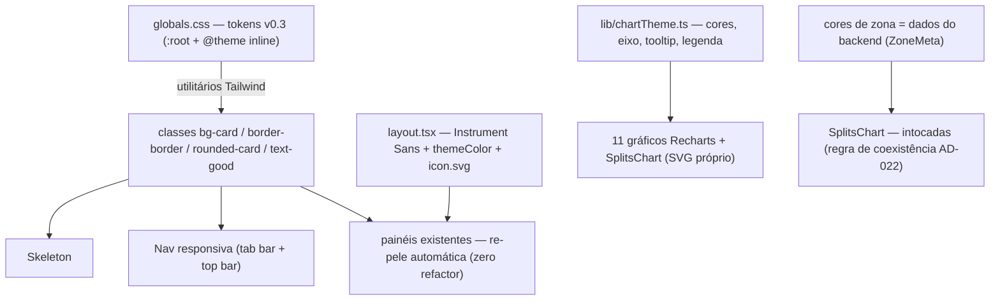

# Design System v0.3 — Design

**Spec**: `.specs/features/design-system/spec.md`
**Status**: Draft

---

## Architecture Overview

Quatro camadas, todas consumindo uma única fonte de verdade de tokens. Nenhum endpoint, nenhum dado, nenhuma composição de painel muda — a pele troca por baixo.



**Abordagens consideradas** (Large — exploração exigida):

1. **Entrega dos tokens (escolhida: A)** — (A) manter os nomes canônicos atuais (`--background`, `--card`, `--accent`, `--muted`, `--foreground`) com os valores v0.3 e adicionar os tokens novos no `@theme inline`; (B) renomear tudo para os nomes v0.3 (night/surface/lime) — sweep massivo de 100+ usos, churn sem ganho; (C) cores direto no `@theme` sem `:root` — perde o indirecionamento que o tema escuro permanente usa. **A** entrega a re-pele inteira num commit sem tocar nenhum componente.
2. **Navegação responsiva (escolhida: A)** — (A) um módulo `Nav.tsx` com a lista `PANELS` (href + label + ícone) e duas renderizações CSS-only (`md:hidden` / `hidden md:flex`); (B) hook JS `matchMedia` com render condicional — estado duplicado e flash; (C) dois componentes independentes — a fonte de verdade (itens + `activePanel`) se bifurca. **A** mantém uma lista, um `aria-current`, dois lugares.
3. **Tema de gráfico (escolhida: A)** — (A) módulo TS de constantes + props compartilhadas + classes de tooltip/legenda, aplicado por chart; (B) wrappers de componente em volta do Recharts — invasivo, esconde a lib que a AD-008 consagra; (C) CSS vars inline por gráfico — espalha de novo. **A** é o "import e use" que os 11 charts já pedem.

---

## Code Reuse Analysis

### Existing Components to Leverage

| Component | Location | How to Use |
| --------- | -------- | ---------- |
| Padrão de pill ativo `bg-accent/15` | `Nav.tsx:52` | Sobrevive nas duas renderizações (tab bar e top bar) — continuidade DSN-17 |
| `activePanel` por `startsWith` | `Nav.tsx:25` | Fonte única do estado ativo, reaproveitada pelo TabBar |
| `tabular-nums` (já usado no HrvChart) | `HrvChart.tsx:134` | Classe Tailwind existente — sweep para os demais números |
| Padrão de legenda caption | `HrvChart.tsx:95` (SeriesLegend) | Vira classe compartilhada do chartTheme |
| Padrão de tooltip card | `HrvChart.tsx:49` (HrvTooltip) | Classe compartilhada `tooltipCard` — conteúdo por chart, cartão do tema |
| `PanelSection` (índice opcional) | `PanelSection.tsx` | Intocado — recebe a pele nova via tokens (Out of Scope: composição) |
| Cores de zona VDOT | backend → `ZoneMeta` (`api.ts:213`) | **Fonte única é o backend** — o frontend não move nada; a regra de coexistência vira documentação no chartTheme |
| `Geist_Mono` | `layout.tsx:11` | Permanece como mono (variável `--font-geist-mono` interna segue o nome atual) |

### Integration Points

| System | Integration Method |
| ------ | ----------------- |
| API / backend | **Nenhum** — zero endpoints novos, contratos intocados (spec: 100% frontend) |
| Recharts 3.10 | Constantes do tema entram como props existentes (stroke, tick, tickLine) — nenhum wrapper |
| next/font (Next 16.4) | `Instrument_Sans({ variable: "--font-instrument-sans", subsets: ["latin"], display: "swap" })` — export confirmado no pacote; self-hosting no build (guia `01-app/01-getting-started/13-fonts.md`) |
| Favicon | Convenção `app/icon.svg` (guia `01-app/03-api-reference/03-file-conventions/01-metadata/app-icons.md`) — auto-detect, zero config |

---

## Components

### Camada 1 — Tokens (`globals.css`, edição)

- **Purpose**: a única fonte de cor/forma da plataforma; re-pela 100% das superfícies sem tocar componentes.
- **Location**: `frontend/src/app/globals.css`
- **Interfaces** (bloco completo):

```css
:root {
  /* Identidade v0.3 (AD-022) — referência: docs/design/identidade-visual-v0.3.html */
  /* Nomes canônicos mantidos: os usos de bg-card/text-muted/accent seguem intactos (DSN-02) */
  --background: #0B0F12;    /* v0.3 "Night" */
  --foreground: #F5F7F2;    /* v0.3 "Soft White" */
  --accent: #B7F36B;        /* v0.3 "Lime" — acento funcional, nunca fundo geral */
  --muted: #A1AAA9;
  --card: #121815;          /* v0.3 "Surface" */
  --raised: #1B241A;        /* v0.3 "Forest" — cartão-herói */
  --deep: #273323;          /* badges, chips de numeral */
  --border: #354039;        /* borda decorativa (1,8:1 — nunca o único sinal) */
  --border-hover: #4A574E;  /* borda de interativos (hover/focus) */
  --on-accent: #182014;     /* texto sobre lime */
  /* semântica de saúde (consumida pela Home em spec própria) */
  --good: #B7F36B;
  --attention: #E9B44C;
  --alert: #EF6757;
}
@theme inline {
  --color-background: var(--background);
  --color-foreground: var(--foreground);
  --color-accent: var(--accent);
  --color-muted: var(--muted);
  --color-card: var(--card);
  --color-raised: var(--raised);
  --color-deep: var(--deep);
  --color-border: var(--border);
  --color-border-hover: var(--border-hover);
  --color-on-accent: var(--on-accent);
  --color-good: var(--good);
  --color-attention: var(--attention);
  --color-alert: var(--alert);
  --radius-card: 16px;
  --radius-ctl: 12px;
  --font-sans: var(--font-instrument-sans);
  --font-mono: var(--font-geist-mono);
}
```

- **Dependencies**: nenhuma — é a base.
- **Reuses**: o padrão `:root` + `@theme inline` existente do arquivo.

### Camada 2 — Tipografia e marca (`layout.tsx` + `icon.svg`)

- **Purpose**: fonte com assinatura (Instrument Sans 400–700, variable, `display: swap`), `themeColor` `#0B0F12` e favicon do pulso.
- **Location**: `frontend/src/app/layout.tsx`, `frontend/src/app/icon.svg` (novo)
- **Interfaces**: troca `Geist` → `Instrument_Sans` (variable `--font-instrument-sans`); `Geist_Mono` permanece; nenhum peso declarado (fonte variável); `viewport.themeColor = "#0B0F12"`.
- **Dependencies**: next/font/google (export `Instrument_Sans` confirmado no pacote 16.4.0).
- **Reuses**: padrão de configuração do Geist atual.
- **Nota de robustez (DSN-10)**: o next/font **self-hospeda a fonte no build** (guia 13-fonts.md) — runtime offline não depende de rede; o `display: swap` + stack de sistema é a rede de segurança para falha de load.

### Camada 3 — Tema de gráfico (`lib/chartTheme.ts`, novo)

- **Purpose**: a assinatura "contexto em neutro, um único destaque lime" compartilhada pelos 11 charts — constantes, props de eixo, classes de tooltip/legenda e a tabela de cores por entidade.
- **Location**: `frontend/src/lib/chartTheme.ts`
- **Interfaces**:

```ts
export const chart = {
  axis: "#354039",        // linha de base + eixos (hairline)
  muted: "#A1AAA9",       // ticks e labels
  context: "#4A574E",     // séries/barras de contexto
  subject: "#B7F36B",     // lime — destaque "hoje" e sujeitos de recuperação/desempenho
  attention: "#E9B44C",   // fora da banda, REM, padrões de custo
  alert: "#EF6757",       // fadiga/estresse
  bandOpacity: 0.06,       // banda pessoal (fill do sujeito)
} as const;
export const tick = { fill: chart.muted, fontSize: 10 } as const;      // prop de tick Recharts
export const axisLine = { stroke: chart.axis } as const;                // axisLine do XAxis
export const tooltipCard = "rounded-ctl border-border bg-card px-3 py-2 text-xs";
export const legendCaption = "mt-2 flex flex-wrap items-center gap-x-3 gap-y-1 text-xs text-muted";
```

- **Dependencies**: nenhuma (módulo puro).
- **Reuses**: padrões de tick/tooltip/legenda já presentes nos charts.
- **Coexistência (DSN-16, documentada no módulo)**: as cores das zonas VDOT vêm do backend (`ZoneMeta.color`, fonte única) e só aparecem em superfície de treino; o lime da marca é deliberadamente distinto do verde-easy de zona — nenhuma cor do tema reutiliza matiz de zona fora de contexto de treino.

**Tabela de mapeamento por entidade** (a regra: mesma entidade, mesma cor, em qualquer gráfico):

| Component | Série | Cor | Observação |
| --------- | ----- | --- | ---------- |
| SleepChart | duração | lime | piso de 7h = `ReferenceLine` dashed `context` |
| SleepStagesChart | fase leve | muted `#A1AAA9` | |
| | fase profunda | lime | |
| | REM | attention | |
| RemChart | REM % | attention | banda 21–31% = fill attention 6%, bordas dashed `context` |
| WeekdayPattern | barras por dia | context; hoje lime | DSN-13 aplicado a barras |
| HrvChart | média 7d | lime | banda pessoal lime 6% (AD-010 intacta) |
| | noites individuais | context | dots discretos |
| | noite fora da banda | attention | HRV-13 mantido |
| RhrChart | FC repouso | alert | família carga/fadiga |
| StressChart | estresse | alert | família carga/fadiga |
| PmcChart | CTL (fitness) | lime | |
| | ATL (fadiga) | alert | |
| | TSB (forma, barras) | context | valor do dia destacado lime (DSN-13) |
| Vo2maxTrend | VO2max | lime | selo "estimativa" permanece (AD-009) |
| VdotTimeline | VDOT | lime | faixa honesta = lime 6% (AD-004 intacta) |
| SplitsChart | zonas VDOT | **backend — intocadas** | FC linha = `foreground` (neutra); eixo/labels/tooltip do tema |

**Famílias semânticas**: lime = recuperação/desempenho/"hoje" · alert (coral) = carga/fadiga/estresse · attention (âmbar) = fora de banda/REM · muted/context = o resto.

### Camada 4 — Shell responsivo (`Nav.tsx`, `(app)/layout.tsx`, `Header.tsx`, `UserMenu.tsx`)

- **Purpose**: navegação de app — tab bar inferior no mobile (<768px), top bar no header no desktop (≥768px), mesmos itens e padrão de ativo.
- **Location**: `frontend/src/components/Nav.tsx` (fonte de verdade), `frontend/src/app/(app)/layout.tsx`, `frontend/src/components/Header.tsx`, `frontend/src/components/UserMenu.tsx`
- **Interfaces**:
  - `PANELS: { href, label, Icon }[]` — 4 itens (Treinos, Saúde, Performance, Perfil); ícones SVG line 22px inline (sem lib nova); o 5º item ("Hoje") entra com a spec da Home.
  - `Nav` (desktop): `hidden` abaixo de md, `md:flex` — pills com ícone + label, ativo `bg-accent/15 text-accent` (padrão atual preservado).
  - `TabBar` (mobile): `md:hidden fixed bottom-0 inset-x-0 z-40`, `border-t border-border`, `bg-background/92 backdrop-blur`, grid 4 colunas, ícone 22 + label 10px, ativo lime com pill lime/12, `pb-[max(18px,env(safe-area-inset-bottom))]` (DSN-22).
  - `(app)/layout.tsx`: `<TabBar />` após o conteúdo + wrapper com respiro inferior mobile (`pb-24 md:pb-0`) — o alvo de toque ≥44px vem do padding do item (DSN-18).
  - `Header.tsx`: wordmark "ritmo" + pulso lime (DSN-25); nav desktop no slot do meio.
  - `UserMenu.tsx`: `display_name` vira texto simples (o `Link` para `/perfil` sai — DSN-21); botão "Sair" ganha `hover:border-border-hover`.
- **Dependencies**: tokens da Camada 1.
- **Reuses**: `activePanel`/`usePathname`/Suspense boundary do Nav atual; pill ativo existente.

### Skeleton (`components/Skeleton.tsx`, novo)

- **Purpose**: carregamento com a cara da identidade — blocos neutros pulsando ~1,6s, sem spinner (DSN-23).
- **Location**: `frontend/src/components/Skeleton.tsx` + keyframes no `globals.css`:

```css
@keyframes skeleton-pulse { 0%,100% { opacity: .55 } 50% { opacity: 1 } }
.skeleton {
  animation: skeleton-pulse 1.6s ease-in-out infinite;
  background: linear-gradient(90deg, var(--raised), var(--deep), var(--raised));
  background-size: 200% 100%;
  border-radius: var(--r-ctl);
}
```

- **Interfaces**: `<Skeleton className="h-4 w-2/3" />` — composição por painel (3–5 blocos no lugar dos textos "Carregando…" de HealthPanel, PerformancePanel, WorkoutsList, WorkoutDetail e `/perfil`).
- **Dependencies**: tokens da Camada 1.
- **Reuses**: estados de loading existentes (o contrato de erro permanece — DSN-24).

---

## Data Models

Nenhum — a feature não cria dado, não toca modelos e não muda contratos de API. As cores de zona continuam vindo do backend (`ZoneMeta`).

## Error Handling Strategy

| Error Scenario | Handling | User Impact |
| -------------- | -------- | ----------- |
| Fonte não carrega no runtime | next/font self-hospeda no build; `display: swap` + stack de sistema como rede de segurança (DSN-10) | Texto na stack de fallback, zero bloqueio |
| Carregamento do painel falha | Estado de erro existente intocado — só a pele nova via tokens (DSN-24) | Mensagem atual, cartão re-pelado |
| Gráfico sem dados | Estado vazio do bloco permanece (CLR-11/HLT-19) | "—" atual, nenhum número inventado |
| Viewport cruza 768px | Duas renderizações CSS da mesma fonte de verdade — `aria-current` e rota preservados | Navegação troca de lugar sem perder o ativo |

---

## Risks & Concerns

| Concern | Location (file:line) | Impact | Mitigation |
| ------- | -------------------- | ------ | ---------- |
| `node_modules` ausente no worktree novo | verificado via Test-Path (False) | Gates `npm run lint/build` não rodam | Setup do orquestrador ANTES do Execute: `npm ci` no worktree; gates são só frontend (sem Postgres) |
| Overlap `perfil/page.tsx` com garmin-tokens-db T10 (ConnectionCard no topo do estado ready) | `perfil/page.tsx:66-74` (meu alvo: estado loading) vs insert deles no ready | Conflito de merge se as duas branches editarem a mesma região | **Merge `main` → `design-system` imediatamente antes do Execute**; hunks distintos (loading vs ready) tendem ao auto-merge |
| Adjacência AD-022 ↔ Handoff no STATE.md | `.specs/STATE.md` (fim dos Decisions) | Conflito trivial quando o outro agent fechar a feature deles | Resolução manual documentada: manter ambos |
| Sweep mecânico incompleto (bordas/raio/num) | ~dezenas de usos de `border-white/10`, `rounded-xl` | Resquício da pele velha | Greps como critério de verificação (DSN-06): `git grep "border-white/10"` → vazio |
| Contraste das famílias semânticas sobre cartões tinted | charts sobre `bg-card`/`bg-raised` | Cores podem ler escuro demais (ex.: context sobre raised) | UAT visual 390px contra o mock; ajuste fino de opacidade se necessário |
| TabBar fixa sobrepõe conteúdo (listas longas) | `(app)/layout.tsx` | Último item da lista pode ficar sob a barra | Wrapper `pb-24 md:pb-0` cobre barra + respiro; UAT no WorkoutsList paginado |
| REM amber no RemChart desvia do default lime do DSN-14 | tabela de mapeamento | Decisão de design precisa de endosso | Flagged para o usuário: consistência de entidade (REM amber na RemChart E na SleepStages) > semântica local de "sujeito lime" |

---

## Tech Decisions (only non-obvious ones)

| Decision | Choice | Rationale |
| -------- | ------ | --------- |
| Nomes de token | Mantém os canônicos atuais (`--background`/`--card`/`--accent`/`--muted`/`--foreground`) com valores v0.3; novos: `--raised`, `--deep`, `--border`, `--border-hover`, `--on-accent`, `--good`, `--attention`, `--alert`, `--radius-card`, `--radius-ctl` | 100+ usos intactos (DSN-02); os nomes v0.3 ("Night"/"Surface"/"Lime") vivem como comentários de referência |
| REM = attention (amber) em TODOS os gráficos | Refinamento local do DSN-14 | Mesma entidade, mesma cor, em qualquer gráfico — princípio de sistema; o lime segue como default de sujeito para as demais séries únicas |
| Sweep de bordas | `border-white/10` → `border-border`; interativos ganham `hover:border-border-hover` | A borda decorativa a 1,8:1 nunca pode ser o único sinal (DSN-04) |
| Raio | Tokens semânticos `rounded-card` (16px) / `rounded-ctl` (12px) + sweep de `rounded-xl` contextual | "Uma resposta por pergunta" (v0.3); redefinir a escala default do Tailwind enganaria controles |
| Ícones da nav | SVG inline (4 ícones line 22px) | Zero dependência nova; estilo linear consistente |
| Favicon | `src/app/icon.svg` (convenção do Next 16, docs app-icons.md) | Auto-detect, zero config |
| Breakpoint da nav | `md` (768px) do Tailwind | Default da stack; alinhado à decisão do usuário (22/10) |
| Grid dos charts | Remoção total do `CartesianGrid`; linha de base = `axisLine` do XAxis | DSN-12 — só a linha de base como guia |
| Variável da mono | `--font-geist-mono` mantém o nome | Churn zero; é interna |

> **Project-level decisions**: nenhuma AD nova — a AD-022 já cobre a adoção da identidade; as decisões aqui são feature-local (a tabela de mapeamento vira o guia dos retrofits futuros).
