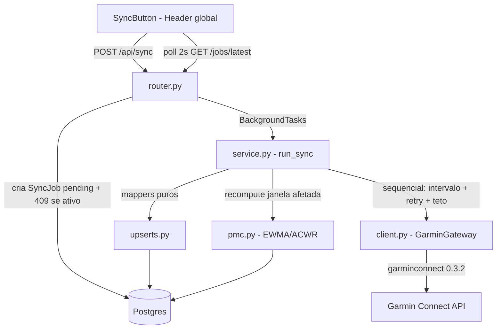

# Sync do Garmin — Design

**Spec**: `.specs/features/garmin-sync/spec.md`
**Status**: Approved (usuário, 14/10/2026)

---

## Architecture Overview

Job síncrono in-process (FastAPI BackgroundTasks), exatamente como travado no plano (§5: "BackgroundTasks na v1; RQ/Celery se escalar") e no spec (SYNC-01). Alternativas consideradas e rejeitadas: worker de fila (RQ/arq) é Fase 2.5, não v1; asyncio não se aplica — a `garminconnect` é `requests`-based (bloqueante), o que combina com BackgroundTasks rodando `def` em threadpool.

Princípio estrutural (AD-002): **um único módulo toca a API do Garmin** — o gateway. Ele é o único ponto onde existem contagem de chamadas, intervalo mínimo, retry e teto. O resto do backend nunca vê a lib.



Fluxo: POST cria `SyncJob(pending)` e responde 201 → background task transiciona `pending → running`, executa as fases em sequência (atividades+splits → saúde → recordes → PMC) → `done`/`error`. A UI lê progresso exclusivamente do banco (polling de 2s), nunca do Garmin.

**Verificação da lib (fonte: `garminconnect==0.3.2` instalada em `backend/.venv`, lida na íntegra):**

| Uso | Método confirmado | Observação |
| --- | --- | --- |
| Login por tokens | `Garmin().login(tokenstore)` → `(mfa_status, token)` | levanta `GarminConnectAuthenticationError` (401), `GarminConnectTooManyRequestsError` (429), `GarminConnectConnectionError` |
| Atividades por data | `get_activities_by_date(start, end)` | **pagina internamente de 20 em 20 — cada página é 1 HTTP call sem pausa**; por isso o gateway faz paginação própria via `connectapi` (ver Tech Decisions) |
| Splits | `get_activity_splits(activity_id)` | 1 chamada |
| Sono | `get_sleep_data(cdate)` | 1 chamada/dia |
| HRV | `get_hrv_data(cdate) -> dict \| None` | `None` em dia sem dado → skip (SYNC-19) |
| RHR | **`get_rhr_day(cdate)`** | não existe `get_rhr_data` nesta versão |
| Stress | `get_stress_data(cdate)` | 1 chamada/dia |
| Body battery | `get_body_battery(start, end)` | 1 chamada de range |
| Recordes | `get_personal_record()` | 1 chamada |

**Orçamento de chamadas (contas do design):**

- Steady state (janela 3d): atividades 1 página + splits ~3–6 (corridas da janela) + sono/HRV/RHR/stress 3×4 + battery 1 + recordes 1 ≈ **18–22 chamadas** ✓ (meta ≤ ~20 do plano §9.4)
- Backfill (180d/60d): páginas ~10 + splits ~120–150 (todas as corridas, banco vazio) + saúde 60×4 + battery 1 + recordes 1 ≈ **~370–420 chamadas** — dentro do teto `SYNC_MAX_CALLS=1500`; a ~1s/chamada ≈ 6–7 min de primeiro sync, com progresso visível na UI

---

## Code Reuse Analysis

### Existing Components to Leverage

| Component | Location | How to Use |
| ---------- | -------- | ---------- |
| `token_utils` (resolve/secure/exists) | `backend/app/garmin/token_utils.py` | Gateway e CLI de login reusam `resolve_token_path` + `secure_token_dir` — zero reescrita de handling de tokens |
| ORM models (13 tabelas) | `backend/app/db/models.py` | Reuso integral; só **acrescentamos** `PersonalRecord`, `SyncState`, constraint de `Split` e índice parcial de `SyncJob` |
| Engine/session/`init_db` | `backend/app/db/engine.py` | Sem mudanças (`create_all` cobre as tabelas novas — sem Alembic, decisão do spec) |
| `Settings` (pydantic-settings) | `backend/app/core/config.py` | Estender com as 6 env vars `SYNC_*` |
| Conftest Postgres (`ritmo_test`, drop por teste) | `backend/tests/conftest.py` | Reuso como está; novas fixtures de payload em `tests/helpers.py` |
| `Garmin` class | lib instalada | Usada só dentro do gateway; chamadas de dados vão pelos métodos dela, exceto atividades (paginação própria) |

### Integration Points

| System | Integration Method |
| ------ | ------------------ |
| FastAPI | Novo `APIRouter` em `app/garmin/router.py`, montado em `main.py` com prefixo `/api/sync` |
| Postgres | Upserts por chave natural (`garmin_id`, `(user_id, date)`, `(user_id, event)`, `(activity_id, idx)`) — sem raw SQL, SQLAlchemy 2.x |
| Docker Compose | `backend`: montar `~/.garminconnect` (rw) + env `GARMINTOKENS` + `TZ=America/Sao_Paulo`; `frontend`: env `NEXT_PUBLIC_API_URL` |
| Frontend | `layout.tsx` ganha `<Header/>` global (spec: botão visível de qualquer painel) |

---

## Components

### `app/garmin/client.py` — GarminGateway

- **Purpose**: único ponto de acesso à API do Garmin; impõe sequência, intervalo, retry, teto e contagem.
- **Interfaces**:
  - `GarminGateway.from_settings() -> GarminGateway` — constrói `Garmin()` + `login(tokenstore)`; usa `token_utils`
  - `get_activities(start: date, end: date) -> list[dict]` — **paginação própria** (20/pág via `connectapi`, 1 contagem + 1 sleep por página)
  - `get_splits(activity_id: int) -> dict | None`
  - `get_sleep(day) / get_hrv(day) / get_rhr(day) / get_stress(day) -> dict | None`
  - `get_body_battery(start, end) -> list[dict]`
  - `get_personal_records() -> dict`
  - `calls_made: int` (propriedade; conta só chamadas de dados — as ~2 chamadas internas do `login()` são custo fixo documentado, fora do contador)
- **Exceções próprias**: `GarminAuthExpiredError` (mapeia `GarminConnectAuthenticationError` — não retenta), `SyncBudgetExceededError` (teto `SYNC_MAX_CALLS`)
- **Retry**: `GarminConnectTooManyRequestsError` + erros transitórios de conexão → 3 tentativas, backoff 2s/4s/8s (SYNC-07); entre chamadas: `sleep(SYNC_CALL_INTERVAL_S)`
- **Dependencies**: `garminconnect`, `token_utils`, `Settings`
- **Reuses**: `token_utils.resolve_token_path`/`secure_token_dir`

### `app/garmin/mappers.py` — funções puras

- **Purpose**: JSON do Garmin → dicts prontos para o ORM; sem DB, sem client — 100% testáveis com fixtures.
- **Interfaces**:
  - `map_activity(raw) -> dict` — `garmin_id=activityId`, `start_time=startTimeLocal`, `activity_type=activityType.typeKey`, nome, distância, duração, FC, cadência, potência, elevação, TEs, `training_load`, `raw_json=raw`
  - `is_running(raw) -> bool` — `typeKey` em {`running`, `trail_running`} (splits só para corrida, SYNC-12)
  - `map_splits(raw) -> list[dict]` — normaliza formato (dict com lista interna ou lista); `None`/vazio → `[]` sem warning (edge do spec)
  - `map_sleep(raw) -> dict | None` — `None` se sem `dailySleepDTO`/`sleepTimeSeconds` (skip do dia)
  - `map_hrv(raw) -> dict | None`, `map_rhr(raw) -> dict | None`, `map_stress(raw) -> dict | None`
  - `map_battery(rows) -> list[dict]` — 1 linha por `calendarDate`
  - `map_personal_records(raw) -> list[dict]` — filtra para corrida; `event`, `value`, `pr_date`, `raw_json`
- **Dependencies**: nenhuma (puro Python)

### `app/garmin/upserts.py` — escrita idempotente

- **Purpose**: toda escrita no banco passa por aqui; cada função retorna contagens (`new`/`updated`).
- **Interfaces**:
  - `upsert_activity(db, user_id, data) -> str` (`"new"` | `"updated"`) — por `garmin_id`
  - `upsert_splits(db, activity_id, rows) -> int` — upsert por `(activity_id, idx)` **+ prune** (`DELETE idx >= len(rows)`); contagens estáveis
  - `upsert_health_rows(db, model, user_id, rows) -> int` — genérico por `(user_id, date)` para sleep/hrv/rhr/battery/stress
  - `upsert_records(db, user_id, rows) -> int` — por `(user_id, event)`
  - `set_sync_state(db, user_id, data_type, last_date)` / `get_sync_state(db, user_id, data_type) -> date | None`
- **Reuses**: models existentes + constraints novas

### `app/garmin/pmc.py` — carga determinística

- **Purpose**: CTL/ATL/TSB/ACWR por dia em Python puro (SYNC-22..24).
- **Interfaces**:
  - `aggregate_daily_loads(db, user_id) -> list[(date, float)]` — `sum(training_load)` por data local, carga 0 em dia sem atividade
  - `recompute(db, user_id, from_date, today) -> int` — recalcula **só de `from_date` até hoje** (SYNC-23): semente CTL/ATL vem da última linha de `load` anterior à janela (ou primeiro load, se não houver); EWMA α=1/42 (CTL) e α=1/7 (ATL); `TSB=CTL−ATL`; `ACWR=sum(7d)/(sum(28d)/4)` — `None` até existir janela de 28d completa; apaga e reinsere as linhas da janela
- **Dependencies**: SQLAlchemy session; **Reuses**: `DailyLoad`, `Activity`

### `app/garmin/service.py` — orquestrador

- **Purpose**: máquina de estados do `SyncJob` + sequência de fases + `stats_json`.
- **Interfaces**:
  - `create_job(db, user_id) -> SyncJob` — `IntegrityError` → `JobConflictError` → endpoint devolve 409 (SYNC-02, edge de 2 cliques)
  - `run_sync(job_id: int) -> None` — entrada do BackgroundTasks; **abre `SessionLocal()` própria**; `pending → running` (+`started_at`) → fases → `done|error` (+`finished_at`, SYNC-04). Transições fora dessa sequência são proibidas (assert de estado em cada transição)
  - Fases em ordem: **atividades+splits** (crítico: falha após retries → `error`, SYNC-14) → **sono** → **HRV** → **RHR** → **stress** → **body battery** → **recordes** → **PMC** → done
  - Tipo de saúde/recordes falho após retries → warning `{"tipo", "erro"}` em `stats_json` e segue (SYNC-20); `sync_state` só atualiza em tipo bem-sucedido (SYNC-13/21)
  - Janela por tipo: `get_sync_state` vazio → backfill (`SYNC_BACKFILL_ACTIVITIES_DAYS=180` / `SYNC_BACKFILL_HEALTH_DAYS=60`); senão `last_date − SYNC_REPULL_DAYS` até hoje (SYNC-10/15/18)
  - `stats_json` atualizado a cada fase e a cada item (progresso "Puxando 12 atividades…")
- **Dependencies**: `GarminGateway` (via `from_settings`, monkeypatchável nos testes), `mappers`, `upserts`, `pmc`
- **Exceções**: `GarminAuthExpiredError` → `error` + `reauth_needed: true` (SYNC-25); `SyncBudgetExceededError` → `error` + stats das chamadas feitas (SYNC-09)

**`stats_json` (schema exato, SYNC-05/06):**

```json
{
  "step": "activities",
  "message": "Puxando 12 atividades…",
  "activities_new": 0, "activities_updated": 0, "splits": 0,
  "sleep_days": 0, "hrv_days": 0, "rhr_days": 0, "battery_days": 0, "stress_days": 0,
  "records": 0, "calls_made": 0, "duration_s": 0,
  "warnings": [], "reauth_needed": false
}
```

### `app/garmin/router.py` — API

- **Interfaces**:
  - `POST /api/sync` → cria job + `BackgroundTasks.add_task(run_sync, job_id)` → `201 {id, status}` (SYNC-01)
  - `GET /api/sync/jobs/{id}` → `JobOut {id, status, started_at, finished_at, error, stats}` (SYNC-05)
  - `GET /api/sync/jobs/latest` → último job do usuário (qualquer status; `{job: null}` se nunca houve sync) — é o que a UI poleia
- **Reuses**: `get_db` do engine

### `app/garmin/login.py` — CLI de re-auth (P2)

- **Purpose**: `python -m app.garmin.login` — credenciais via `getpass`, MFA via prompt (a lib aceita `prompt_mfa`), dump no tokenstore + `secure_token_dir`. A UI nunca pede credenciais (decisão do spec: re-auth é CLI).

### Frontend

- **`src/components/SyncButton.tsx`** (`"use client"`): estados `idle` (botão "Puxar do Garmin") → `running` (botão disabled + `stats.message`) → `done` (resumo dos contadores, PT-BR) → `error` (mensagem) → `reauth` ("Reconectar Garmin" + instrução `python -m app.garmin.login` no lugar do resumo, SYNC-08/26). Poll `GET /api/sync/jobs/latest` a cada **2s** enquanto `pending|running`.
- **`src/components/Header.tsx`**: server component com nome do app + `SyncButton`, montado no `layout.tsx` (global, desktop e mobile — decisão do spec).
- **`src/lib/api.ts`**: base `NEXT_PUBLIC_API_URL` (default `http://localhost:8000`) + tipagem `JobOut`.
- **Constraint de implementação**: Next.js **16.4.0** com breaking changes — ler `frontend/node_modules/next/dist/docs/` antes de escrever o componente (aviso do `frontend/AGENTS.md`).

---

## Data Models

### Novas tabelas (`app/db/models.py`)

```python
class PersonalRecord(Base):
    """Recorde pessoal de corrida — upsert por (user_id, event)."""
    __tablename__ = "personal_records"
    __table_args__ = (UniqueConstraint("user_id", "event", name="uq_pr_user_event"),)
    id: int (PK)
    user_id: int (FK users.id, default=DEFAULT_USER_ID)
    event: str(60)        # ex.: "FASTEST_5K" / "5K"
    value: float | None
    pr_date: date | None
    raw_json: dict | None  # sempre preservado (spec)

class SyncState(Base):
    """last_sync por tipo de dado — memória do incremental."""
    __tablename__ = "sync_state"
    __table_args__ = (UniqueConstraint("user_id", "data_type", name="uq_syncstate_user_type"),)
    id: int (PK)
    user_id: int (FK users.id)
    data_type: str(40)    # activities | sleep | hrv | rhr | stress | body_battery | records
    last_date: date       # fim da última janela concluída com sucesso
```

### Mudanças em tabelas existentes

```python
# Split: dedup exigido pelo spec (SYNC-11)
__table_args__ = (UniqueConstraint("activity_id", "idx", name="uq_split_activity_idx"),)

# SyncJob: lock por usuário no nível do banco (SYNC-02 + edge de cliques simultâneos)
Index("uq_syncjobs_user_active", "user_id", unique=True,
      postgresql_where=text("status IN ('pending', 'running')"))
```

O índice parcial cobre `pending` **e** `running`: segundo POST concorrente viola o índice → `IntegrityError` → 409 determinístico, sem janela de corrida entre check e insert.

### Config novas (`app/core/config.py`)

```python
sync_repull_days: int = 3                 # SYNC_REPULL_DAYS
sync_backfill_activities_days: int = 180  # SYNC_BACKFILL_ACTIVITIES_DAYS
sync_backfill_health_days: int = 60       # SYNC_BACKFILL_HEALTH_DAYS
sync_call_interval_s: float = 1.0         # SYNC_CALL_INTERVAL_S
sync_max_calls: int = 1500                # SYNC_MAX_CALLS
sync_retry_max: int = 3                   # SYNC_RETRY_MAX (backoff 2/4/8s)
```

---

## Error Handling Strategy

| Error Scenario | Handling | User Impact |
| -------------- | -------- | ----------- |
| 401/auth no login ou em qualquer chamada | `GarminAuthExpiredError` → job `error`, `reauth_needed: true` | UI: "Reconectar Garmin" + comando CLI; banco intacto (SYNC-25) |
| 429 / erro transitório de conexão | Gateway retenta 3× com backoff 2s/4s/8s | Sync mais lento; só visível em `calls_made` (SYNC-07) |
| Falha de atividades após retries | Job `error` com a mensagem — tipo crítico | "Sync falhou"; nada parcial gravado de splits (SYNC-14) |
| Falha de um tipo de saúde/recordes após retries | Warning `{tipo, erro}` em `stats_json`, demais tipos continuam, job `done` (SYNC-20) | Resumo mostra o que sincronizou + aviso |
| Teto `SYNC_MAX_CALLS` atingido | `SyncBudgetExceededError` → job `error` com stats das chamadas feitas (SYNC-09) | "Sync interrompido: teto de chamadas"; próximo sync retoma incremental |
| Dia de saúde sem dado (`None`/vazio) | Skip silencioso, sem linha, sem erro (SYNC-19) | Invisível |
| Corrida sem splits (esteira/sem GPS) | Grava atividade com 0 splits, sem warning (edge do spec) | Atividade válida sem gráfico |
| Segundo clique durante sync | Índice parcial → `IntegrityError` → 409 + estado do job corrente (SYNC-02) | Botão já está disabled; resposta 409 |
| Restart do servidor no meio do sync | Lifespan marca jobs `pending/running` órfãos como `error` ("interrompido por restart") | Sem 409 eterno; próximo sync normal |
| API do Garmin muda endpoint | Erro de conexão após retries → job `error` com mensagem clara | Banco mantém último estado bom (edge do spec) |

---

## Risks & Concerns

| Concern | Location (file:line) | Impact | Mitigation |
| ------- | -------------------- | ------ | ---------- |
| Paginação interna do `get_activities_by_date` (20/pág, sem pausa entre páginas) — rajada na lib | `garminconnect/__init__.py:2151` | Bursts de ~10 chamadas rápidas no backfill violam o espírito do intervalo mínimo e o contador subestima | Gateway faz paginação própria via `connectapi` (1 sleep + 1 contagem por página) — controle total |
| Acoplamento a atributos internos da lib (`garmin_connect_activities`) | `garminconnect/__init__.py:258` | Upgrade da lib pode quebrar a paginação própria | Versão pinada `==0.3.2` no `pyproject.toml`; gateway isola o resto do código |
| Nomes de campos do payload não verificados para battery/stress/rhr/recordes/detalhes de sono | lib: apenas assinaturas confirmadas | Mapper pode ler campo errado → dado faltante | `raw_json` sempre preservado (spec): correção de mapper não exige re-pull; mappers desenvolvidos contra fixtures modeladas no payload real; primeira sync real valida os campos (tarefa explícita) |
| Job `running` órfão após restart trava todos os syncs (409 eterno) | `main.py` lifespan | Feature inutilizável até intervenção manual | Recovery no lifespan: jobs ativos → `error`; seguro porque v1 é single-instância |
| Tokens do host não existem dentro do container backend | `docker-compose.yml:23` | Login falha no compose (reauth falso-positivo) | Compose monta `~/.garminconnect` (rw) + env `GARMINTOKENS=/garminconnect` |
| `date.today()` no container = UTC, não o calendário local do usuário | `docker-compose.yml` | Janela termina 1 dia errado perto da meia-noite | Compose define `TZ=America/Sao_Paulo` no backend; datas gravadas seguem as de calendário do Garmin (premissa do spec) |
| BackgroundTasks roda no threadpool da request; sync de backfill segura 1 thread por ~7 min | FastAPI | Irrelevante para 1 usuário local; bloqueante se escalar | Aceito na v1 (plano); Fase 2.5 troca por fila sem mudar `run_sync` |
| TestClient executa background tasks de forma síncrona | Starlette | Testes de "job em progresso" não funcionam via POST | Estados intermediários testados invocando `run_sync` direto com fake; POST testado para 201/409/estados finais |
| FC óptica como juiz | n/a (AD-005) | Fora do escopo desta feature | Sync apenas grava; avaliação vem depois |
| Nenhuma cobertura de teste no frontend (sem infra de testes UI) | `frontend/` | Estados do botão dependem de UAT manual | Botão simples (um componente, polling); UAT interativo na fase Execute |

---

## Tech Decisions (only non-obvious ones)

| Decision | Choice | Rationale |
| -------- | ------ | ---------- |
| Paginação de atividades | Própria, via `Garmin.connectapi` + params `{startDate, start, limit: 20}` | Contagem e intervalo por página; a da lib itera sem pausa |
| Lock de sync por usuário | Índice parcial único `(user_id) WHERE status IN ('pending','running')` | Determinístico no banco, sem race check-then-insert; cobre também o gap pending→running |
| Splits idempotentes | Upsert por `(activity_id, idx)` + prune de `idx >= len` | Letra do spec (SYNC-11) + espelha edições que reduzem splits |
| `calls_made` | Só chamadas de dados via gateway | Auditável e determinístico; as ~2 chamadas internas do `login()` são custo fixo documentado |
| Semente PMC no recompute | CTL/ATL da última linha de `load` anterior à janela; sem linha → semente = load do primeiro dia | Honra SYNC-23 (recalcular só a janela) mantendo EWMA contínua; 180d ≈ poucas centenas de linhas, trivial |
| ACWR em janela incompleta | `None` até 28d completos | Fórmula do spec exige soma de 28d; parcial enganaria o painel |
| Recordes/body battery falham | Warning + `done` (mesma política dos tipos de saúde) | Não críticos para o sync; consistente com SYNC-20 |
| Progresso na UI | Polling de 2s em `GET /jobs/latest` | SSE/websocket é overkill para v1; spec pede apenas progresso visível |
| Falha de tipo de saúde | Warning e continua — sem retry do tipo inteiro | Retry já acontece por chamada no gateway (SYNC-07); repetir o loop inteiro multiplicaria chamadas |
| Container TZ | `TZ=America/Sao_Paulo` no compose | "Hoje" da janela = calendário do usuário; spec manda não converter datas do Garmin |

Nenhuma decisão projeto-level nova: o design conforma a AD-001/007 (user_id em toda tabela, Postgres, SQLAlchemy), AD-002 (sequencial, job isolado, UI lê do banco), AD-003 (PMC determinístico em Python), AD-005 (sem interpretação de FC aqui) e AD-006 (uso pessoal, sem revisão de ToS).

---

## Requirement Coverage

27 requisitos (SYNC-01..27) cobertos: 01–02 (router + índice parcial), 03/07/09 (gateway), 04/05/06 (service/stats), 08/26 (SyncButton), 10–14 (janelas + upserts de atividades/splits), 15–17 (backfill + recordes + calls_made), 18–21 (saúde + sync_state), 22–24 (pmc), 25/27 (auth expired + retomada incremental via sync_state preservado).
