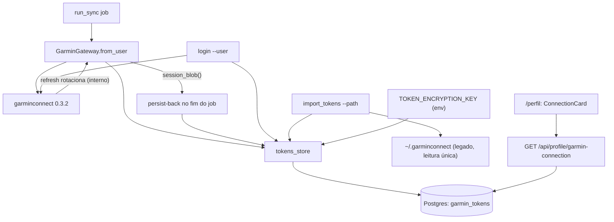

# garmin-tokens-db Design

**Spec**: `.specs/features/garmin-tokens-db/spec.md`
**Status**: Draft

---

## Architecture Overview

Tokens Garmin migram para o Postgres como blob opaco cifrado (Fernet). O gateway
ganha `from_user(db, user_id)` e perde `from_settings`; o persist-back do refresh é
explícito no fim do job (sem acoplamento aos internals da lib); dois CLIs cobrem a
escrita (login de convidado com upsert, importação do legado com recusa); o /perfil
ganha uma seção de exibição derivada dos tokens + último job. Nenhuma leitura de
filesystem em caminho runtime — o único leitor do arquivo legado é o CLI de
importação.



Fluxos-chave:

- **Sync**: `from_user` lê a linha, decripta, passa o blob inline para
  `garmin.login(blob)` (a lib aceita string com len > 512 como dados diretas),
  guarda `updated_at` do carregamento. No fim do job (done ou error não-auth),
  o service persiste `gateway.session_blob()` de volta com guard otimista.
- **Reauth**: sem linha, blob ilegível, ou 401 da lib → `GarminAuthExpiredError` →
  canal existente (`stats.reauth_needed=true`, SYNC-25) — nenhum estado novo.
- **Login CLI**: credenciais + MFA interativo → `client.dumps()` → valida
  `di_token` → upsert cifrado.
- **Import CLI**: lê `garmin_tokens.json` do path → valida JSON → recusa se a linha
  existe → grava cifrado.

---

## Code Reuse Analysis

### Existing Components to Leverage

| Component | Location | How to Use |
| --------- | -------- | ---------- |
| Padrão de erro de auth → `reauth_needed` | `app/garmin/client.py:42`, `app/garmin/service.py:427` | `from_user` e o "sem tokens" reusam `GarminAuthExpiredError` — zero estado novo |
| `make_settings` de teste | `tests/test_garmin_gateway.py` | Padrão para testes com `Settings(token_encryption_key=...)` direto |
| Stub da lib via monkeypatch | `tests/test_garmin_login.py` (FakeGarmin), `tests/fake_garmin.py` (FakeGateway) | Mesma técnica para os CLIs e para o `from_user` |
| `session_client` (conftest) | `tests/conftest.py:60` | Testes do endpoint de status com usuário real da sessão |
| Normalização de email | `app/auth/service.py` (lowercase) | CLI resolve o usuário com o mesmo critério |
| `PanelSection` (índice opcional) | `frontend/src/components/PanelSection.tsx` | Seção "Conexão Garmin" sem índice (não é passo de fio condutor) |
| Padrão de seed com guarda de existência | `app/db/engine.py:73-96` | N/A para tokens (seed é CLI) — mas o import CLI copia o espírito "re-executar não duplica" via recusa |
| FK CASCADE do `sessions` | `app/db/models.py:61` | Mesma política de revogação total na tabela de tokens |

### Integration Points

| System | Integration Method |
| ------ | ------------------ |
| Postgres | Nova tabela `garmin_tokens` via `create_all` (tabela nova — AD-019 não se aplica) |
| `run_sync` | Único call site de produção do gateway (`service.py:397`) troca `from_settings()` → `from_user(db, job.user_id)` |
| Lifespan (`main.py:31`) | Fail-fast da `TOKEN_ENCRYPTION_KEY` antes do `init_db()` |
| conftest | `TOKEN_ENCRYPTION_KEY` fixa de teste setada antes do import da app (como `DATABASE_URL`) |
| `/perfil` | Nova seção no topo da página + `getGarminConnection()` em `api.ts` |

---

## Components

### tokens_store — cofre Fernet + acesso ao banco

- **Purpose**: Único ponto que cifra, decripta, lê e grava tokens; nenhum outro módulo toca a coluna cifrada.
- **Location**: `backend/app/garmin/tokens_store.py` (novo)
- **Interfaces**:
  - `require_key(settings: Settings) -> Fernet` — valida presença e formato; `TokenKeyError` com mensagem de correção (geração via `Fernet.generate_key()`)
  - `get_blob(db, user_id: int, fernet: Fernet) -> tuple[str, datetime] | None` — blob decriptado + `updated_at` da linha; `None` se sem linha
  - `save_blob(db, user_id: int, blob: str, fernet: Fernet, expected_updated_at: datetime | None = None) -> bool` — upsert cifrado; com `expected_updated_at`, UPDATE otimista (`WHERE updated_at = :expected`); `False` = guard recusou
  - `get_meta(db, user_id: int) -> tuple[bool, datetime | None]` — existência + `updated_at` sem decriptar (endpoint de status)
- **Dependencies**: `cryptography.fernet` (nova dependência), `app.core.config`
- **Reuses**: nada — módulo novo, sem sobreposição com o `token_utils` legado

### GarminGateway.from_user

- **Purpose**: Hidratar a sessão Garmin dos tokens do banco do usuário (substitui `from_settings`).
- **Location**: `backend/app/garmin/client.py`
- **Interfaces**:
  - `from_user(cls, db: Session, user_id: int, settings: Settings | None = None) -> GarminGateway` — sem linha/blob ilegível/blob rejeitado pela lib → `GarminAuthExpiredError` (mensagem sem conteúdo do blob)
  - `session_blob(self) -> str` — `self._garmin.client.dumps()` (blob vigente da sessão)
  - `tokens_loaded_at(self) -> datetime | None` — `updated_at` visto no carregamento (injeta o guard)
- **Dependencies**: `tokens_store.get_blob`, lib `garminconnect`
- **Reuses**: `__init__`, `_call`, 11 métodos de dados — intocados

### Persist-back no run_sync

- **Purpose**: Garantir GTDB-04 — blob vigente volta cifrado ao fim do job, com guard.
- **Location**: `backend/app/garmin/service.py`
- **Interfaces**:
  - `_persist_tokens(db, job, stats, gateway) -> None` — `save_blob(..., expected_updated_at=gateway.tokens_loaded_at)`; guard recusado ou exceção → warning em `stats["warnings"]`, nunca interrompe o job
  - Chamado no caminho done E no `except Exception` genérico; NUNCA no `except GarminAuthExpiredError` (blob morto)
- **Dependencies**: gateway, tokens_store
- **Reuses**: padrão de warnings dos stats (`_sync_physio`, `service.py:364`)

### CLI de login — `python -m app.garmin.login --user <email>`

- **Purpose**: Conectar a conta Garmin de um usuário existente (upsert, sobrescreve).
- **Location**: `backend/app/garmin/login.py` (reescrito)
- **Interfaces**:
  - `run_login(db, user_id: int, email: str, password: str, mfa_prompt) -> None` — credenciais + MFA → valida `di_token` não-nulo → `save_blob` (upsert)
  - `main() -> None` — argparse `--user`; usuário inexistente → erro e exit 1 sem gravar (GTDB-07 AC 2); `os.environ.pop("GARMINTOKENS", None)` antes do login força o caminho de credenciais (nunca resumir do arquivo — senão o login de um convidado salvaria os tokens do operador)
- **Dependencies**: lib, tokens_store, `app.db.engine.SessionLocal`, `app.db.models.User`
- **Reuses**: fluxo da lib provado (5 estratégias + `prompt_mfa`), padrão do CLI `app.auth.set_password` (conexão própria ao banco, sem HTTP)

### CLI de importação — `python -m app.garmin.import_tokens [--path <p>]`

- **Purpose**: Importar run-once o tokenstore legado para a linha do usuário 1 (sem MFA).
- **Location**: `backend/app/garmin/import_tokens.py` (novo)
- **Interfaces**:
  - `import_legacy(path: str, db, fernet) -> None` — path é dir → `<path>/garmin_tokens.json` (layout do `dump()` da lib) ou arquivo direto; JSON sem `di_token` → erro; linha existente do usuário 1 → recusa com orientação para o login CLI (exit 1, nada gravado)
  - `main() -> None` — `--path` com default `~/.garminconnect` (seam de teste; sem `--user` — o spec trava o usuário 1)
- **Dependencies**: tokens_store, `resolve_token_path` (expansão de `~`), `DEFAULT_USER_ID`
- **Reuses**: `token_utils.resolve_token_path` (única função que sobrevive do legado)

### Endpoint de status — `GET /api/profile/garmin-connection`

- **Purpose**: Alimentar a seção Conexão do /perfil (só metadados — GTDB-17).
- **Location**: `backend/app/profile/router.py` + `backend/app/profile/service.py`
- **Interfaces**:
  - `garmin_connection(db, user_id: int) -> ConnectionOut` — derivação pura e testável:
    - sem linha → `not_connected`
    - último job `status=error` com `stats.reauth_needed=true` E `finished_at >= tokens.updated_at` → `reauth_needed`
    - senão → `connected`
  - `ConnectionOut(state: Literal["connected","reauth_needed","not_connected"], tokens_updated_at: datetime | None)`
- **Dependencies**: `GarminToken` (meta), `SyncJob` (leitura)
- **Reuses**: padrão dos routers do profile (require_session no include do main)

### Frontend — ConnectionCard

- **Purpose**: Exibir o estado da conexão (AD-009: cabeçalho forte, contexto sempre visível).
- **Location**: `frontend/src/components/profile/ConnectionCard.tsx` (novo) + `frontend/src/app/(app)/perfil/page.tsx` (seção nova no topo) + `frontend/src/lib/api.ts` (`GarminConnectionOut`, `getGarminConnection()`)
- **Interfaces**: `ConnectionCard({ state, tokensUpdatedAt })` — pill colorida por estado ("Conectado" / "Reautenticação necessária" / "Não conectado") + linha "tokens atualizados em …" quando existir
- **Dependencies**: `api.ts`
- **Reuses**: `PanelSection` sem `index`; padrão visual de pills (`bg-accent/15`)

---

## Data Models

### GarminToken

```python
class GarminToken(Base):
    __tablename__ = "garmin_tokens"

    id: int (PK)
    user_id: int  # FK users.id ON DELETE CASCADE, UNIQUE, index
    token_encrypted: str  # Text — blob Fernet (base64) do JSON dumps() da lib
    created_at: datetime  # default _utcnow
    updated_at: datetime  # default _utcnow, onupdate _utcnow — guard do persist-back
```

**Relationships**: 1:1 com `users` (unique `user_id`); exclusão em cascata (padrão `sessions`).
Tabela nova → `create_all` cobre; nenhuma migração ALTER (AD-019).

### Settings (alterações)

| Campo | Ação |
| ----- | ---- |
| `token_encryption_key: str = ""` | **novo** — env `TOKEN_ENCRYPTION_KEY` |
| `garmintokens`, `garmintokens_base64` | **removidos** (com as linhas do `.env.example`) |

### pyproject

`cryptography>=43` nas dependências de produção (Fernet).

---

## Error Handling Strategy

| Error Scenario | Handling | User Impact |
| -------------- | -------- | ----------- |
| Sem linha de tokens no sync | `GarminAuthExpiredError` no `from_user` | Job `error` com `reauth_needed=true` — estado "Reconectar" que a UI já conhece |
| Blob ilegível (chave trocada) | Decript lança `InvalidToken` → tratado como sem tokens | Mesmo canal acima; operador refaz login CLI |
| `TOKEN_ENCRYPTION_KEY` ausente/inválida no startup | `require_key` no lifespan ANTES do `init_db`; `TokenKeyError` sobe | Backend não sobe; traceback com o comando de geração da chave |
| Login CLI: email inexistente / falha de credenciais / MFA errado | exit 1 com mensagem clara; nenhuma gravação | Operador corrige e repete; tokens existentes intactos |
| Login CLI: sessão sem `di_token` (JWT_WEB-only) | Validação pré-gravação: erro "sessão sem token DI — refaça o login" | Nada gravado; sem blob inútil no banco |
| Import CLI: linha existente / arquivo ausente / JSON inválido | exit 1 com orientação; nenhuma gravação | Operador usa o login CLI ou corrige o path |
| Persist-back recusado pelo guard | Warning nos stats do job (GTDB-04 AC 2) | Sync conclui; tokens do re-login preservados |
| Persist-back com exceção | Warning nos stats (GTDB-04 AC 3) | Sync conclui; risco assumido: reauth no ciclo seguinte |

---

## Risks & Concerns

| Concern | Location (file:line) | Impact | Mitigation |
| ------- | -------------------- | ------ | ---------- |
| `dumps()` da lib só persiste campos `di_*` — sessão jwt_web-only (estratégias portal) geraria blob não-resumível | `.venv/.../garminconnect/client.py:1048` | Reauth loop para contas que só autenticam via portal | CLI valida `di_token` antes de gravar; risco aceito (lib pinada 0.3.2; estratégias mobile são as primárias e são as que produzem DI) |
| `garmin.login(blob)` usa heurística len > 512 para distinguir dados de path | `.venv/.../garminconnect/__init__.py:430` | Blob curto (<512 — impossível com JWT real) viraria path → fallback credenciais → auth error | Degradação inofensiva: cai no canal `reauth_needed`; documentado, sem tratamento especial |
| Janela de crash: refresh rotaciona no meio do sync e o processo morre antes do persist-back | `app/garmin/service.py` (novo caminho) | Tokens antigos invalidados → reauth no próximo ciclo | Aceito no spec (AC exige persist "quando o job encerra"); `recover_stale_jobs` marca o job como error; operador re-loga |
| `get_settings` é `lru_cache`d — teste de fail-fast precisa de Settings fresco | `app/core/config.py:79` | Teste falso-positivo lendo chave antiga | Testes constroem `Settings(...)` direto (padrão `make_settings`); conftest seta a env ANTES do import |
| 30+ sites de teste dependem da interface `FakeGateway.from_settings` | `tests/fake_garmin.py:154`, `tests/test_sync_api.py:186` | Suite quebra em massa se a assinatura mudar sem espelho no fake | Fake ganha `from_user(cls, db, user_id, settings=None)` com a mesma assinatura do real; apenas 2 arquivos de teste mudam além do fake |
| Comparação de datetimes naive (colunas TIMESTAMP) vs aware (`_utcnow`) na derivação de estado | `app/db/models.py:34`, `app/garmin/service.py` | `TypeError` silencioso no endpoint de status | Normalizar ambos os lados para UTC naive no service (função pura testada) |
| `run_login` sem defesa resumiria do arquivo se `GARMINTOKENS` existir no env do processo (login de convidado salvaria tokens do operador) | `app/garmin/login.py` (reescrito) | Corrupção de posse de tokens | `os.environ.pop("GARMINTOKENS", None)` antes do login + teste que afirma o `login(None)` |

---

## Tech Decisions (only non-obvious ones)

| Decision | Choice | Rationale |
| -------- | ------ | --------- |
| Persist-back | Explícito pós-sync no service (não hook no `dump()` da lib) | Zero acoplamento a internals (`_tokenstore_path`); ponto de teste determinístico; janela de crash é o trade-off já aceito no spec |
| Resume do blob | `garmin.login(blob)` inline (não `client.loads()` direto) | Reusa profile/settings fetch + refresh proativo do `login()` de alto nível; sem replicar internals |
| Criptografia | Fernet simétrico, chave única de operador | MVP local-first (AD-006); LGPD completa na 2.5; chave é segredo de env como `INVITE_CODE` |
| Escrita de tokens | Upsert no login CLI; recusa no import CLI | Login substitui (re-login legítimo); import nunca reimporta token velho sobre novo (GTDB-11) |
| Endpoint de status | `/api/profile/garmin-connection` com derivação pura no service | Payload espelha o painel (AD-009); função pura testável sem HTTP |
| Env legada | `GARMINTOKENS(_BASE64)` saem de Settings, compose e `.env.example`; import CLI usa `--path` literal | Fonte única = banco (decisão do usuário); o único leitor do arquivo é o CLI de importação (GTDB-18/19) |
| Seção Conexão no /perfil | Sem índice, no topo da página | Conexão é pré-requisito, não passo do fio condutor de zonas (padrão Performance: narração sem índice) |

> Sem AD nova: AD-014 já registra a decisão de nível projeto (banco + Fernet +
> `from_user` + CLI); este design é a materialização dela. GTDB-16 AC 1 foi
> emendado no spec (precisão: tokens atualizados após o job falho voltam a
> exibir "Conectado") — validado com `validate_spec.py`.
