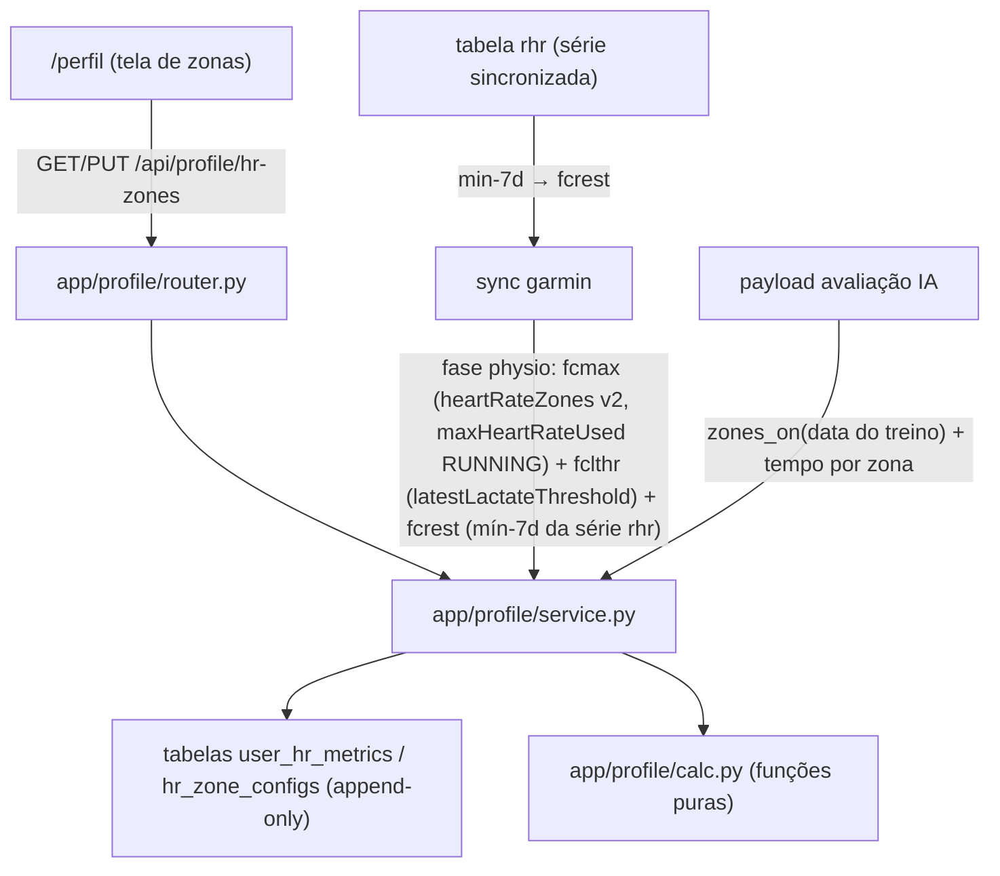

# hr-zones Design

**Spec**: `.specs/features/hr-zones/spec.md`
**Status**: Draft

---

## Architecture Overview

**Abordagem escolhida: séries effective-dated + zonas derivadas na leitura (A).**
Métricas (`fcmax`, `fcrest`, `fclthr`) e configs de zona (método + percentuais) são séries
append-only com `valid_from`; as zonas em bpm são **derivadas por função pura** no momento
da leitura, resolvendo a métrica e a config vigentes na data consultada (HRZ-12 — padrão
Strava). Escrita = inserir linha; leitura = resolver vigente + calcular. Sem snapshots
materializados, sem jobs de recompute — mesma postura do tipo inferido em tempo de leitura
(AD-001).

**Alternativas descartadas:**
- **B. Snapshot materializado por época** (gravar as 5 zonas em bpm a cada mudança):
  leitura trivial, mas mudança de métrica sem mudança de config exige re-derivar snapshots
  (ou zonas ficam stale), duplica dado derivado e complica a leitura retroativa. Descartada.
- **C. Valor vigente + log de auditoria** (classificação sempre com o valor atual):
  a mais simples, mas viola o HRZ-12 — vigente-na-data foi decisão explícita do usuário.
  Descartada pelo spec.



---

## Code Reuse Analysis

### Existing Components to Leverage

| Component | Location | How to Use |
| --- | --- | --- |
| Padrão service/router/calc por domínio | `app/health/`, `app/potential/` | Mesma divisão: `calc.py` puro (AD-003), service leitura/montagem, router com modelos inline |
| `require_session` → `user.id` | `app/auth/deps.py` | Endpoints do router `/api/profile` (padrão user-scope) |
| `_call()` do gateway | `app/garmin/client.py:74` | Novos métodos `get_heart_rate_zones`/`get_lactate_threshold` passam pelo mesmo contador/teto/intervalo |
| Fase de sync tolerante a falha | `app/garmin/service.py` (padrão SYNC-20 de saúde) | Fase physio: warning + job segue `done` |
| `build_evaluation_payload` já recebe `user_id` | `app/evaluation/payload.py` (T6) | Injeção do bloco `zonas_fc` e do `lthr_bpm` por métrica — sem mudança de assinatura |
| Seed idempotente no `init_db` | `app/db/engine.py` (padrão AD-019) | Seed do usuário 1 (fclthr do env, config lthr default) com guarda de existência |
| `session_client` + `apiFetch` | `backend/tests/conftest.py`, `frontend/src/lib/api.ts` | Testes de API e helpers do frontend |
| Padrão de clareza dos painéis | AD-009 | Cabeçalhos de seção da tela de zonas |

### Integration Points

| System | Integration Method |
| --- | --- |
| Lib `garminconnect` 0.3.2 | `get_heart_rate_zones()` (`/biometric-service/heartRateZones/v2` via `connectapi`, `maxHeartRateUsed`) e `get_lactate_threshold(latest=True)` (`/biometric-service/biometric/latestLactateThreshold`) — **confirmados no spike runtime de UAT (21/10/2026)** |
| Série `rhr` própria | `fcrest` derivada do mínimo-7d a cada sync (zero chamadas novas) |
| Sync existente | Nova fase após predições: 3 chamadas (1 zonas de FC + 2 internas do LTHR), falha → warning |

---

## Components

### `app/profile/calc.py` — matemática pura (AD-003)

- **Purpose**: defaults por método, validação de bounds e derivação de zonas — determinístico, zero I/O.
- **Interfaces**:
  - `DEFAULT_BOUNDS: dict[str, list[dict]]` — lthr: 65/80/89/95/100 (Z5 high null); fcr e fcmax: 50/60/70/80/90 (Z5 high 100)
  - `validate_bounds(method: str, bounds: Bounds) -> None` — levanta `BoundsError(motivo)` no primeiro ponto inválido: ≠5 zonas, `z1.low ≤ 0`, cadeia não ascendente (`z[n].high == z[n+1].low` e crescente), zona <1pp, high em Z5 do lthr (deve ser None) / Z5 do fcr/fcmax deve ser 100
  - `zones_bpm(method: str, bounds: Bounds, metrics: dict[str, int | None]) -> list[Zone] | None` — None quando métrica exigida ausente; lthr: `round(pct × fclthr / 100)`; fcr: `fcrest + round(pct × (fcmax − fcrest) / 100)`; fcmax: `round(pct × fcmax / 100)`; Z5: lthr → high None; fcr/fcmax → high = fcmax
  - `classify(hr: int, zones: list[Zone]) -> int | None` — `low ≤ hr < high`; Z5 aberta (`hr ≥ low`); None fora (não ocorre com Z5 aberta, guard de segurança)
- **Dependencies**: none (stdlib).
- **Reuses**: padrão de `app/health/calc.py`.

### `app/db/models.py` — dois modelos novos

- **Purpose**: séries append-only effective-dated.
- **Interfaces**: ver Data Models abaixo.
- **Dependencies**: `Base`, `User`.
- **Reuses**: convenção `user_id` FK index + `_utcnow`.

### `app/profile/service.py` — resolução vigente-na-data + escritas

- **Purpose**: resolve métrica/config vigentes em uma data; escritas idempotentes com manual-wins.
- **Interfaces**:
  - `metric_on(db, user_id, kind, on_date) -> MetricRow | None` — `ORDER BY valid_from DESC, id DESC LIMIT 1` com `valid_from ≤ on_date`
  - `metrics_on(db, user_id, on_date) -> dict[fcmax|fcrest|fclthr → MetricRow | None]`
  - `config_on(db, user_id, on_date) -> ConfigRow | None` (mesmo tie-break)
  - `zones_on(db, user_id, on_date) -> tuple[ConfigRow | None, list[Zone] | None]` — para tela e payload (HRZ-12)
  - `set_metric(db, user_id, kind, value, source, on_date=None) -> bool` — False quando igual à vigente em `on_date` (idempotente, HRZ-03); True cria linha
  - `set_config(db, user_id, method, bounds, on_date=None) -> bool` — idempotente vs config vigente (mesmo método E bounds)
  - `validate_metrics_set(current: dict, updates: dict) -> None` — 422 cross-field: limites por métrica (fcmax 100–230, fcrest 30–110, fclthr 100–220), `fcrest < fcmax`, `fclthr < fcmax` (HRZ-04, edge cases)
- **Dependencies**: models, calc.
- **Reuses**: padrão de exceções de domínio com mensagem exata (estilo `auth/service.py`).

### `app/profile/router.py` — contrato HTTP

- **Purpose**: 3 endpoints sob `/api/profile`, protegidos por `require_session` (user-scope).
- **Interfaces**:
  - `GET /api/profile/hr-zones` → `{metrics: {fcmax: {value, source, valid_from}|null, …}, config: {method, bounds, valid_from}|null, zones: [{n, low, high}|null]|null, defaults: {lthr: [...], fcr: [...], fcmax: [...]}}` — zonas null quando config ausente ou métrica exigida ausente (HRZ-01/10/11); `defaults` para prefill da UI (HRZ-08)
  - `PUT /api/profile/hr-zones` body `{metrics?: {fcmax?, fcrest?, fclthr?}, method?, bounds?}` — ao menos 1 campo (422 senão); `method` sem `bounds` → defaults do método; resposta = mesmo shape do GET (HRZ-02/03/04/08/09)
  - `GET /api/profile/hr-zones/history` → `{metrics: [linhas DESC (valid_from, id)], configs: [linhas DESC]}` (HRZ-15)
- **Dependencies**: service, calc, `require_session`.
- **Reuses**: modelos inline do router (padrão activities/potential).

### `app/garmin/client.py` — 2 métodos de gateway

- **Purpose**: leitura das fontes Garmin, contadas pelo `_call` (orçamento único AD-002).
- **Interfaces**:
  - `get_heart_rate_zones() -> list` — `self._call(lambda: self._garmin.connectapi("/biometric-service/heartRateZones/v2?generateDefaults=false"))` — **fonte do fcmax auto-detectado** (`maxHeartRateUsed` do esporte RUNNING, fallback DEFAULT); a 0.3.2 não envelopa o endpoint (leitura via `connectapi`). **Emenda UAT 21/10/2026**: o design original apontava `userData.maxHeartRate` (user settings) — o payload real da conta não tem essa chave; a Garmin não armazena FC máx no perfil, ela a detecta como o LTHR e a expõe nas zonas de FC
  - `get_lactate_threshold() -> dict` — `self._call(lambda: self._garmin.get_lactate_threshold(latest=True))` — **custa 2 chamadas internas da lib** (power + HR; documentado)
- **Dependencies**: lib pinada 0.3.2.
- **Reuses**: `_call` com teto/retry/intervalo.

### `app/garmin/service.py` + `upserts.py` — fase physio do sync

- **Purpose**: fase final do sync (após predições): atualiza as **três métricas** a partir
  das fontes automáticas (HRZ-05) — `fcmax` do `maxHeartRateUsed` do esporte RUNNING no
  endpoint de zonas de FC (heartRateZones v2 — auto-detectado, como o LTHR),
  `fclthr` do `speed_and_heart_rate.heartRate` (latestLactateThreshold; None → pula) e
  `fcrest` do mínimo dos últimos 7 dias da tabela `rhr` (zero chamadas novas) — criando
  linha `source=garmin` só quando o valor difere do vigente e a vigente não é manual
  (HRZ-03/06; update-if-changed, manual-wins).
- **Interfaces**:
  - `upserts.update_physio_metrics(db, user_id, fcmax: int | None, fclthr: int | None, fcrest: int | None) -> int` — 0 ou nº de linhas novas; idempotente; manual-wins
  - Fase no `run_sync` com try/except → warning `{tipo: "physio", erro}` (padrão SYNC-20), job segue `done`
- **Dependencies**: gateway, service do profile, tabela `rhr`.
- **Reuses**: padrão de fases com stats/warnings.

### `app/evaluation/payload.py` — consumo (HRZ-17/18/19)

- **Interfaces**:
  - `lthr_bpm`: `metric_on(db, user_id, "fclthr", activity.start_time.date())` com fallback `settings.lthr_bpm`
  - bloco `zonas_fc`: `zones_on(db, user_id, data do treino)` → se zonas e ≥1 volta com `avg_hr`+`duration_s`: `{zonas: [{n, low, high}], tempo_por_zona: [{zona, segundos, pct}]}`; senão, bloco omitido (nunca inventado)
- **Dependencies**: profile service/calc.
- **Reuses**: `build_evaluation_payload` já recebe `user_id` (T6) — assinatura inalterada.

### `app/db/engine.py` — seed do usuário 1

- **Purpose**: HRZ-07 — semeia **apenas a config de zonas** (método lthr + defaults) para o
  usuário 1. Nenhuma métrica é seedada: vêm do primeiro sync (HRZ-05) ou de edição manual
  — seed manual bloquearia o auto-update para sempre (manual-wins). Guarda de existência
  (idempotente, padrão AD-019).
- **Dependencies**: models, calc (DEFAULT_BOUNDS).
- **Reuses**: bloco de seed existente do init_db.

### Frontend — `/perfil`

- **Location**: `src/app/(app)/perfil/page.tsx` (client) + `src/components/profile/` (HrValuesCard, HrMethodCard, HrZonesPreview, HrHistoryList) + helpers em `lib/api.ts` (`getHrZones`, `updateHrZones`, `getHrZonesHistory` via `apiFetch`)
- **Entry**: `UserMenu` — display_name vira link para `/perfil` (ao lado do Sair)
- **Proteção**: `proxy.ts` — adicionar `/perfil` às rotas protegidas (matcher)
- **Padrão**: AD-009 — seções numeradas com subtítulo "o que é / por que importa"; método com selo de fonte (Garmin/Manual + vigência); preview das zonas em bpm reage à edição; erros 422 inline por campo em PT-BR (HRZ-14)
- **Note**: `frontend/AGENTS.md` exige ler os docs do Next 16 em `node_modules/next/dist/docs/` antes de escrever a página.

---

## Data Models

### `UserHrMetric` (tabela `user_hr_metrics`)

```python
id: int (PK)
user_id: int (FK users.id, index)
kind: str(10)          # fcmax | fcrest | fclthr
value_bpm: int
source: str(10)        # garmin | manual
valid_from: date       # vigência (append-only; nunca update)
created_at: datetime
# Índice: (user_id, kind, valid_from) — resolução vigente-na-data
# SEM unique de valid_from: duas mudanças no mesmo dia = duas linhas;
# resolução usa tie-break (valid_from DESC, id DESC)
```

### `HrZoneConfig` (tabela `hr_zone_configs`)

```python
id: int (PK)
user_id: int (FK users.id, index)
method: str(10)        # lthr | fcr | fcmax
bounds: JSON           # {"zones": [{"low": 65, "high": 80}, … {"low": 100, "high": null}]}
valid_from: date
created_at: datetime
# Índice: (user_id, valid_from) — mesmo tie-break
```

**Relacionamentos**: duas séries independentes por usuário (a mudança de métrica não cria
config e vice-versa — edge do spec). Zonas em bpm **não são persistidas** (derivadas).

**Migração**: tabelas novas → `create_all` cria; sem ALTERs (AD-019 nem é acionado).

---

## Error Handling Strategy

| Error Scenario | Handling | User Impact |
| --- | --- | --- |
| Métrica fora dos limites / incoerente (fclthr ≥ fcmax) | 422 por campo com mensagem PT-BR (HRZ-04) | Erro inline no campo da tela |
| Bounds inválidos (cadeia, <1pp, z1.low ≤ 0, high no lthr-Z5) | 422 com o primeiro ponto inválido (HRZ-09) | Erro inline na zona apontada |
| PUT sem nenhum campo | 422 "nada para atualizar" | — |
| Garmin indisponível na fase physio | warning no stats + job `done` (padrão SYNC-20) | Histórico sem update; tela segue com vigentes |
| Zonas sem `maxHeartRateUsed` / LTHR `heartRate: None` (nunca detectado) | Fase pula a métrica (sem linha, sem warning) | Tela mostra "nunca configurado" + orientação |
| Métrica exigida pelo método ausente | GET devolve `zones: null` (HRZ-11) | Tela orienta configurar o valor faltante |
| Sem sessão | 401 JSON (user-scope, padrão) | Redirect `/login` |
| Voltas sem FC no payload | Bloco `zonas_fc` omitido (HRZ-19) | Avaliação sem o bloco — honesto |

---

## Risks & Concerns

| Concern | Location (file:line) | Impact | Mitigation |
| --- | --- | --- | --- |
| `get_lactate_threshold(latest=True)` faz **2 chamadas internas** (power + HR) | lib `__init__.py:1187,1195` | +2 chamadas por sync (23→26 no incremental) | Documentado no gateway; orçamento 1500 folgado; power ignorado na extração |
| Chave `userData.maxHeartRate` não confirmada em runtime | lib lê `settings["userData"]` no login (`__init__.py:513-532`) | fcmax pode não chegar na primeira versão | **RESOLVIDO no UAT (21/10/2026): a chave não existe** — a Garmin não armazena FC máx no perfil; a fonte correta passou a ser o endpoint de zonas de FC (`heartRateZones/v2`, `maxHeartRateUsed` do esporte RUNNING, 199 auto-detectado); extração resiliente mantida (ausente → pula, sem warning-spam) |
| LTHR nunca detectado pelo relógio (`heartRate: None`) | lib `__init__.py:1207-1227` | `fclthr` não chega pelo sync → zonas lthr ficam null até edição manual | Fase pula a métrica sem warning; tela orienta ("configure o LTHR"); payload cai no fallback do env; o spike revela se o relógio do dono detecta |
| `update_user_settings` é o endpoint que o app GRAVA nas configs do Garmin (se algum dia escrevermos) | `/userprofile-service/userprofile/user-settings` | Risco de sobrescrever o perfil Garmin | Design é **read-only** — nenhum endpoint de escrita no gateway |
| fcrest derivada da série pode não existir antes do primeiro sync | `rhr` table | Seed sem dado | Guarda de existência; P2 botão sugere quando a série aparecer |
| Esquecer `/perfil` no matcher do proxy | `frontend/src/proxy.ts` | Tela renderiza shell sem dados (401 no fetch) | Task explícita + teste do UAT |
| Payload da avaliação cresce (bloco `zonas_fc`) | `evaluation/payload.py` | +tokens por avaliação | Bloco pequeno (5 zonas + 5 contagens); custo marginal |

---

## Tech Decisions (only non-obvious ones)

| Decision | Choice | Rationale |
| --- | --- | --- |
| Zonas persistidas? | Não — derivadas na leitura por função pura | Vigente-na-data sem jobs de recompute; padrão do app (tipo inferido, AD-001) |
| Tie-break de vigência | `ORDER BY valid_from DESC, id DESC` | Duas mudanças no mesmo dia são legítimas (sem unique de valid_from) |
| Módulo | `app/profile/` (router `/api/profile`) | A feature `user-profile` (5ª) estende o mesmo router depois — `/perfil` já é o dono do prefixo |
| fcrest no sync | Auto-atualizada a cada sync (update-if-changed, manual-wins) do mínimo-7d da série `rhr` | Decisão do usuário (20/10): o sync traz todas as infos; a evolução da fcrest é o histórico que o spec pede — dado, não ruído |
| PUT único | `metrics? + method? + bounds?` em um endpoint | Contrato pequeno; cada mudança = linha(s) nova(s) com mesmo `valid_from` (época coerente) |
| Defaults no GET | Campo `defaults` (os 3 métodos) | UI prefilla sem duplicar constantes no frontend |
| Seed só do usuário 1 | Guarda `user_id == 1` no init_db; **apenas a config lthr (defaults)** — nenhuma métrica | Convidado nasce vazio (sync/tela configuram); métrica manual seedada bloquearia o Garmin para sempre (manual-wins) |
| Fontes no gateway | `get_heart_rate_zones` (heartRateZones v2 via `connectapi`) + `get_lactate_threshold` (read-only) | Confirmado no spike runtime de UAT (21/10/2026); nenhum endpoint de escrita |

> **Project-level decision**: registrado como **AD-021** (supersede parcialmente a AD-015
> para LTHR/FC; zonas VDOT por usuário seguem planejadas, adiado).

---

## Requirement Traceability

| Requirement | Component(s) |
| --- | --- |
| HRZ-01..04 | profile router + service (GET/PUT, validação) |
| HRZ-05..06 | garmin service/upserts (fase physio, manual-wins) |
| HRZ-07 | db/engine (seed) |
| HRZ-08..11 | profile calc (defaults/validação/zonas) + service/config |
| HRZ-12 | profile service (resolução vigente-na-data) |
| HRZ-13..16 | frontend /perfil + proxy + UserMenu |
| HRZ-17..19 | evaluation/payload (lthr + zonas_fc) |
