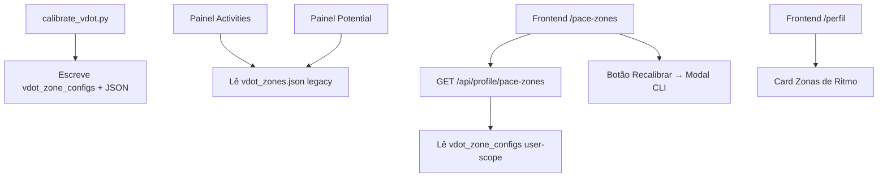

# Pace Zones (VDOT) Design

**Spec**: `.specs/features/pace-zones/spec.md`
**Status**: Draft

---

## Architecture Overview

Esta feature move as zonas VDOT do arquivo JSON para uma tabela dedicada no banco, mantendo o JSON como fallback de compatibilidade para os painéis `activities` e `potential`.



---

## Code Reuse Analysis

### Existing Components to Leverage

| Component | Location | How to Use |
|-----------|----------|------------|
| `HrZoneConfig` model | `backend/app/db/models.py:373` | Template para novo `VdotZoneConfig` |
| `calibrate_vdot.py` | `backend/app/vdot/calibrate_vdot.py` | Atualizar para gravar no banco + JSON |
| `load_zone_config` / `load_calibration` | `backend/app/vdot/zones.py`, `calibration.py` | Painéis legacy continuam usando; novo endpoint usa DB |
| `require_session` + `apiFetch` | `backend/app/auth/deps.py`, `frontend/src/lib/api.ts` | Auth padrão |
| `PanelSection`, `Skeleton` | `frontend/src/components/` | Layout igual `/zonas-fc` |
| `ShoePickerModal` | `frontend/src/components/workouts/ShoePickerModal.tsx` | Base para `RecalibrateModal` |
| Migration pattern | `backend/alembic/versions/` | Nova migration + data migration |

### Integration Points

| System | Integration Method |
|--------|-------------------|
| Backend DB | Nova tabela `vdot_zone_configs` (Alembic migration) |
| Backend API | Novo endpoint `GET /api/profile/pace-zones` no router de perfil |
| Calibração | `calibrate_vdot.py` atualizado para dual-write (DB + JSON) |
| Frontend Router | Nova rota `/pace-zones` em `(app)` + link no `/perfil` |
| Auth | Cookie de sessão via `apiFetch` (padrão existente) |

---

## Components

### Backend: Model `VdotZoneConfig`

- **Purpose**: Tabela dedicada para zonas VDOT por usuário (1 linha vigente)
- **Location**: `backend/app/db/models.py` (novo model)
- **Schema**:
  ```python
  class VdotZoneConfig(Base):
      __tablename__ = "vdot_zone_configs"
      id: int (PK)
      user_id: int (FK users, index)
      vdot: float
      source: str          # "10K em 41:15", "teste 5K", etc.
      test_date: date
      distance_m: float
      time_s: float
      zones: dict          # JSON com as 5 zonas (mesmo shape do vdot_zones.json)
      equivalencias: dict  # JSON {"5K": "3:58/km", ...}
      valid_from: date     # data da calibração
      created_at: datetime
  ```
- **Dependencies**: `Base`, `User`, `mapped_column`, `ForeignKey`, `JSON`, `Date`, `DateTime`
- **Reuses**: Padrão de `HrZoneConfig` (user-scope, effective-dated)

### Backend: Migration + Seed

- **Purpose**: Criar tabela + popular com dado atual do `vdot_zones.json`
- **Location**: `backend/alembic/versions/xxx_create_vdot_zone_configs.py`
- **Interfaces**: `upgrade()` cria tabela + `op.bulk_insert` com dado do JSON
- **Dependencies**: Alembic, `vdot_zones.json` lido em runtime na migration

### Backend: `calibrate_vdot.py` atualizado

- **Purpose**: Gravar calibração no banco (nova tabela) + manter JSON para compatibilidade
- **Location**: `backend/app/vdot/calibrate_vdot.py`
- **Interfaces**: Função `save_calibration_to_db(db, user_id, calibration_data)`
- **Dependencies**: `get_db`, `VdotZoneConfig` model
- **Reuses**: Lógica existente de cálculo (`gerar_zonas`, `calculate_vdot`, `equivalent_time`)

### Backend: `GET /api/profile/pace-zones`

- **Purpose**: Retorna zonas VDOT do banco para o usuário logado
- **Location**: `backend/app/profile/router.py`
- **Interfaces**:
  - `GET /api/profile/pace-zones` → `PaceZonesOut` (Pydantic model inline)
- **Dependencies**: `require_session`, `get_db`, `VdotZoneConfig` model
- **Error**: 500 "zonas VDOT não configuradas" se linha não existe

### Frontend: `PaceZonesPage`

- **Purpose**: Página que exibe VDOT, 5 zonas, equivalências + botão recalibrar
- **Location**: `frontend/src/app/(app)/pace-zones/page.tsx`
- **Interfaces**: `getPaceZones(): Promise<PaceZonesOut>`
- **Dependencies**: `apiFetch`, `PanelSection`, `Skeleton`, `RecalibrateModal`
- **Reuses**: Padrão exato de `/zonas-fc/page.tsx`

### Frontend: `RecalibrateModal`

- **Purpose**: Modal com comando CLI para recalibração
- **Location**: `frontend/src/components/profile/RecalibrateModal.tsx`
- **Interfaces**: `isOpen: boolean`, `onClose: () => void`
- **Dependencies**: Nenhum externo (modal simples)
- **Reuses**: Estrutura visual de modais do app

---

## Data Models

### Backend SQLAlchemy Model

```python
# backend/app/db/models.py
class VdotZoneConfig(Base):
    __tablename__ = "vdot_zone_configs"
    __table_args__ = (
        Index("ix_vdotzoneconfigs_user_valid_from", "user_id", "valid_from"),
    )

    id: Mapped[int] = mapped_column(Integer, primary_key=True)
    user_id: Mapped[int] = mapped_column(ForeignKey("users.id"), default=DEFAULT_USER_ID, index=True)
    vdot: Mapped[float] = mapped_column(Float)
    source: Mapped[str] = mapped_column(String(60))
    test_date: Mapped[date] = mapped_column(Date)
    distance_m: Mapped[float] = mapped_column(Float)
    time_s: Mapped[float] = mapped_column(Float)
    zones: Mapped[dict] = mapped_column(JSON)
    equivalencias: Mapped[dict] = mapped_column(JSON)
    valid_from: Mapped[date] = mapped_column(Date, index=True)
    created_at: Mapped[datetime] = mapped_column(DateTime, default=_utcnow)
```

### Backend API Response (Pydantic inline no router)

```python
class PaceZoneOut(BaseModel):
    key: Literal["easy", "marathon", "threshold", "interval", "repetition"]
    pace_range: str | None = None
    pace: str | None = None
    ms_min: float | None = None
    ms_max: float | None = None
    ms: float | None = None
    description: str

class PaceZonesOut(BaseModel):
    vdot: float
    source: str
    test_date: date
    distancia_metros: float
    tempo_segundos: float
    zones: dict[str, PaceZoneOut]
    equivalencias: dict[str, str]
```

### Frontend TypeScript (`api.ts`)

```typescript
export type PaceZone = {
  key: "easy" | "marathon" | "threshold" | "interval" | "repetition";
  pace_range?: string;
  pace?: string;
  ms_min?: number;
  ms_max?: number;
  ms?: number;
  description: string;
};

export type PaceZonesOut = {
  vdot: number;
  source: string;
  test_date: string;
  distancia_metros: number;
  tempo_segundos: number;
  zones: Record<"easy" | "marathon" | "threshold" | "interval" | "repetition", PaceZone>;
  equivalencias: Record<string, string>;
};

export async function getPaceZones(): Promise<PaceZonesOut> {
  const res = await apiFetch("/api/profile/pace-zones", { cache: "no-store" });
  if (!res.ok) throw await parseError(res);
  return (await res.json()) as PaceZonesOut;
}
```

---

## Error Handling Strategy

| Error Scenario | Handling | User Impact |
|----------------|----------|-------------|
| Tabela sem linha para user | Backend: 500 "zonas VDOT não configuradas" | Frontend: tela erro com mensagem |
| Calibração falha escrita DB | Transação rollback, exceção propagada | CLI: erro visível; JSON não atualizado |
| Usuário não autenticado | `apiFetch` redirecta `/login?next=/pace-zones` | Login page |
| Migration seed falha | Migration falha, rollback automático Alembic | Deploy bloqueado |

---

## Risks & Concerns

| Concern | Location | Impact | Mitigation |
|---------|----------|--------|------------|
| Painéis `activities`/`potential` ainda leem JSON | `activities/router.py`, `potential/router.py` | Dessincronização se calibrar e JSON não atualizar | `calibrate_vdot.py` faz dual-write (DB + JSON) |
| Migration data seed lê arquivo em runtime | Alembic migration | Falha se arquivo movido/renomeado | Ler caminho via `get_settings().vdot_zones_path` |
| Tabela órfã `ZoneConfig` (zones) existe | `models.py:208` | Confusão futura | Documentar que `vdot_zone_configs` é a correta; `ZoneConfig` deprecated |
| Dual-write calibração pode falhar meio termo | `calibrate_vdot.py` | JSON e DB dessincronizados | Transação única no DB; JSON escrito por último (append-only) |

---

## Tech Decisions

| Decision | Choice | Rationale |
|----------|--------|-----------|
| Nova tabela vs. reativar `ZoneConfig` | Nova `vdot_zone_configs` | `ZoneConfig` tem schema genérico (zones: JSON); VDOT precisa campos estruturados (vdot, source, test_date, equivalencias) |
| Single row per user vs. histórico | Single row (upsert on calibrate) | MVP simples; histórico é P3 futuro |
| Dual-write JSON + DB na calibração | Sim | Painéis legacy não quebram; migração gradual |
| Endpoint no router de perfil | Sim | User-scope, agrupa com `/hr-zones`, `/garmin-connection` |
| Ícone "Zonas de Ritmo" | SVG stopwatch/relógio (⏱️) | Diferencia de coração (FC) e tênis |

---

## Follow-up Work (Out of Scope for This Feature)

| Item | Description | Priority |
|------|-------------|----------|
| Migrar `activities` para ler VDOT do banco | `activities/router.py` e `service.py` usam `load_zone_config(path)` → mudar para query `VdotZoneConfig` user-scope | P2 |
| Migrar `potential` para ler VDOT do banco | `potential/router.py` usa `load_calibration(path)` → mudar para query `VdotZoneConfig` user-scope | P2 |
| Remover `vdot_zones.json` legacy | Após migração completa dos painéis, arquivo pode ser removido + `calibrate_vdot.py` para de fazer dual-write | P3 |
| Deprecar tabela órfã `ZoneConfig` (`zones`) | Modelo não usado; remover ou renomear para evitar confusão | P3 |

> **Project-level decisions**: Nenhuma decisão nova que afete outras features.