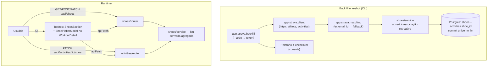

# Tênis no Ritmo — Design

**Spec**: `.specs/features/tenis/spec.md`
**Context**: `.specs/features/tenis/context.md`
**Status**: Draft

---

## Architecture Overview

Três frentes independentes sobre o mesmo modelo de dados: (1) módulo
`app/shoes` no padrão dos domínios existentes (CRUD + km derivada), (2)
domínio novo `app/strava` com backfill one-shot via CLI — sem endpoint, sem
token persistido, sem integração viva —, (3) frontend com seção em Treinos e
modal no detalhe da atividade.



Ordem de entrega travada na spec: backend → backfill → UI → modal. A análise
comparativa é outra feature (ver context.md, Deferred Ideas).

---

## Code Reuse Analysis

### Existing Components to Leverage

| Component | Location | How to Use |
| --------- | -------- | ---------- |
| Padrão de módulo de domínio | `app/profile/router.py` + `app/activities/` | Replicar: `APIRouter(prefix="/api/shoes")`, endpoints `Depends(require_session)` + `Depends(get_db)`, um `db.commit()` por endpoint, HTTPException 404/422 |
| Padrão de service | `app/activities/service.py` | Funções puras `(db, user_id, ...) -> dict`, `select()` SQLAlchemy 2.0 |
| Modelo template | `Race` em `app/db/models.py` | User-scoped simples; FK user com index |
| UniqueConstraint com nome | `Sleep`/`PersonalRecord` | `uq_shoe_user_strava` em `__table_args__` |
| Migração idempotente | `engine.py::_migrate_schema` | Extender — requer refator (ver Risks #1) |
| CLI | `app/garmin/import_tokens.py` | argparse + `SessionLocal()` + exceção de domínio + `sys.exit(1)` + docstring com usage |
| Retry/backoff | `app/garmin/client.py::_call` | Mesmo espírito (2,4,8 s), adaptado ao httpx no módulo strava |
| Isolamento | `app/auth/deps.py::require_session` | Nunca `DEFAULT_USER_ID` em query — sempre `user.id` da sessão |
| Testes | `conftest.py::session_client`, `test_user_isolation.py::_seed_other_user` | Matriz happy + 422 + 404 + 401 + A×B |
| Fetch tipado | `frontend/src/lib/api.ts` | Novas funções + types espelhando pydantic |
| Padrão de painel | `components/home/HomePanel.tsx` (PanelState union + Skeleton), `PanelSection.tsx` | ShoesSection copia o padrão loading/error/empty/ready |
| Detalhe | `components/workouts/WorkoutDetail.tsx` | Onde vive o gatilho do modal e o badge do tênis |

### Integration Points

| System | Integration Method |
| ------ | ------------------ |
| Strava API v3 | httpx (já é dependência direta do backend — zero deps novas): `GET /athlete`, `GET /athlete/activities` (per_page=200, pagina até vazio, filtra `type=="Run"`) |
| Postgres | Tabela nova `shoes` (create_all) + `activities.shoe_id` (migração ad-hoc) |
| API existente | `GET /api/activities/{id}` detail ganha campo `shoe` — o modal precisa saber o estado atual |
| Frontend | `next.config.ts` rewrite same-origin → `apiFetch` (`lib/api.ts`) |

---

## Components

### Backend — `Shoe` model + migração

- **Purpose**: Estrutura de dados user-scoped e a emenda idempotente de `activities.shoe_id`.
- **Location**: `app/db/models.py` + `app/db/engine.py`
- **Interfaces**:
  - `class Shoe(Base)` — colunas: `id`, `user_id` (FK users.id, index), `name` String(200) NOT NULL, `brand` String(100) NULL, `model` String(200) NULL, `acquired_date` Date NULL, `initial_km` Float NOT NULL default 0.0, `max_km` Float NULL, `status` String(20) NOT NULL default "ativo", `strava_gear_id` String(64) NULL, `created_at` DateTime default `_utcnow`. `__table_args__ = (UniqueConstraint("user_id", "strava_gear_id", name="uq_shoe_user_strava"),)`
  - `Activity.shoe_id: int | None` — FK `shoes.id` com `ondelete="SET NULL"` (padrão `Evaluation.activity_id`), index
  - `_migrate_schema()` — refatorado em blocos independentes por tabela: `_migrate_users_columns()` (existente, extraído sem mudança de comportamento) e `_migrate_activities_shoe_id()` (condicional à coluna: `ALTER TABLE activities ADD COLUMN shoe_id INTEGER` + `CREATE INDEX ix_activities_shoe_id`)
- **Dependencies**: nenhuma nova
- **Reuses**: padrão `Race`/`Sleep`; espírito AD-019 (idempotente, zero deps)

### Backend — `app/shoes/service.py`

- **Purpose**: Regras de tênis: CRUD, km derivada, associação atividade↔tênis.
- **Location**: `app/shoes/service.py`
- **Interfaces**:
  - `list_shoes(db, user_id) -> list[dict]` — UMA query agregada: `select(Shoe, count(Activity.id), coalesce(sum(Activity.distance_m), 0), max(Activity.start_time))` com outerjoin `Activity.shoe_id == Shoe.id`, group by `Shoe.id`. Cada item: campos do shoe + `current_km = initial_km + soma`, `run_count`, `last_use`, `life_pct` (None quando `max_km` ausente). Ordenação: ativos primeiro, depois `last_use` desc.
  - `create_shoe(db, user_id, data) -> dict` — valida `name` não vazio, `initial_km >= 0`, `status in {"ativo","aposentado"}`; `user_id` explícito (nunca o default do modelo)
  - `update_shoe(db, user_id, shoe_id, patch) -> dict | None` — None quando não existe/é de outro usuário
  - `associate(db, user_id, activity_id, shoe_id) -> dict` — valida atividade (posse + `activity_type in RUNNING_TYPES`), valida tênis (posse); grava `shoe_id`. Erros via `class AssociationError(Exception)` com `code`: `activity_not_found` → 404, `not_running` → 422, `shoe_not_found` → 404, `shoe_not_owned` → 404
- **Dependencies**: models, `RUNNING_TYPES` de `app.garmin.mappers`
- **Reuses**: padrão de service puro de `activities/service.py`; exceção de domínio de `profile/service.py` (`MetricValidationError`)

### Backend — `app/shoes/router.py`

- **Purpose**: API de tênis.
- **Location**: `app/shoes/router.py`
- **Interfaces**:
  - `router = APIRouter(prefix="/api/shoes")` com rotas `GET ""`, `POST ""`, `PATCH "/{shoe_id}"`
  - Schemas pydantic inline (padrão `activities/router.py`): `ShoeCreateIn {name, brand?, model?, acquired_date?, initial_km?, max_km?, status?}`, `ShoeUpdateIn` (todos opcionais, `status` validado), `ShoeOut` (todos os campos + `current_km`, `run_count`, `last_use`, `life_pct`)
- **Dependencies**: `require_session`, `get_db`, service
- **Reuses**: padrão de router do projeto; registro em `main.py` como `include_router(shoes_router, dependencies=[Depends(require_session)])`

### Backend — Associação no domínio de atividades

- **Purpose**: Endpoint de associação pós-atividade (alimentado pelo modal).
- **Location**: `app/activities/router.py` + `app/activities/service.py`
- **Interfaces**:
  - `PATCH /api/activities/{activity_id}/shoe` com body `ShoeAssignmentIn {shoe_id: int | None}` → resposta `{shoe: ShoeSummaryOut | None}`
  - `ShoeSummaryOut {id, name, brand, model, status}` (pydantic inline)
  - `get_activity_detail` ganha campo `shoe: dict | None` (join simples por `shoe_id` — alimenta o badge e o gatilho do modal)
- **Dependencies**: `shoes/service.associate` (regra), activities/service (fetch)
- **Reuses**: rota já protegida por include; `RUNNING_TYPES` importado

### Backend — `app/strava/` (domínio novo)

- **Purpose**: Backfill one-shot do histórico do Strava, aposentado após a execução (TEN-D2).
- **Location**: `app/strava/client.py`, `app/strava/matching.py`, `app/strava/backfill.py`
- **Interfaces**:
  - `client.py` — `exchange_code(client_id, client_secret, code) -> str` (token); `fetch_athlete_shoes(token, http: httpx.Client | None) -> list[dict]`; `fetch_run_activities(token, http: httpx.Client | None) -> list[dict]` (pagina até vazio, filtra `type == "Run"`, devolve `{id, external_id, gear_id, distance, moving_time, start_date}`). Backoff exponencial `(2, 4, 8)` em 429/5xx, até 3 tentativas, depois aborta (seam `http` injetável para teste)
  - `matching.py` (funções puras) — `garmin_id_from_external_id(external_id) -> str | None` (regex `^garmin_push_(\d+)$`); `find_match(strava_activity, candidates: list[dict]) -> int | None | "ambiguous"` (fallback: `|Δdistance| ≤ 2%` e `|Δmoving_time| ≤ 2%` e `|Δstart| ≤ 5h` — os 5h cobrem o fuso GMT→wall clock local de runs noturnas; 0 ou 2+ candidatos → `"ambiguous"` nunca casa)
  - `backfill.py` — CLI `python -m app.strava.backfill [--code CODE | --token TOKEN] [--user-id 1] [--yes]`: resolve token → busca shoes + runs → upsert por `strava_gear_id` → para cada run com `gear_id`, casa e associa retroativamente → `initial_km = max(0, km_strava − Σ(casadas))` → **commit único no fim** (tudo-ou-nada; re-executar é idempotente por construção) → imprime relatório (tênis criados/atualizados, km, casadas/sem match/sem gear_id, checksum `initial_km + Σ casadas + não alocada = total Strava`). Preview + confirmação via `input()` a menos que `--yes`. Docstring com o passo-a-passo do OAuth manual (criar app em strava.com/settings/api, escopos `profile:read_all,activity:read_all`, URL de autorização com redirect localhost)
- **Dependencies**: `httpx` (já dep direta), `STRAVA_CLIENT_ID`/`STRAVA_CLIENT_SECRET` em `core/config.py` (padrão 100% env), `SessionLocal`
- **Reuses**: padrão CLI de `import_tokens.py`; espírito de retry de `garmin/client.py`

### Frontend — API client

- **Purpose**: Ponta tipada do frontend.
- **Location**: `frontend/src/lib/api.ts`
- **Interfaces**: types `Shoe`, `ShoeCreate`, `ShoeUpdate`, `ShoeSummary`; funções `getShoes()`, `createShoe(body)`, `updateShoe(id, body)`, `setActivityShoe(activityId, shoeId | null)`; `ActivityDetail` ganha `shoe: ShoeSummary | null`
- **Reuses**: `apiFetch`, `parseError`, `cache: "no-store"`

### Frontend — `ShoesSection`

- **Purpose**: Gestão de tênis na página Treinos.
- **Location**: `frontend/src/components/workouts/ShoesSection.tsx` ("use client"), montada no fim de `frontend/src/app/(app)/treinos/page.tsx`
- **Interfaces**: `PanelState` union (loading/error/empty/ready) no padrão HomePanel; grid de cards `rounded-card border border-border bg-card` com barra de vida (marcos 75%/90%), status, último uso, contagem; criar/editar inline num form (sugere `max_km=800` na criação); aposentar com `confirm()`; badge de higiene (TEN-28, P3): % de corridas com tênis nos últimos 30 dias
- **Reuses**: `PanelSection.tsx`, `Skeleton.tsx`, `formatKm`/`formatDateTime` de `lib/format.ts`

### Frontend — `ShoePickerModal` + integração no detalhe

- **Purpose**: Garantir dado novo sempre com tênis (TEN-17..20).
- **Location**: `frontend/src/components/workouts/ShoePickerModal.tsx` (novo — não existe modal reutilizável no projeto) + `WorkoutDetail.tsx`
- **Interfaces**:
  - Modal: overlay `fixed inset-0 z-50` + `backdrop-blur` (referência visual: TabBar); lista ordenada por (a) padrão do tipo — `localStorage["shoe-default-by-type"][inferredType]` e (b) `last_use` desc; ações: escolher (um toque), "Definir como padrão para [tipo]", "Agora não"
  - `WorkoutDetail`: quando `detail.shoe == null` e a atividade é corrida → renderiza o modal; `useRef` guarda "já perguntou nesta visita" (dispensa não reabre); após associar, refetch do detail e badge `shoe.name` no header; tênis aposentados visíveis em seção separada do modal (atribuição retroativa legítima)
- **Dependencies**: `setActivityShoe`, `getShoes`, `infer_type` já presente no payload do detail
- **Reuses**: padrão de fetch/refresh do WorkoutDetail (flag `cancelled`), estilo de pills/cards do sistema v0.3

---

## Data Models

### `Shoe` (SQLAlchemy → Postgres `shoes`)

```python
class Shoe(Base):
    __tablename__ = "shoes"
    __table_args__ = (UniqueConstraint("user_id", "strava_gear_id", name="uq_shoe_user_strava"),)
    id: int (PK)
    user_id: int (FK users.id, index)
    name: str (String(200), NOT NULL)
    brand: str | None (String(100))
    model: str | None (String(200))
    acquired_date: date | None
    initial_km: float (NOT NULL, default 0.0)
    max_km: float | None
    status: str (String(20), NOT NULL, default "ativo")  # ativo | aposentado
    strava_gear_id: str | None (String(64))  # múltiplos NULL ok no unique do Postgres
    created_at: datetime (default _utcnow)
```

**Relationships**: `Activity.shoe_id → shoes.id` (`ondelete="SET NULL"`, index).
A km acumulada **não é coluna** — derivada: `initial_km + Σ activities.distance_m`.

### Payloads (pydantic ↔ TS)

`ShoeOut`: campos do shoe + `current_km: float`, `run_count: int`,
`last_use: datetime | None`, `life_pct: float | None`.
`ShoeSummaryOut`/`ShoeSummary`: `{id, name, brand, model, status}`.

---

## Error Handling Strategy

| Error Scenario | Handling | User Impact |
| -------------- | -------- | ----------- |
| Sem sessão (401) | `require_session` por include + por endpoint (padrão do projeto) | Redirect para `/login` (apiFetch) |
| Tênis/atividade de outro usuário | Query sempre com `user_id` da sessão; inexistente → 404 textual no padrão | `{"detail": "tênis não encontrado"}` |
| Payload inválido (nome vazio, `initial_km < 0`, status inválido) | Validação no service + pydantic → 422 | Mensagem por campo, padrão hr-zones |
| Associação em atividade não-corrida | `AssociationError(code="not_running")` → 422 | Mensagem clara; o modal nunca abre para não-corridas |
| Strava 429/5xx | Backoff (2,4,8 s), 3 tentativas, abort com relatório parcial | Re-executar o CLI retoma do zero (idempotente) |
| Token inválido/expirado | Abort antes de qualquer escrita (commit único) | Mensagem explica renovar `--code` |
| Runs Strava sem `gear_id` ou sem match | Não associadas; reportadas como km não alocada | Nada inventado; atribuição retroativa manual via modal |
| Match ambíguo | Não casa; listado no relatório | Sem associação errada |
| Strava com runs privadas fora do escopo | `activity:read_all` cobre; se o usuário recusar o escopo, o checksum acusa o gap | Relatório mostra a diferença |

---

## Risks & Concerns

| Concern | Location | Impact | Mitigation |
| ------- | -------- | ------ | ---------- |
| `_migrate_schema` atual tem early-return (`if "email" in columns: return`) | `app/db/engine.py:68` | Bloqueia a migração nova de `activities.shoe_id` em bases já migradas | Refatorar em blocos independentes por tabela (`_migrate_users_columns` + `_migrate_activities_shoe_id`), cada um condicional ao próprio objeto — T1 da fase de tasks |
| `user_id` FK com `default=DEFAULT_USER_ID` (armadilha do modelo) | `app/db/models.py` (padrão das tabelas) | Service que esquecer de setar grava para o usuário 1 silenciosamente | `create_shoe` recebe e seta `user_id` explícito; teste A×B cobre |
| N+1 na listagem de tênis | novo `shoes/service.py` | 1 query por tênis a cada GET com histórico grande | Agregação em query única (outerjoin + group by) |
| Fuso no matching fallback (`start_date` GMT vs `start_time` wall clock local) | `app/strava/matching.py` | Runs noturnas casariam no dia "errado" | Janela de 5h cobre o fuso -3; ambiguidade nunca casa |
| Sem componente modal reutilizável | `frontend/src/components/` | Modal do zero pode fugir do sistema visual v0.3 | Copiar linguagem do TabBar (overlay + backdrop-blur) e dos cards/pills |
| Frontend sem suite de testes | `frontend/` | Tasks de UI sem gate de teste automatizado | Gate das tasks de frontend = `npm run build` (type check) + verificação manual listada na task |
| `external_id` ausente/não-garmin em runs subidas manualmente no Strava | API Strava | Sem a chave primária de matching | Fallback heurístico + relatório de não-casadas |
| Dupla contagem de km se snapshot + decomposição divergirem | `backfill.py` | Km final errada | `initial_km = km_strava − Σ(casadas)` por construção + checksum no relatório (TEN-27) |
| `--user-id` default 1 no CLI | `backfill.py` | Multi-user futuro associa no user errado | Flag explícita; docstring documenta |

---

## Tech Decisions

| Decision | Choice | Rationale |
| -------- | ------ | ---------- |
| Backfill como CLI, não endpoint | `python -m app.strava.backfill` | Travado na spec (TEN-D2): one-shot, token não persistido, sem superfície de API para algo aposentado |
| HTTP do Strava | `httpx` (já é dependência direta) | Zero dependências novas; seam injetável para testes |
| Transação do backfill | Commit único no fim (tudo-ou-nada) | Abort = estado consistente; idempotência natural da re-execução |
| Rota de associação | `PATCH /api/activities/{id}/shoe` no activities/router, regra no shoes/service | A rota é do recurso atividade; a regra é do domínio tênis |
| `ondelete` de `shoe_id` | SET NULL | Sem DELETE de tênis na API, mas protege se algum dia houver |
| Tolerância do fallback de matching | distance ±2%, moving_time ±2%, start ±5h | ±2% é robusto a GPS noise; 5h cobre fuso GMT→local sem abrir mão da regra "ambíguo nunca casa" |
| "Padrão por tipo de treino" | localStorage (hint de UI) + `last_use` do backend | Preferência de interação do dispositivo, não dado de domínio; zero API extra |
| Km derivada | Agregada no `list_shoes` (não coluna) | Reatribuição recalcula sozinha (TEN-D4); sem drift |
| Gate das tasks de frontend | `npm run build` | Sem suite JS no projeto; build valida types e compilação |

> Nenhuma Tech Decision aqui é project-level (todas feature-local): o log
> `## Decisions` de `.specs/STATE.md` permanece vazio. Se "backfill one-shot de
> fonte externa via CLI" virar padrão para outras integrações futuras, aí sim
> vira AD.
