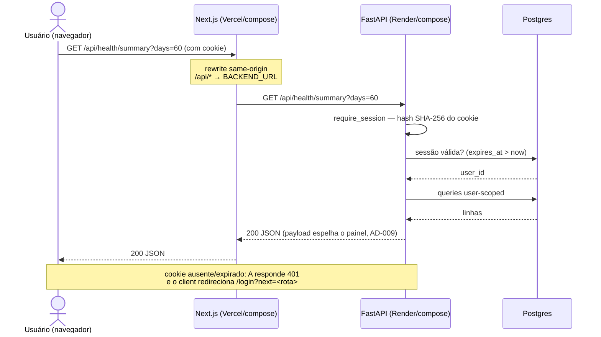
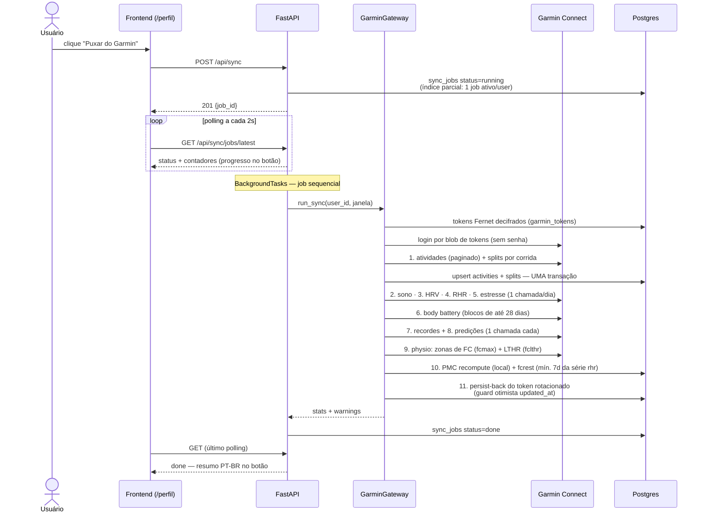
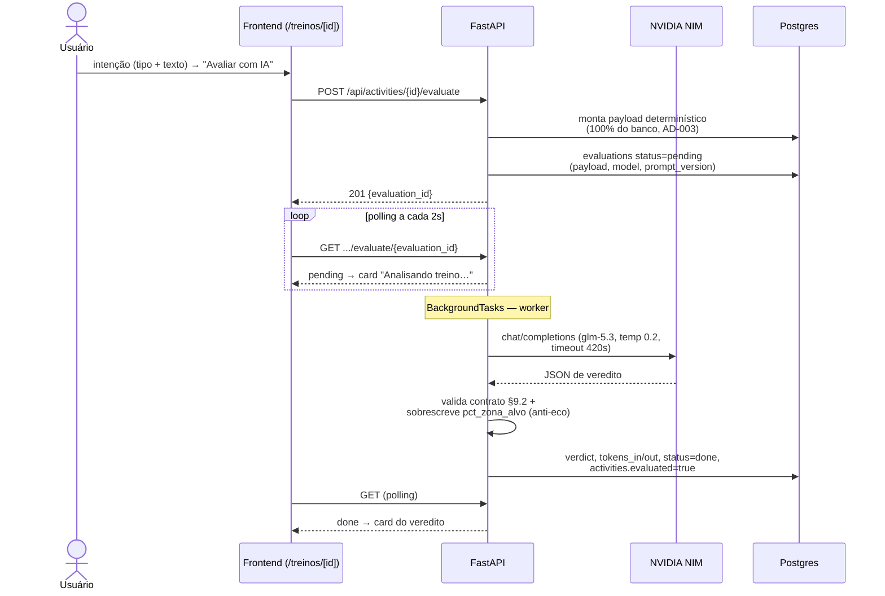
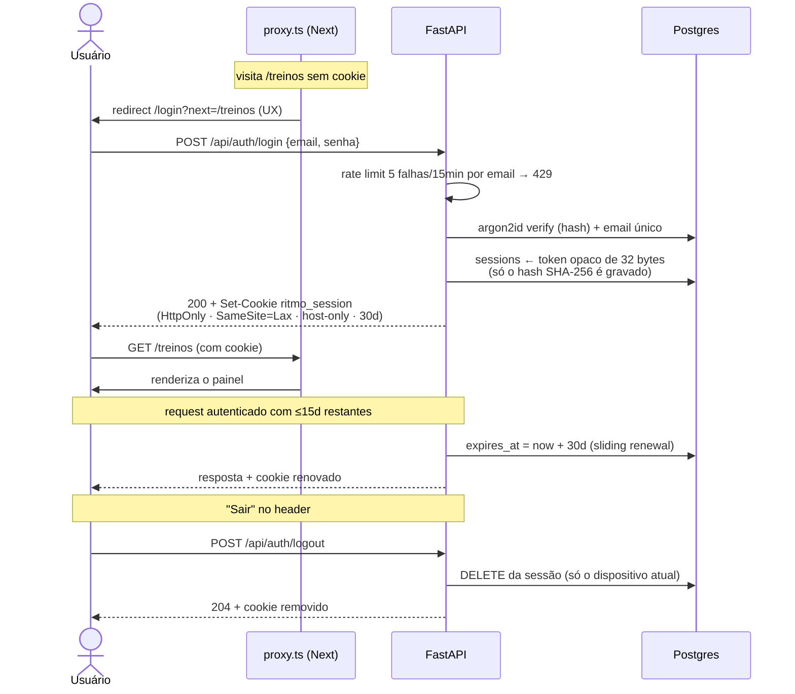

# Arquitetura — Fluxos

Quatro fluxos explicam o tempo de vida de cada ação importante do sistema.
As state machines de sync e avaliação estão nas páginas de
[Sync Garmin](../backend/garmin-sync.md) e [Avaliação com IA](../backend/avaliacao-ia.md).

## 1. Request de painel (transporte same-origin, AD-020)

Todo fetch do frontend usa base relativa (`API_BASE = ""`). O Next entrega
em `BACKEND_URL` — o cookie de sessão vale para o host que o usuário abriu,
e o CORS deixa de ser requisito do fluxo normal.

## 2. Sync do Garmin

O job roda em `BackgroundTasks` — o client recebe `201` na hora e polla o
status a cada 2s. Fases em sequência rígida (nunca concorrentes):

Casos de erro (o job nunca fica mudo):

- **Token expirado** (401): nenhuma tentativa de retry — job `error` com
  `reauth_needed: true`; o botão vira **Reconectar Garmin** com a
  instrução da CLI (a UI nunca pede credenciais, AD-014).
- **Teto de chamadas** (`SYNC_MAX_CALLS`) ou falha persistente: job
  `error` com o motivo.
- **Falha de um tipo de saúde**: vira warning em `stats_json` e o job
  segue (a fase 1 — atividades — é a única crítica: falha nela =
  rollback integral).
- **Restart do backend**: `recover_stale_jobs()` no startup marca jobs
  órfãos como `error` ("interrompido por restart").

## 3. Avaliação com IA

O POST grava a linha `pending` e responde `201` na hora; a NIM roda em
background e o client polla a cada 2s.

Falhas viram `status=error` **com o motivo gravado na linha** (timeout,
429, JSON fora do contrato) — a tentativa nunca se perde, e não há retry
automático (cada pedido custa tokens). Re-avaliar cria linha nova; o
card mostra sempre a mais recente e o histórico lista as anteriores.

## 4. Login e sessão (stateful, AD-018)

Três camadas de proteção, uma autoridade: o `proxy.ts` otimista (redirect
de UX antes de render), o `apiFetch` do client (401 em uso →
`/login?next=`) e o `require_session` do backend — **a única que decide**.
