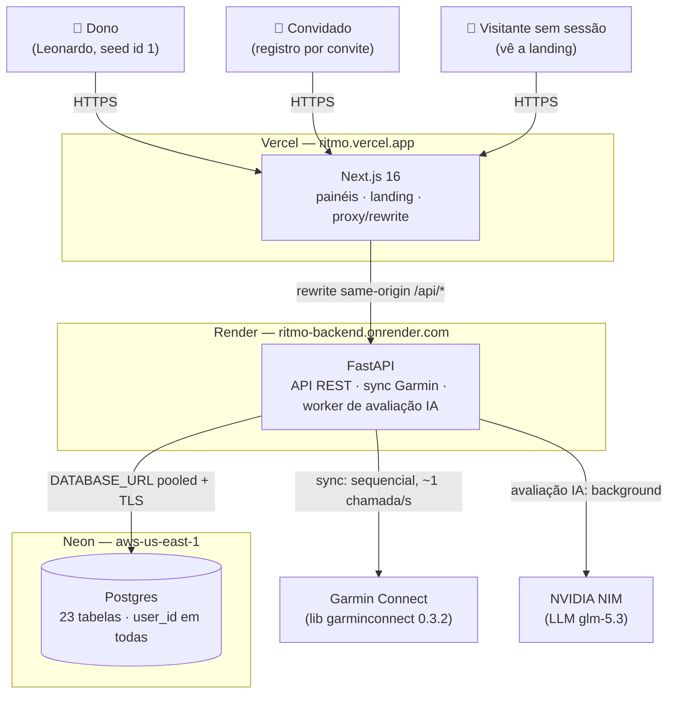
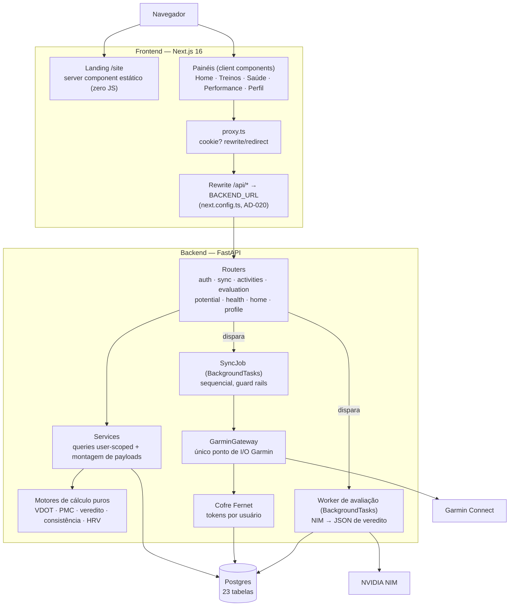

# Arquitetura — Visão Geral

Como o Ritmo é montado: as peças, quem conversa com quem e os princípios
que travam o desenho. O detalhe de cada peça mora nas seções
[Backend](../backend/visao-geral.md) e [Frontend](../frontend/visao-geral.md).

## Contexto do sistema



O mesmo desenho roda local pelo `docker-compose.yml` — os artefatos são
idênticos (Dockerfile do backend, build standalone do Next): muda só quem
hospeda cada peça.

## Containers



Duas formas de escrita existem no backend — ambas partem de um endpoint:

| | Sync do Garmin | Avaliação com IA |
|---|---|---|
| Gatilho | botão **Puxar do Garmin** (`POST /api/sync`) | botão **Avaliar com IA** (`POST /api/activities/{id}/evaluate`) |
| Execução | `BackgroundTasks` — job sequencial | `BackgroundTasks` — worker único |
| Fonte dos dados | API do Garmin → upserts idempotentes | banco próprio → payload determinístico → NIM |
| Resposta ao client | `201` imediato + polling do job | `201` imediato + polling da avaliação |

Tudo o que os painéis exibem é **leitura do banco** — nenhuma navegação
toca o Garmin.

## Princípios que travam a solução

1. **O banco é a fonte de leitura** — a UI lê exclusivamente do Postgres
   próprio; o Garmin só é chamado pelo botão de sync (AD-002). Navegar nos
   painéis = zero chamadas externas.
2. **Sync é o único caminho de escrita Garmin, e é sequencial** — nunca
   paralelo (rate limit + re-auth MFA são o risco), com teto de chamadas,
   intervalo mínimo e retries com backoff. Ver
   [Sync Garmin](../backend/garmin-sync.md).
3. **Python calcula, o LLM só interpreta** (AD-003) — zero alucinação de
   número: zonas, consistência, PMC e VDOT vêm de código determinístico e
   testável; a IA devolve um JSON de veredito validado contra contrato.
4. **User-scope em toda query** — toda tabela carrega `user_id`; toda
   leitura/escrita usa o usuário da sessão (isolamento A×B testado
   ponta a ponta).
5. **Config 100% por env vars** — nada hardcoded; sem a chave de
   criptografia o backend nem sobe (fail-fast).
6. **API autoritativa, proxy otimista** (AD-018) — o FastAPI valida a
   sessão e responde 401; o `proxy.ts` do Next olha só a presença do
   cookie para decidir UX (redirect/rewrite), nunca valida token.
7. **Transporte same-origin** (AD-020) — o Next reescreve `/api/*` para o
   backend; o cookie vale para o host que o usuário abriu (LAN, localhost
   e produção funcionam igual).
8. **Schema sem Alembic na v1** (AD-019) — `create_all` + ALTERs
   idempotentes condicionais no `init_db`; deploy = migration.
9. **Identidade visual v0.3 como fundação** (AD-022) — tokens dark+lime,
   tab bar no mobile, "contexto em neutro, um único destaque lime" nos
   gráficos.

## Camadas do backend

```text
HTTP      main.py — lifespan (fail-fast, init_db, recovery de jobs)
            + CORS + includes dos routers com require_session
Routers     validação pydantic → 422 PT-BR, códigos HTTP, zero regra
Services    queries user-scoped, transações, montagem de payloads AD-009
Motores     funções puras determinísticas (vdot/, pmc, infer, metrics,
            home/calc, health/calc, potential/calc, profile/calc)
I/O         GarminGateway (única porta p/ lib garminconnect)
            nim.py (cliente NIM httpx)
Escrita     upserts idempotentes por chave natural
            tokens_store (cofre Fernet)
```

## Ambientes

| | Produção | Local (compose) |
|---|---|---|
| Frontend | Vercel (`next build` nativo) | container `frontend` :3000 (build standalone) |
| Backend | Render (Docker do `backend/Dockerfile`) | container `backend` :8000 |
| Postgres | Neon pooled (`-pooler`, TLS) | `postgres:16` :5432 (bancos `ritmo` + `ritmo_test`) |
| Transporte | `BACKEND_URL` = URL pública do Render | `BACKEND_URL` = `http://backend:8000` |
| Sessão | cookie `Secure` (HTTPS ponta a ponta) | cookie sem `Secure` (HTTP LAN) |

Detalhes: [Produção](../infra/deploy.md) e [Ambiente local](../infra/local.md).
