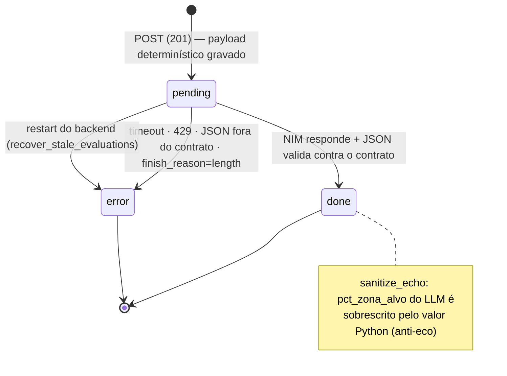

# Backend — Avaliação com IA

Avaliação de corrida sob demanda, no detalhe do treino. O desenho é a
AD-003: **Python calcula todos os números deterministicamente; o LLM só
interpreta** — zero alucinação de número, auditoria completa por linha.

## Fluxo

`POST /api/activities/{id}/evaluate` valida rápido (`503` sem
`NVIDIA_API_KEY` → `422` não-corrida → `404`), monta o payload, grava a
linha `evaluations.status=pending` e responde `201` **na hora**. A NIM é
consumida por um worker em `BackgroundTasks` (o mesmo padrão do sync) e
o frontend polla o status a cada 2s.



**A tentativa nunca se perde**: qualquer falha vira `status=error` com o
motivo gravado na coluna `error` (ex.: `finish_reason=length`, `HTTP 429`)
— o card de erro na UI mostra a causa. Sem retry automático: cada pedido
custa tokens e é explícito. Re-avaliar cria **linha nova** (nunca
sobrescreve); a mais recente é o card, as anteriores ficam no histórico.

## Payload determinístico (`app/evaluation/payload.py`)

100% do banco — o LLM nunca calcula. Blocos (vazio é omitido, nunca
inventado):

| Bloco | Conteúdo |
|---|---|
| `intencao` | tipo declarado (7 tipos, prefill do inferido) + texto livre |
| `resumo` | distância, duração, pace, FC, elevação |
| `voltas` | splits classificados por zona VDOT pessoal |
| `tempo_por_zona_pct` | distribuição por zona |
| `zona_alvo` | por intenção: fácil→easy · tempo/limiar→threshold · intervalado→interval · longão→easy∪marathon · progressivo/prova→null |
| `consistencia` | equilíbrio de metades, drift cardíaco, decoupling, fade de cadência |
| `contexto` | sono, HRV, RHR, temperatura média das voltas do dia do treino |
| `carga_do_dia` | CTL/ATL/TSB/ACWR |
| `zonas` | meta das zonas VDOT |
| `vdot` | do `vdot_zones.json` calibrado |
| `lthr_bpm` | **fclthr vigente do usuário na data do treino** (effective-dated, AD-021); fallback `LTHR_BPM` do env |
| `zonas_fc` | tempo por zona de FC com as zonas vigentes na época |
| `prs` | recordes **datados** |
| `padroes` | patterns ativos do usuário |

## NIM (`app/evaluation/nim.py`)

Cliente `httpx` direto para `{NVIDIA_BASE_URL}/chat/completions`
(OpenAI-compatível), Bearer `NVIDIA_API_KEY`, `temperature=0.2`,
`max_tokens=16000`, timeout `NVIDIA_TIMEOUT_S` (420s default — o glm-5.3
é raciocinador e passa de 120s). Erros canônicos: `NimError` /
`NimTimeout` / `NimInvalidJSON` (inclui `content=null` de
`finish_reason=length`). Cercas de markdown na resposta são aceitas e
descascadas.

## Veredito (contrato §9.2)

5 vereditos possíveis: `on_target` · `too_hard` · `too_easy` ·
`context_explained` · `fatigue_signal`. JSON validado campo a campo
(`app/evaluation/schemas.py`):

```json
{
  "veredito": "on_target",
  "headline": "…",
  "execucao_vs_intencao": {"pct_zona_alvo": 87.5, "principais_desvios": ["…"]},
  "o_que_funcionou": ["…"],
  "corrigir_prox_vez": ["…"],
  "contexto_relevante": ["…"],
  "confianca": "alta"
}
```

Extras são ignorados; obrigatório ausente rejeita (vira `error` com
motivo). O **`pct_zona_alvo` do card é sempre o calculado em Python** —
o eco do LLM é sobrescrito antes de gravar.

## Auditoria

Cada linha carrega `model`, `prompt_version` (`v1`), `tokens_in`,
`tokens_out` e o **payload inteiro** (`payload_json`) — custo e
reprodutibilidade por avaliação (AD-003).

## Config

| Env | Default | Efeito |
|---|---|---|
| `NVIDIA_API_KEY` | *(vazio)* | vazio → botão responde `503` |
| `NVIDIA_MODEL` | `z-ai/glm-5.3` | o flash `z-ai/glm-5.3-flash` é a opção rápida |
| `NVIDIA_TIMEOUT_S` | `420` | timeout da chamada |
| `NVIDIA_BASE_URL` | `https://integrate.api.nvidia.com/v1` | endpoint NIM |

Nos testes a NIM é 100% mockada (`httpx.MockTransport`) — nenhum teste
paga tokens.
