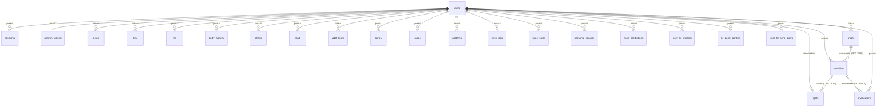

# Backend — Banco de Dados

Postgres 16 — **23 tabelas**, todas declaradas em `backend/app/db/models.py`.
O schema nasce de `Base.metadata.create_all` dentro de `init_db()`
(`app/db/engine.py`): sem Alembic na v1 (AD-019), migrações são **ALTERs
idempotentes condicionais** checando `information_schema.columns` — deploy
= migration.

Convenções: `user_id` FK → `users.id` em **toda** tabela (AD-001, default
`DEFAULT_USER_ID = 1`); `DateTime` naive-UTC; `created_at` default utcnow;
chaves naturais viram `UniqueConstraint` — são as chaves de upsert do sync.

## Mapa de relacionamentos

## Identidade e sessão

### `users`
| Coluna | Tipo | Constraints |
|---|---|---|
| `id` | int | PK |
| `display_name` | String(120) | — |
| `email` | String(255) | **unique**, nullable (o seed id 1 nasce sem email) |
| `password_hash` | String(255) | nullable — PHC argon2id |
| `created_at` | DateTime | default utcnow |

### `sessions`
| Coluna | Tipo | Constraints |
|---|---|---|
| `id` | int | PK |
| `user_id` | FK users | **ondelete CASCADE**, index |
| `token_hash` | String(64) | **unique + index** — SHA-256 do cookie |
| `expires_at` | DateTime | index |
| `created_at` | DateTime | default |

## Treinos

### `activities`
| Coluna | Tipo | Constraints |
|---|---|---|
| `id` | int | PK |
| `user_id` | FK users | index, default 1 |
| `garmin_id` | String(64) | **unique + index** (chave de upsert) |
| `start_time` | DateTime | index |
| `activity_type` | String(30) | index (`running`, `trail_running`, …) |
| `name` | String(200) | — |
| `distance_m` / `duration_s` | Float | — |
| `avg_hr` / `max_hr` / `feel` / `rpe` | int | nullable |
| `avg_cadence` / `power` / `elevation_gain_m` / `aerobic_te` / `anaerobic_te` / `training_load` | Float | nullable |
| `shoe_id` | FK shoes | **ondelete SET NULL**, nullable, index |
| `raw_json` | JSON | nullable — payload original preservado |
| `evaluated` | Boolean | default False (acende com veredito `done`) |
| `created_at` | DateTime | default |

### `splits`
| Coluna | Tipo | Constraints |
|---|---|---|
| `id` | int | PK |
| `user_id` | FK users | index |
| `activity_id` | FK activities | **ondelete CASCADE**, index |
| `idx` | int | **UQ `(activity_id, idx)`** `uq_split_activity_idx` |
| `dist_m` / `duration_s` | Float | — |
| `pace_s` / `avg_cadence` / `avg_temperature` / `elevation_m` | Float | nullable |
| `avg_hr` | int | nullable |
| `intensity_type` | String(30) | nullable (lapDTO `intensityType`) |

### `shoes` — Tênis (T7–T11)
| Coluna | Tipo | Constraints |
|---|---|---|
| `id` | int | PK |
| `user_id` | FK users | index |
| `name` | String(200) | NOT NULL |
| `brand` | String(100) | nullable |
| `model` | String(200) | nullable |
| `acquired_date` | Date | nullable |
| `initial_km` | Float | NOT NULL, default 0.0 |
| `max_km` | Float | nullable |
| `status` | String(20) | NOT NULL, default "ativo" (`ativo` \| `aposentado`) |
| `strava_gear_id` | String(64) | nullable, **UQ `(user_id, strava_gear_id)`** `uq_shoe_user_strava` |
| `created_at` | DateTime | default utcnow |

**Km derivada**: não é coluna — calculada on-the-fly como `initial_km + Σ activities.distance_m` das atividades associadas. Reatribuição retroativa recalcula automaticamente.

## Saúde (1 linha por `(user_id, date)`)

| Tabela | Colunas de dado | UQ |
|---|---|---|
| `sleep` | `duration_s` · `score` · `awakenings` · `deep_pct` · `rem_pct` · `light_pct` · `bed_time` · `wake_time` (GMT) | `uq_sleep_user_date` |
| `hrv` | `value` · `status` (cru da Garmin, persistido) | `uq_hrv_user_date` |
| `rhr` | `value` | `uq_rhr_user_date` |
| `body_battery` | `value` | `uq_bodybattery_user_date` |
| `stress` | `avg` | `uq_stress_user_date` |

### `load` — PMC
| Coluna | Tipo | Constraints |
|---|---|---|
| `id` | int | PK |
| `user_id` | FK users | index |
| `date` | Date | index |
| `ctl` / `atl` / `tsb` / `acwr` | Float | nullable |
| `load_focus` | JSON | nullable |
| | | **UQ** `uq_load_user_date` |

## Domínio do corredor

### `vdot_tests`
`id` · `user_id` · `date` (index) · `distance_m` · `time_s` · `vdot` · `source` (`prova|teste|estimado`)

### `zones`
`id` · `user_id` · `zones` (JSON) · `valid_from` (Date, index) — hoje serve às zonas de FC históricas; as zonas VDOT de pace seguem no `vdot_zones.json` (AD-015/AD-021).

### `evaluations`
| Coluna | Tipo | Observações |
|---|---|---|
| `id` | int | PK |
| `user_id` | FK users | index |
| `activity_id` | FK activities | **ondelete SET NULL**, nullable, index |
| `intent_type` / `intent_text` | String(40) / Text | o que o usuário declarou |
| `payload_json` | JSON | payload determinístico enviado (auditoria AD-003) |
| `model` / `prompt_version` | String(80) / String(20) | auditoria (default `v1`) |
| `verdict` | String(40) | `on_target|too_hard|too_easy|context_explained|fatigue_signal` |
| `verdict_json` | JSON | resposta validada contra o contrato §9.2 |
| `tokens_in` / `tokens_out` | int | custo por avaliação |
| `status` | String(20) | `pending → done \| error` |
| `error` | Text | nullable — **o motivo fica gravado** |

### `races`
`id` · `user_id` · `name` · `date` (index) · `distance_m` · `goal_time_s` · `result_time_s` · `vdot_estimated`

### `patterns`
`id` · `user_id` · `name` · `trigger` · `description` · `active` (default True) · **UQ `(user_id, name)`**

## Recordes e predições

| Tabela | Colunas | UQ |
|---|---|---|
| `personal_records` | `event` (FASTEST_1K…LONGEST_RUN) · `value` · `pr_date` · `raw_json` | `uq_pr_user_event` |
| `race_predictions` | `event` (5K\|10K\|HALF_MARATHON\|MARATHON) · `time_s` · `date` · `raw_json` | `uq_racepred_user_event` |

## Infra de sync

### `sync_jobs`
| Coluna | Tipo | Observações |
|---|---|---|
| `id` | int | PK |
| `user_id` | FK users | index |
| `window_days` | int | default 3 |
| `status` | String(20) | `pending → running → done \| error` |
| `started_at` / `finished_at` | DateTime | nullable |
| `error` | Text | nullable |
| `stats_json` | JSON | contadores por fase + warnings + `reauth_needed` |
| | | **índice parcial unique** `uq_syncjobs_user_active` em `user_id` WHERE `status IN ('pending','running')` — o lock de 1 job ativo por usuário (409 no POST) |

### `sync_state`
`id` · `user_id` · `data_type` (`activities|sleep|hrv|rhr|stress|body_battery|records`) · `last_date` · **UQ `(user_id, data_type)`** — a memória do incremental.

### `garmin_tokens`
`id` · `user_id` (**unique + CASCADE** — 1:1) · `token_encrypted` (Text, blob Fernet base64) · `created_at` · `updated_at` (default + onupdate — **guard otimista** do persist-back).

## Métricas fisiológicas (effective-dated, AD-021)

| Tabela | Colunas | Observações |
|---|---|---|
| `user_hr_metrics` | `kind` (`fcmax\|fcrest\|fclthr`) · `value_bpm` · `source` (`garmin\|manual`) · `valid_from` · `created_at` | **append-only**, sem UQ de valid_from (tie-break por id DESC); index `(user_id, kind, valid_from)` |
| `hr_zone_configs` | `method` (`lthr\|fcr\|fcmax`) · `bounds` (JSON `{"zones":[{low,high}×5]}`) · `valid_from` · `created_at` | append-only; index `(user_id, valid_from)` |
| `user_hr_sync_prefs` | `kind` · `mode` (`garmin\|manual`) · `updated_at` | **UQ `(user_id, kind)`** — "manual vence o sync" enquanto durar |

## Chaves de upsert (idempotência do sync)

Rodar o sync 2× não duplica nada — toda escrita é upsert por chave natural:

| Tabela | Chave |
|---|---|
| `activities` | `(user_id, garmin_id)` |
| `splits` | `(activity_id, idx)` (+ prune de `idx` ≥ len(rows)) |
| `sleep` · `hrv` · `rhr` · `body_battery` · `stress` | `(user_id, date)` |
| `personal_records` · `race_predictions` | `(user_id, event)` |
| `user_hr_metrics` · `hr_zone_configs` | linha nova por mudança (effective-dated); valor igual não cria linha |
| `sync_state` | `(user_id, data_type)` — só avança em fase bem-sucedida |
| `shoes` | `(user_id, strava_gear_id)` — upsert no backfill Strava (T6) |

## Seeds do `init_db`

Idempotentes por design (o boot de produção roda tudo de novo a cada
cold start):

1. **Usuário 1** "Leonardo" (nasce sem email/senha — bootstrap via CLI).
2. **Prova The Best Açaí** (08/11/2026, 21.097,5 m) para o usuário 1,
   quando não há prova futura — alimenta o countdown da Home (AD-025).
3. **Config de zonas FC default** `lthr` (65/80/89/95/100) do usuário 1.
4. `setval` da `users_id_seq` — corrige o sequence após seeds manuais.
