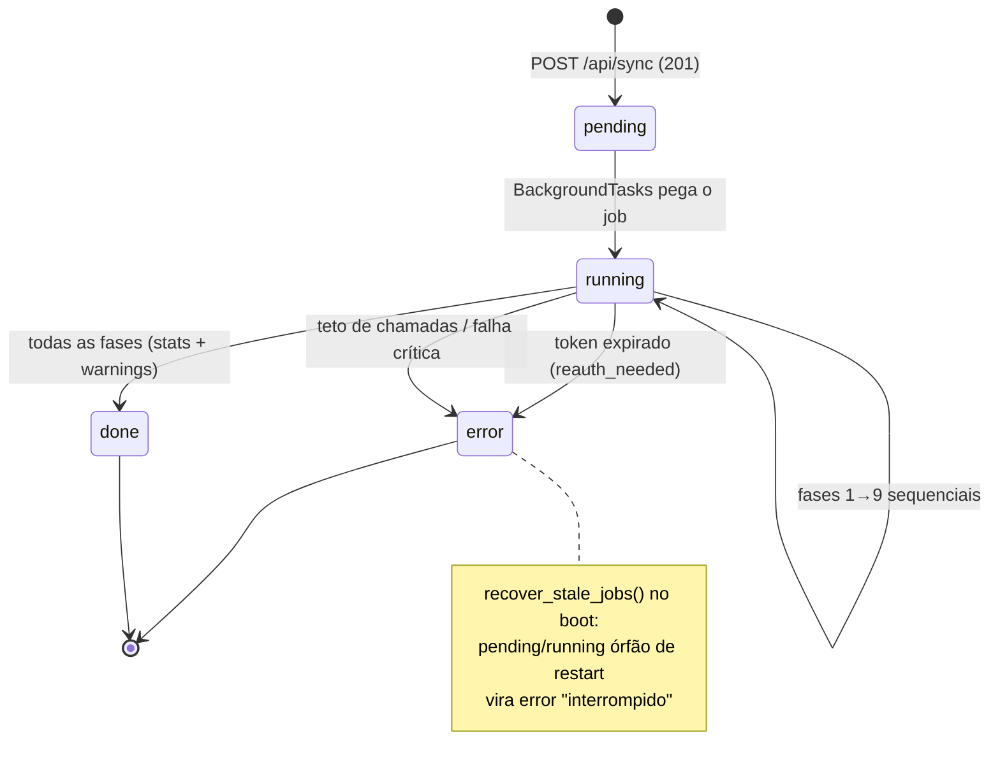

# Backend — Sync Garmin

O sync é a **única porta de entrada de dados Garmin** (AD-002): um job
sequencial disparado pelo botão **Puxar do Garmin** no `/perfil`
(`POST /api/sync`). Toda a I/O externa vive em `GarminGateway`
(`app/garmin/client.py`) — nenhum outro módulo importa a lib
`garminconnect`.

## O que é buscado

| Fase | Gateway | Chamada / endpoint | Dados extraídos | Grava em | Cadência |
|---|---|---|---|---|---|
| 1 | `get_activities` | activities API (`startDate/endDate`, **paginação própria** — 20/página) | activityId, startTimeLocal, typeKey, nome, distância, duração, FC média/máx, cadência, power, elevação, aerobic/anaerobic TE, training load; `raw_json` preservado | `activities` | 1 contagem + 1 chamada/página |
| 1 | `get_splits` | `get_activity_splits` | lapDTOs: distância, duração, FC média, cadência, temperatura, elevação, `intensityType` | `splits` | 1 por corrida (running/trail) |
| 2 | `get_sleep` | `get_sleep_data` | duração, score, % profundo/REM/leve, despertares, deitar/acordar (GMT) | `sleep` | 1/dia |
| 3 | `get_hrv` | `get_hrv_data` | `lastNightAvg` + status cru | `hrv` | 1/dia |
| 4 | `get_rhr` | `get_rhr_day` | valor WELLNESS_RESTING_HEART_RATE | `rhr` | 1/dia |
| 5 | `get_stress` | `get_stress_data` | estresse médio do dia | `stress` | 1/dia |
| 6 | `get_body_battery` | `get_body_battery` | último nível do dia | `body_battery` | 1 chamada por **bloco ≤ 28 dias** (a API rejeita range maior) |
| 7 | `get_personal_records` | `get_personal_record` | PRs de corrida por evento (1K…maratona + longão), valor, data | `personal_records` | 1 por sync |
| 8 | `get_race_predictions` | `get_race_predictions` | snapshot latest: tempos 5K/10K/meia/maratona + data | `race_predictions` | 1 por sync |
| 9 | `get_heart_rate_zones` | `/biometric-service/heartRateZones/v2` | **`maxHeartRateUsed`** do esporte RUNNING = FC máx auto-detectada (o `userData` NÃO tem maxHeartRate — fonte confirmada em spike) | `user_hr_metrics` | 1 por sync (fase physio) |
| 9 | `get_lactate_threshold` | `get_lactate_threshold(latest=True)` | `speed_and_heart_rate.heartRate` = LTHR detectado pelo relógio | `user_hr_metrics` | 1 por sync (conta 2 chamadas internas) |
| — | *(local)* | mínimo dos últimos 7 dias da série `rhr` já sincronizada | FC de repouso derivada | `user_hr_metrics` | **zero chamadas** |

Cálculo de carga (PMC) e VDOT **nunca** chamam o Garmin: são computados
localmente a partir de `training_load` e dos dados de prova.

## Máquina de estados do job



O lock de **1 job ativo por usuário** é um índice parcial unique no
Postgres — o POST responde `409` se já existe job em curso.

## Backfill × incremental

A janela vem do `sync_state` (memória por tipo de dado):

| | Quando | Janela |
|---|---|---|
| **Backfill** | primeira sync (sem `sync_state` do tipo) | atividades: 180 dias (`SYNC_BACKFILL_ACTIVITIES_DAYS`) · saúde: 120 dias (`SYNC_BACKFILL_HEALTH_DAYS` = 60 de exibição + 59 de lookback da banda HRV) |
| **Incremental** | `sync_state.last_date` existe | `last_date − SYNC_REPULL_DAYS` (3 dias — o Garmin reprocessa dados por até 72h) |

`sync_state` só avança quando o tipo completa com sucesso. Rodar 2× não
duplica: toda escrita é upsert por chave natural
(ver [Banco de dados](banco-de-dados.md#chaves-de-upsert-idempotencia-do-sync)).

## Fases (sequência rígida)

1. **Atividades + splits** — crítico: UMA transação; falha = rollback
   integral e job `error` (nada parcial entra no banco).
2. **Sono · HRV · RHR · estresse** — 1 chamada/dia, dia vazio pulado;
   falha de um tipo vira warning em `stats_json` e o job segue.
3. **Body battery** — range fatiado em blocos de ≤28 dias.
4. **Recordes + predições** — 1 chamada cada, upsert por evento, sem delete.
5. **Physio** — fcmax (zonas de FC v2) + fclthr (lactato) + fcrest (local);
   valor ausente pula a métrica sem erro; **manual vence** (a preferência
   `user_hr_sync_prefs` bloqueia o overwrite enquanto durar — flip de
   posse pelo botão "Voltar a puxar do Garmin").
6. **PMC** — recompute local da janela afetada, com semente da última
   linha anterior (não recalcula o passado).
7. **Persist-back do token** — o refresh OAuth2 rotacionado pela sessão
   é gravado de volta com guard otimista (`updated_at = :expected`).

## Guard rails

| Controle | Config | Comportamento |
|---|---|---|
| Teto de chamadas | `SYNC_MAX_CALLS` (1500) | conferido **antes** de cada chamada → `SyncBudgetExceededError` |
| Intervalo mínimo | `SYNC_CALL_INTERVAL_S` (1s) | sleep após cada sucesso — sequencial, nunca paralelo |
| Retry | `SYNC_RETRY_MAX` (3) | backoff 2/4/8s em 429/erro de conexão |
| Auth expirada | — | 401 **nunca retenta** → job `error` com `reauth_needed` |

Validação real (14/10/2026): backfill com 232 atividades + 1563 splits +
60–61 dias por tipo de saúde + 7 recordes em 408 chamadas / 606s; o
incremental seguinte: 23 chamadas, contagens idênticas.

## Cofre de tokens (AD-014)

- Tokens OAuth de cada usuário vivem em `garmin_tokens.token_encrypted`,
  **cifrados com Fernet** sob `TOKEN_ENCRYPTION_KEY` — o único módulo que
  toca a coluna é `tokens_store.py`.
- `GarminGateway.from_user()` faz `garmin.login(blob)` — login **por
  tokens**, sem credenciais, a partir do banco.
- Sem a chave, o backend **não sobe** (fail-fast no lifespan).
- O sync persiste o blob rotacionado de volta (guard otimista evita
  sobrescrever um re-login mais novo).

## CLIs (re-auth é operação de operador)

```bash
cd backend
# onboarding/renovação de QUALQUER usuário (MFA interativo, upsert dos tokens)
uv run python -m app.garmin.login --user <email>

# run-once: importa ~/.garminconnect legado para o usuário 1 (recusa se já tem tokens)
uv run python -m app.garmin.import_tokens
```

Em produção as CLIs rodam **na sua máquina** apontando
`$env:DATABASE_URL` para o Neon (a connection string vale de qualquer
lugar) — o Shell do Render é pago e desnecessário. Detalhes em
[Operações](../infra/operacoes.md).
