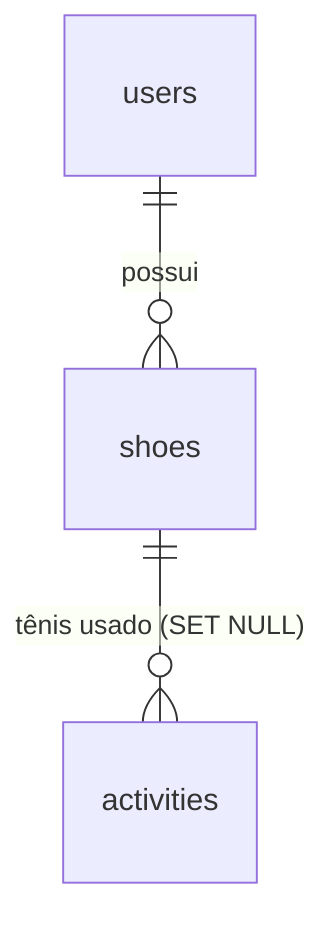

# Backend — Tênis (quilometragem + atribuição)

> Feature **tenis** (T1–T11): CRUD de tênis, backfill one-shot do Strava, gestão na UI (Treinos), modal de atribuição no detalhe da corrida.

---

## Visão geral

O módulo de tênis resolve o problema do rodízio real de 6+ tênis com quilometragem derivada (nunca contador solto), histórico importado do Strava via backfill one-shot, ciclo de vida completo na UI (criar, editar, aposentar) e dado novo sempre com tênis (modal de atribuição ao abrir corrida sem tênis).

**Arquivos principais**:
- `backend/app/shoes/` — domínio `shoes` (model, service, router)
- `backend/app/strava/` — backfill CLI one-shot (client, matching, backfill)
- `frontend/src/components/workouts/ShoesSection.tsx` — gestão na página Treinos
- `frontend/src/components/workouts/ShoePickerModal.tsx` — modal de seleção
- `frontend/src/components/workouts/WorkoutDetail.tsx` — gatilho + badge

---

## Modelo de dados



### `shoes`
| Coluna | Tipo | Constraints |
|---|---|---|
| `id` | int | PK |
| `user_id` | FK users | index |
| `name` | String(200) | NOT NULL |
| `brand` | String(100) | nullable |
| `model` | String(200) | nullable |
| `acquired_date` | Date | nullable |
| `initial_km` | Float | NOT NULL, default 0.0 |
| `max_km` | Float | nullable |
| `status` | String(20) | NOT NULL, default `"ativo"` (`ativo` \| `aposentado`) |
| `strava_gear_id` | String(64) | nullable, **UQ `(user_id, strava_gear_id)`** `uq_shoe_user_strava` |
| `created_at` | DateTime | default utcnow |

### `activities.shoe_id`
FK `shoes.id` com `ondelete="SET NULL"`, index. Apenas atividades `running`/`trail_running` podem receber `shoe_id` (validação em `RUNNING_TYPES`).

**Km derivada**: não é coluna — calculada on-the-fly como `initial_km + Σ activities.distance_m` das atividades associadas. Reatribuição retroativa recalcula automaticamente.

---

## API de tênis (`/api/shoes`)

Todas as rotas exigem sessão (`require_session`) e operam no `user_id` da sessão — isolamento textual: `"tênis não encontrado"` para 404.

### GET `/api/shoes`
Lista tênis do usuário com km derivada agregada em **1 query** (outerjoin + group by).

**Resposta** (`ShoesListOut`):
```json
{
  "items": [
    {
      "id": 1,
      "name": "Kayano 30",
      "brand": "ASICS",
      "model": "Gel-Kayano 30",
      "acquired_date": "2024-01-15",
      "initial_km": 0.0,
      "max_km": 800.0,
      "status": "ativo",
      "strava_gear_id": "g1234567",
      "created_at": "2024-01-15T10:00:00",
      "current_km": 788.5,
      "run_count": 42,
      "last_use": "2026-10-25T07:15:00",
      "life_pct": 98.6
    }
  ],
  "attribution_30d_pct": 92.3
}
```

**Campos derivados**:
- `current_km = initial_km + Σ distance_m / 1000`
- `run_count` = contagem de atividades associadas
- `last_use` = `MAX(start_time)` das atividades associadas
- `life_pct` = `(current_km / max_km) * 100` (null se `max_km` ausente)
- `attribution_30d_pct` = % de corridas dos últimos 30 dias com tênis associado (null se 0 corridas na janela)

**Ordenação**: ativos primeiro (`status != 'aposentado'`), depois `last_use` DESC.

---

### POST `/api/shoes`
Cria tênis com status `"ativo"` default. `user_id` explícito (nunca `DEFAULT_USER_ID`).

**Body** (`ShoeCreateIn`):
```json
{
  "name": "Kayano 30",
  "brand": "ASICS",
  "model": "Gel-Kayano 30",
  "acquired_date": "2024-01-15",
  "initial_km": 0.0,
  "max_km": 800.0,
  "status": "ativo",
  "strava_gear_id": "g1234567"
}
```

**Validações (422)**:
- `name` não vazio
- `initial_km >= 0`
- `status in {"ativo", "aposentado"}`

**Resposta** (`ShoeOut`): tênis criado com `current_km = initial_km`, `run_count = 0`, `last_use = null`, `life_pct = null`.

---

### PATCH `/api/shoes/{shoe_id}`
Edita tênis do usuário. 404 se não existe ou pertence a outro.

**Body** (`ShoeUpdateIn`) — todos opcionais:
```json
{
  "name": "Kayano 31",
  "brand": "ASICS",
  "model": "Gel-Kayano 31",
  "acquired_date": "2025-01-15",
  "initial_km": 50.0,
  "max_km": 800.0,
  "status": "aposentado",
  "strava_gear_id": "g7654321"
}
```

**Validações (422)** iguais ao POST quando campos enviados.

**Resposta** (`ShoeOut`): tênis atualizado com km derivada recalculada.

---

### Sem DELETE
Não há rota de exclusão — aposentadoria via `status = "aposentado"` preserva histórico e integridade referencial.

---

## Associação tênis ↔ atividade

### PATCH `/api/activities/{activity_id}/shoe`
Associa/desassocia tênis a uma atividade.

**Body** (`ShoeAssignmentIn`):
```json
{ "shoe_id": 1 }      // associa
{ "shoe_id": null }   // desassocia
```

**Validações**:
- Atividade existe e pertence ao usuário → 404 se não
- Atividade é `running` ou `trail_running` → 422 se não (`"não é uma corrida"`)
- Tênis existe e pertence ao usuário → 404 se não
- `shoe_id = null` sempre permitido para atividades do usuário

**Resposta** (`ShoeAssignmentOut`):
```json
{ "shoe": { "id": 1, "name": "Kayano 30", "brand": "ASICS", "model": "Gel-Kayano 30", "status": "ativo" } }
```
Ou `{ "shoe": null }` ao desassociar.

---

### GET `/api/activities/{activity_id}` (detail)
Campo `shoe` no detail (alimenta badge e gatilho do modal):
```json
{
  "activity": { ... },
  "splits": [...],
  "zones": [...],
  "hr_color": "#ff6b6b",
  "consistency": { ... },
  "context": { ... },
  "evaluations": [...],
  "shoe": { "id": 1, "name": "Kayano 30", "brand": "ASICS", "model": "Gel-Kayano 30", "status": "ativo" } | null
}
```

---

## Backfill Strava (CLI one-shot)

**Arquivo**: `backend/app/strava/backfill.py`

```bash
python -m app.strava.backfill [--code CODE | --token TOKEN] [--user-id 1] [--yes]
```

### Pré-requisitos (OAuth manual)
1. Criar app em <https://strava.com/settings/api>:
   - **Authorization Callback Domain**: `localhost`
   - **Scopes**: `profile:read_all,activity:read_all`
2. URL de autorização:
   ```
   https://www.strava.com/oauth/authorize?client_id=SEU_CLIENT_ID&response_type=code&redirect_uri=http://localhost/exchange_token&approval_prompt=force&scope=profile:read_all,activity:read_all
   ```
3. Abrir no browser, autorizar, copiar o `code` do redirect `http://localhost/exchange_token?code=...`
4. Executar backfill com `--code CODE`

### Flags
| Flag | Descrição |
|---|---|
| `--code CODE` | Authorization code do OAuth (XOR com `--token`) |
| `--token TOKEN` | Access token direto (pula troca de code) |
| `--user-id N` | ID do usuário no Ritmo (default: 1) |
| `--yes` | Pula confirmação interativa (preview + `input()`) |

### O que faz
1. Troca `code` por `access_token` (POST `oauth/token`) — **token nunca persiste no banco**
2. Busca tênis do atleta (`GET /athlete` → equipamentos)
3. Busca todas as atividades `type == "Run"` (paginação `per_page=200` até vazio)
4. **Upsert por `strava_gear_id`**: cria ou atualiza tênis no Ritmo com `initial_km` ajustado para que `km_derivada = distância Strava`
5. Para cada run com `gear_id`: matching retroativo via `external_id` (`garmin_push_<id>`) ou fallback heurístico (±2% distância, ±2% tempo, ±5h fuso)
6. **Commit único no fim** (tudo-ou-nada — aborta sem escrever nada se erro)
7. Imprime relatório completo

### Matching retroativo (P2)
| Estratégia | Critério |
|---|---|
| `external_id` | Regex `^garmin_push_(\d+)$` → `activity.garmin_id` |
| Fallback | `|Δdist| ≤ 2%` E `|Δtempo| ≤ 2%` E `|Δinício| ≤ 5h` |
| Ambiguidade | 0 ou 2+ candidatos → **não casa** (lista no relatório) |
| Sem `gear_id` | Fica sem tênis, entra como km não alocada |

### Relatório de saída
```
=== BACKFILL STRAVA ===
Tênis criados: 4
Tênis atualizados: 2
Corridas casadas: 156
Corridas sem match: 3
Corridas sem gear_id: 12
---
Kayano 30 (g1234567):
  initial_km: 0.0
  km casadas: 788.5
  km não alocada: 0.0
  total Strava: 788.5
  CHECKSUM: 0.0 + 788.5 + 0.0 = 788.5 ✓
---
Corre 3 (g7654321):
  initial_km: 0.0
  km casadas: 623.2
  km não alocada: 15.3
  total Strava: 638.5
  CHECKSUM: 0.0 + 623.2 + 15.3 = 638.5 ✓
=== FIM ===
```

### Idempotência
Re-executar não duplica tênis nem associações — upsert por `strava_gear_id` + commit único.

### Tratamento de erros
| Cenário | Comportamento |
|---|---|
| Strava 429/5xx | Backoff exponencial (2, 4, 8 s), 3 tentativas, aborta com relatório parcial |
| Token inválido/expirado | Aborta **antes de qualquer escrita** (commit único = estado consistente) |
| Run sem `gear_id` | Não associa, reporta como km não alocada |
| Match ambíguo | Não casa, lista no relatório |

---

## UI: Seção Tênis (`/treinos`)

**Componente**: `ShoesSection.tsx` (PanelState: loading/error/empty/ready)

### Cards
Cada tênis exibe:
- Nome, marca/modelo
- **Barra de vida útil** com marcos em 75% (amarelo) e 90% (vermelho)
- Status: `"ativo"` (verde) / `"aposentado"` (cinza)
- Último uso + contagem de corridas

### Criar / Editar inline
Formulário com todos os campos. **Criação sugere `max_km = 800`**.

### Aposentar
Botão "Aposentar" → `confirm()` explícito → `PATCH status="aposentado"`.
- Tênis permanece listável (status `"aposentado"`, opacity 60%)
- Sai das sugestões do modal de atribuição

### Badge de higiene (P3)
No `PanelSection` badge: `"{N}% das corridas dos últimos 30 dias com tênis"` (vindo de `attribution_30d_pct`).

---

## Modal de seleção (`ShoePickerModal`)

**Props**: `activityId`, `inferredType`, `onAssigned(shoe)`, `onDismiss`

**Visual**: overlay `fixed inset-0 z-50` + `backdrop-blur` (estilo TabBar).

### Ordenação
1. **Padrão do tipo** — `localStorage["shoe-default-by-type"][inferredType]`
2. **Último uso** DESC
3. **Aposentados** em bloco separado (visíveis para atribuição retroativa)

### Ações por tênis
| Botão | Ação |
|---|---|
| **Escolher** | `setActivityShoe(activityId, shoeId)` → `onAssigned` → fecha modal |
| **Definir como padrão para [Tipo]** | Grava no `localStorage` → afeta próxima ordenação |
| **Agora não** | `onDismiss` → não reabre na mesma visita |

---

## Gatilho no detalhe da corrida (`WorkoutDetail`)

**Lógica**:
```tsx
// 1x por visita (useRef)
if (detail.shoe === null && isRunning && !modalShownRef.current) {
  modalShownRef.current = true
  setShowShoeModal(true)
}
```

- `isRunning = activity_type === 'running' || 'trail_running'`
- **Não-corridas nunca disparam** o modal
- Ao associar: refetch do detail + badge `shoe.name` no header
- Dispensar (`"Agora não"`) → não reabre na mesma visita; navegar para fora e voltar → pergunta de novo

---

## Testes (backend)

| Arquivo | Cobertura |
|---|---|
| `tests/test_shoes_migration.py` | 7 testes — migração idempotente (base nova + base velha) |
| `tests/test_shoes_api.py` | **31 testes** — CRUD, validações, isolamento A×B, associação, detail, `attribution_30d_pct` |
| `tests/test_strava_client.py` | 11 testes — client httpx, backoff, paginação, token |
| `tests/test_strava_matching.py` | 18 testes — `external_id`, fallback ±2%/±2%/5h, ambiguidade, esteira |
| `tests/test_strava_backfill.py` | 12 testes — orquestração, idempotência, aborto consistente, checksum |

```bash
cd backend && uv run pytest tests/test_shoes_api.py -v
cd backend && uv run pytest tests/test_strava_*.py -v
```

---

## Referências
- Spec: `.specs/features/tenis/spec.md`
- Design: `.specs/features/tenis/design.md`
- Tasks: `.specs/features/tenis/tasks.md`
- Banco de dados: `backend/banco-de-dados.md`