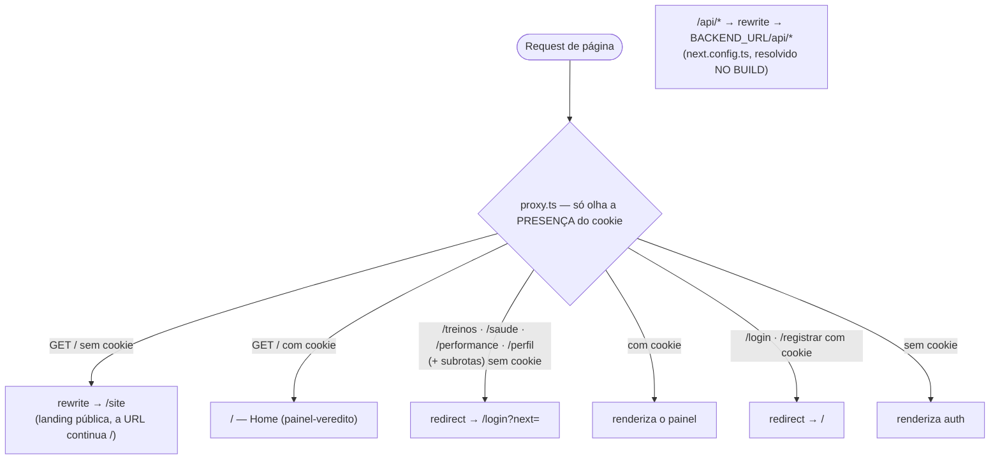
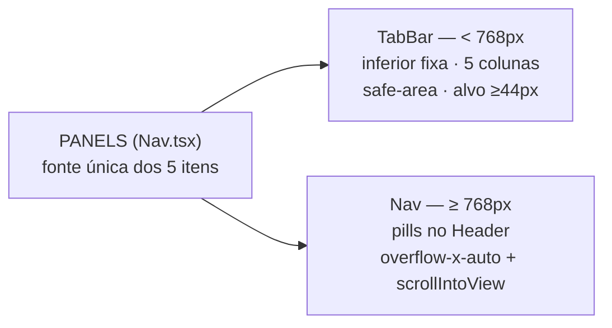

# Frontend — Rotas & Navegação

5 rotas de página autenticadas + 2 de auth + 1 landing pública, em 3
route groups. A proteção é **UX no proxy + autoridade na API** (AD-018):
o `proxy.ts` redireciona pela presença do cookie; quem decide mesmo é o
`require_session` do backend (401 → o client manda pra `/login`).

## Mapa de rotas e decisões do proxy

Regras do `src/proxy.ts`:

1. `/` sem sessão → **rewrite** para `/site` — visitante vê a landing
   sem mudar de URL; com sessão, `/` é o painel Home.
2. Painéis sem cookie → **redirect** `/login?next=<path+query
   URL-encoded>` — após o login, volta à rota original.
3. `/login` · `/registrar` com cookie → redirect `/`.
4. Matcher: páginas, **exceto** `api`, `_next/*`, `favicon` — o proxy
   nunca intercepta o transporte da API.

> `/site` não é protegida: usuário logado que digitar `/site` vê a
> landing normalmente.

## Route groups

| Group | Layout | Páginas |
|---|---|---|
| `(app)` | `Header` + `TabBar` (wrapper com `pb-24` no mobile reserva a tab bar) | `/` Home · `/treinos` · `/treinos/[id]` · `/saude` · `/performance` · `/perfil` |
| `(auth)` | `<main>` centralizado, **sem** header/nav | `/login` · `/registrar` |
| `(site)` | herda o root | `/site` (landing) |

## As rotas

| Rota | Arquivo | Tipo | Propósito |
|---|---|---|---|
| `/` | `src/app/(app)/page.tsx` | server | Home — veredito do dia (porta de entrada do produto, AD-025) |
| `/site` | `src/app/(site)/site/page.tsx` | **server estático, zero JS de cliente** | Landing pública: hero, como funciona, 6 seções com prints reais, CTAs |
| `/treinos` | `src/app/(app)/treinos/page.tsx` | server | Lista de corridas/todas com paginação |
| `/treinos/[id]` | `src/app/(app)/treinos/[id]/page.tsx` | server + Suspense | Detalhe do treino (`id` numérico validado; `notFound()` caso contrário) |
| `/saude` | `src/app/(app)/saude/page.tsx` | server | Painel Saúde (4 seções) |
| `/performance` | `src/app/(app)/performance/page.tsx` | server | Painel Performance (4 blocos narrativos) |
| `/perfil` | `src/app/(app)/perfil/page.tsx` | **client** | Conexão Garmin + zonas de FC (3 seções numeradas) |
| `/login` | `src/app/(auth)/login/page.tsx` | client | Login (lê `?next=`) |
| `/registrar` | `src/app/(auth)/registrar/page.tsx` | client | Registro por convite (auto-login no 201) |

Não há route handlers (`route.ts`) — toda a API passa pelo rewrite
same-origin. Também não há `loading.tsx`/`error.tsx` globais: os
estados vivem dentro de cada painel (padrão skeleton DSN-23).

## Navegação: 5 itens, duas barras

A fonte única é o array `PANELS` em `Nav.tsx` — as duas barras e o
redirecionamento pós-login consomem dele:

**Home `/` · Treinos `/treinos` · Saúde `/saude` · Performance `/performance` · Perfil `/perfil`**

- **Ativação**: pathname exato ou `startsWith(href + "/")` — a raiz `/`
  é special-case (só exato, senão casaria toda rota).
- `aria-current="page"` no item ativo; lime `#B7F36B` como acento.
- `usePathname` suspende sob `cacheComponents` → cada nav carrega
  boundary `<Suspense>`.
- Header: wordmark "ritmo" com pulso de HRV em SVG lime + `Nav` +
  `UserMenu` (display_name + Sair) — sem ações globais (o sync mora no
  `/perfil`, AD-023).

## Transporte da API (AD-020)

- O client usa **base relativa** (`API_BASE = ""`) — o cookie vale para
  o host que o usuário abriu (localhost, IP da LAN e produção).
- `next.config.ts`: `rewrites: /api/:path* → ${BACKEND_URL}/api/:path*`.
- **`BACKEND_URL` é resolvido NO BUILD** (o Next materializa as rewrites
  no build output) — trocou a env? redeploy. No compose o valor é o
  hostname interno `http://backend:8000` (imune a DHCP).
