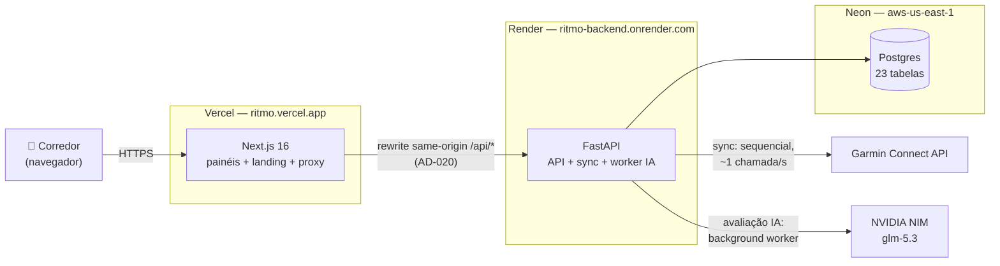

# Ritmo — Documentação Técnica

O Ritmo é uma plataforma pessoal de corrida: o botão **Puxar do Garmin**
sincroniza atividades, splits, sono, HRV, FC de repouso, body battery,
estresse, recordes e predições de prova para um **Postgres próprio** — e os
painéis **Home · Treinos · Saúde · Performance · Perfil** leem 100% desse
banco, sem nunca tocar a API do Garmin na navegação. A avaliação de treino
com IA roda sob demanda: o Python calcula todos os números
deterministicamente e o LLM só interpreta.

Este site documenta a solução como ela é: as rotas da API, as tabelas do
banco, o que exatamente é buscado do Garmin, os componentes do frontend e a
infraestrutura de deploy.

## O sistema em um diagrama



## Mapa da documentação

| Seção | O que responde |
|---|---|
| **Arquitetura** | Como as peças conversam (contexto e containers), os fluxos por trás de cada ação (request, sync, avaliação, auth) e o registro de decisões AD-NNN |
| **Backend** | Os 19 endpoints da API, as 23 tabelas do Postgres, o sync do Garmin (o que é buscado e como), auth e sessões, avaliação com IA, motores de cálculo, env vars e testes |
| **Frontend** | Rotas e navegação, catálogo de componentes, arquitetura de cada página e os padrões transversais (tema, charts, estados) |
| **Infra & Deploy** | Produção (Vercel + Render + Neon), ambiente local (docker compose) e operações do dia a dia |
| **Produto** | O plano da plataforma — visão, fases e roadmap (fonte de verdade do produto) |

## Stack em resumo

| Camada | Tecnologia |
|---|---|
| Frontend | Next.js 16 (App Router) · React 19 · Tailwind 4 · Recharts 3 — tema dark v0.3, mobile-first |
| Backend | FastAPI · SQLAlchemy 2 · Python 3.12 · uv |
| Banco | Postgres 16 (Neon em produção; `postgres:16` no compose local) |
| Integrações | Garmin Connect (`garminconnect` 0.3.2) · NVIDIA NIM (LLM de avaliação) |
| Deploy | Vercel (frontend) · Render (backend Docker + este site) · Neon (Postgres) |

## Rodando o projeto

```bash
docker compose up -d          # stack completo: postgres :5432 + backend :8000 + frontend :3000
curl http://localhost:8000/api/health
```

Dev diário (hot-reload), testes e variações: [Ambiente local](infra/local.md).

---

> Os comentários de código do projeto citam decisões por ID (`AD-002`,
> `SYNC-24`, `HRZ-06`…). A tabela completa dos AD-NNN está em
> [Decisões de arquitetura](arquitetura/decisoes.md); as regras de
> desenvolvimento (spec-driven) seguem no
> [README do repo](https://github.com/leonardocroda/ritmo).
